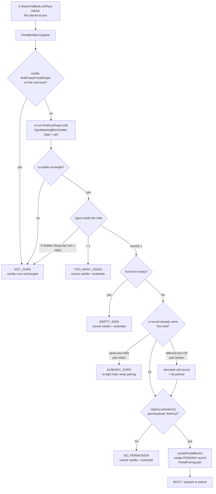

**English** · [中文](zh-CN/ARCHITECTURE.md)

# Architecture

PairedPortals replaces one vanilla rule — "a nether portal always leads to the nether" — with another
one: **two portals whose signs carry the same text are each other's destination.** This document is
the design of that replacement, written for someone who is going to read the code: what the mod is and
what it deliberately is not, a per-file inventory, the three mixin injection points and why they are
exactly those three, the ignition pipeline and the data model behind it, the invariants that hold
across pairing and demolition, the geometry that decides which door owns a frame cell, the travel path
down to the landing-spot arithmetic, and the reflection bridge to Worlds. It is the English canonical
form of material whose Chinese original is [README.zh-CN.md](../README.zh-CN.md) §1, §2, §4, §5, §5.1
and §11; those section numbers are used here as well, and the [Chinese mirror](zh-CN/ARCHITECTURE.md)
keeps the same structure.

Nothing here is a tutorial. For how to build it see [BUILDING.md](BUILDING.md), for how it behaves in
game see [GAMEPLAY.md](GAMEPLAY.md), for the operator surface see [COMMANDS.md](COMMANDS.md), and for
the evidence behind each claim see [TESTING.md](TESTING.md).

## 1. What the mod is, and its exact boundaries

A **custom portal** is a vanilla obsidian frame in portal shape whose hole contains **one written
sign**. Lighting it does not produce a nether portal in the vanilla sense: the hole is filled with
real vanilla `minecraft:nether_portal` blocks, the frame stays real obsidian, and the door is recorded
as *unbound*. The next door lit with the **same sign text** becomes its partner, and from then on
walking into either one delivers you to the other — whichever dimensions the two are in.

Three properties define the boundaries of the whole design:

| Property | Evidence in the repository |
|---|---|
| **Server-side.** A vanilla client connects with nothing installed and no resource pack, and a singleplayer world runs the mod through its own integrated server — the metadata lets both sides load it, while all of the logic stays on the server. | [`fabric.mod.json`](../src/main/resources/fabric.mod.json) declares `"environment": "*"`, has a `main` entrypoint and **no** `client` entrypoint; the built jar is 45 entries and carries **no client-side resource** — the mod's own class files plus `fabric.mod.json` and `pairedportals.mixins.json`, with no `assets/`, `lang/`, `models/` or `textures/` entry (`unzip -Z1 build/libs/pairedportals-1.0.0.jar \| grep -v '\.class$'`) |
| **Zero game registrations.** No new block, item, entity, block entity, POI type, menu, packet, tag or data component exists. | the only two game callbacks in the entire source are `ServerTickEvents.END_SERVER_TICK` and `CommandRegistrationCallback.EVENT`, both in [`PairedPortals.java:56-63`](../src/main/java/com/example/pairedportals/PairedPortals.java) — plus the mod's own command tree, which is not a registry entry |
| **No third-party dependencies.** | `fabric.mod.json` `depends` lists only `fabricloader`, `fabric-api`, `minecraft` and `java`; the optional Worlds bridge (§11) is reflection, and `suggests` it without requiring it |

The consequence of the first two is the reason the mod exists in this shape. A server-side mod cannot
rename a block for the client — a block's display name is resolved client-side from the client's own
language files, and a custom name data component belongs to items, not to blocks in the world. So F3
and every WAILA-style overlay will always say "Obsidian". **The action bar is the only client-visible
surface a zero-resource server mod actually owns**, and that is where the two sentences of door state
live (§7).

The same boundary decides how the wording itself works, and it is worth stating up front because it
looks like an omission. Whatever the metadata says (`"environment": "*"` since 1.0.0, so the mod also
loads in a singleplayer world), there is no client-side half — one `main` entrypoint and nothing
under `assets/` — so the mod can never ship a language file, and a `Component.translatable(...)`
would be sent to the client as a key nobody can resolve — it would arrive as raw
`pairedportals.message.pending` text. **The server has to
choose the wording itself, per player, and send a literal**, which is what the `text/` package in §2
does: the language comes from the one per-player signal a server has, the language code the client
reported when it joined (`ServerPlayer.clientInformation().language()`). Anything starting `zh` is
Chinese; everything else, including console senders, command blocks and every log line, is English.

The consequence of the third is that the jar contains **no third-party code at all**. Minecraft,
Fabric Loader and Fabric API are read from the machine at build time and never redistributed
([BUILDING.md](BUILDING.md) §3).

The mod also never adds a dimension. It has no opinion about which dimensions exist; a door's
destination is whatever dimension key its partner's record carries (§5, §11).

## 2. Per-file inventory

All 25 Java files, in package order. Responsibility lines are confirmed against the source; the
wording follows README.zh-CN.md §1 where that table covers the file. (`ActivationPolicy` and
`IgnitionResult` are not in that table and are described from the source; the three `text/` files are
newer than it and are covered separately in §2.1.)

| File | Responsibility |
|---|---|
| [`PairedPortals.java`](../src/main/java/com/example/pairedportals/PairedPortals.java) | Mod entrypoint `implements ModInitializer`: registers the tick callback (name hints every 10 ticks, frame sweep every 40 ticks) and the command tree. Holds `MOD_ID`, `LOGGER`, the `-Dpairedportals.debug` switch and `info`/`debug` logging helpers |
| [`mixin/BaseFireBlockMixin.java`](../src/main/java/com/example/pairedportals/mixin/BaseFireBlockMixin.java) | ① Ignition split: at `BaseFireBlock.onPlace` HEAD, decide whether this ignition lands in a hole with a valid sign; if so cancel vanilla and build the door ourselves; warn the igniter on the two refusal results |
| [`mixin/NetherPortalBlockMixin.java`](../src/main/java/com/example/pairedportals/mixin/NetherPortalBlockMixin.java) | ② Travel takeover: at `NetherPortalBlock.getPortalDestination` HEAD, return our own `TeleportTransition` when the entity is standing in one of our doors |
| [`mixin/PortalForcerMixin.java`](../src/main/java/com/example/pairedportals/mixin/PortalForcerMixin.java) | ③ Vanilla isolation: at `PortalForcer.findClosestPortalPosition` RETURN, report "not found" when vanilla's search has found one of our doors |
| [`mixin/PortalShapeAccessor.java`](../src/main/java/com/example/pairedportals/mixin/PortalShapeAccessor.java) | `@Accessor` mixin interface reading `PortalShape`'s six private fields (`bottomLeft`, `rightDir`, `axis`, `width`, `height`, `numPortalBlocks`) |
| [`portal/CustomPortal.java`](../src/main/java/com/example/pairedportals/portal/CustomPortal.java) | The record of one door: id / dimension / hole AABB / axis / width / height / sign text / ignition sequence / created-at / state / partner id. Serialises to and from its 12 NBT keys |
| [`portal/PortalState.java`](../src/main/java/com/example/pairedportals/portal/PortalState.java) | `PENDING` / `BOUND`, plus `byName` which degrades anything unrecognised to `PENDING` |
| [`portal/PortalLocation.java`](../src/main/java/com/example/pairedportals/portal/PortalLocation.java) | `(dimension, block pos)` as the index key for every lookup |
| [`portal/PortalRegistry.java`](../src/main/java/com/example/pairedportals/portal/PortalRegistry.java) | The `SavedData` registry with its three derived indexes `byId` / `byHole` / `pendingByText`, sequence allocation, the activation policy, and NBT (de)serialisation |
| [`portal/PortalPairing.java`](../src/main/java/com/example/pairedportals/portal/PortalPairing.java) | Pairing: among doors with the same text take the earliest `PENDING`, flip both ends to `BOUND`. Also the two manual operations `unpair` and `forcePair` (both leave both doors standing) |
| [`portal/PortalBuilder.java`](../src/main/java/com/example/pairedportals/portal/PortalBuilder.java) | The build logic behind the ignition split — classify (claim / rebuild / queue) and the read-only replay `explain` used by `/pairedportals debug` |
| [`portal/PortalGeometry.java`](../src/main/java/com/example/pairedportals/portal/PortalGeometry.java) | Reads a `PortalShape`'s hole cells and sign positions through the `@Accessor`, and reads a sign's front text |
| [`portal/PortalValidator.java`](../src/main/java/com/example/pairedportals/portal/PortalValidator.java) | The 40-tick sweep (`isFrameValid` / `sweep`) and demolition (`retire` / `demolish` / `extinguish`): if the frame is gone, this door **and its partner** come down together |
| [`portal/IgnitionResult.java`](../src/main/java/com/example/pairedportals/portal/IgnitionResult.java) | The six-value outcome enum of an ignition attempt: `NOT_OURS` / `BUILT` / `EMPTY_SIGN` / `TOO_MANY_SIGNS` / `NO_PERMISSION` / `ALREADY_OURS` |
| [`portal/ActivationPolicy.java`](../src/main/java/com/example/pairedportals/portal/ActivationPolicy.java) | The `all` / `op` / `none` activation gate and its nearest-player permission test (8-block radius) |
| [`proxy/SignMaskingBlockGetter.java`](../src/main/java/com/example/pairedportals/proxy/SignMaskingBlockGetter.java) | A `BlockGetter` that reads the sign inside the hole as air, so vanilla's own shape recognition "does not see" it; remembers which positions it masked |
| [`compat/WorldsCompat.java`](../src/main/java/com/example/pairedportals/compat/WorldsCompat.java) | The reflection soft bridge (no compile dependency): whether a dimension is *loaded* / *registered but not loaded* / *nonexistent*, and whether a Worlds level can accept a traveller right now. Without Worlds installed every answer degrades to its default (§11) |
| [`visual/FrameCells.java`](../src/main/java/com/example/pairedportals/visual/FrameCells.java) | Pure geometry of the frame ring and the hole-side cells, plus the verdict "which door owns this cell" (`portalAt` / `portalOwning` / `distanceToHoleSq`). Contains no entity, display or rendering code at all |
| [`visual/FrameNameHint.java`](../src/main/java/com/example/pairedportals/visual/FrameNameHint.java) | The action-bar hint when the crosshair is on the frame or on a portal block in the hole — the mod's only client-visible surface, and the `warn` channel used for ignition refusals |
| [`teleport/CustomPortalTravel.java`](../src/main/java/com/example/pairedportals/teleport/CustomPortalTravel.java) | Decides how one traversal goes: resolve the door, resolve its partner, handle the three "the far side is not here" cases, compute the landing spot and the relative facing, build the `TeleportTransition` |
| [`teleport/TravelDecision.java`](../src/main/java/com/example/pairedportals/teleport/TravelDecision.java) | `(handled, transition)` — distinguishes "leave vanilla alone" (`NOT_OURS`) from "swallow this attempt" (`NOTHING`) from "go there" (`goTo`) |
| [`command/CustomPortalCommand.java`](../src/main/java/com/example/pairedportals/command/CustomPortalCommand.java) | The `/pairedportals` command tree: `help` \| `list` \| `info` \| `delete` \| `purge` \| `tp` \| `unbind` \| `pair` \| `permission` \| `debug` |
| [`text/Lang.java`](../src/main/java/com/example/pairedportals/text/Lang.java) | The two languages (`EN`, `ZH`) and the one place the answer comes from: `Lang.of(player)` reads the client-reported language, and `of(source)` falls back to `EN` for anything that is not a player (console, command block, `/execute`), so those are pinned to English |
| [`text/Text.java`](../src/main/java/com/example/pairedportals/text/Text.java) | One message carrying both columns (`en`, `zh`), with `resolve(lang)` / `format(lang, args)`; a `Text` argument is resolved with the same language first, so a message can be assembled out of other messages |
| [`text/Messages.java`](../src/main/java/com/example/pairedportals/text/Messages.java) | Every player-visible string in the mod, as `Text` constants and factories (`signBlank`, `noPermission`, `hintWaiting`, `hintBound`, …) |

Two resources complete the mod and neither is a game registration:
[`fabric.mod.json`](../src/main/resources/fabric.mod.json) is the metadata quoted in §1, and
[`pairedportals.mixins.json`](../src/main/resources/pairedportals.mixins.json) declares the four mixin
classes of §3. The mixin config is `"required": true` with `"injectors": { "defaultRequire": 1 }` —
so if a future Minecraft release moves one of the three injection points, the mod **fails to load
loudly** rather than silently doing nothing.

### 2.1 The `text/` package: player-visible wording without a language file

The three `text/` files are the mod's whole answer to "a server-side mod cannot ship translations",
and the shape of the answer is worth stating because it looks like an omission next to the rest of the
table.

- **Both columns live in one object.** [`Text`](../src/main/java/com/example/pairedportals/text/Text.java)
  is a record of `en` and `zh`. The alternative — a key plus two maps — buys nothing here: there is no
  build step that could catch a missing translation (no Gradle, no resource pipeline), so the only
  things that can are a reader seeing the two lines next to each other in `Messages` and a compiler
  noticing that a factory has to produce both.
- **Resolution happens once, at the edge.** `Lang.of(recipient)` is called where the recipient is
  known — [`FrameNameHint`](../src/main/java/com/example/pairedportals/visual/FrameNameHint.java) for
  the action bar, `CustomPortalCommand` for command output. Nothing below that knows a language
  exists. A `Text` used as a format argument is resolved with the same language first, so the `list`
  header's activation-policy label follows the reader rather than the caller.
- **The split is deliberately crude.** Anything starting `zh` (also `zh_`, `zh-`) is Chinese,
  everything else is English. Two languages is what this mod is written in, and inventing a third
  answer — a "partially translated" or "unmatched key" state — would mean shipping strings nobody
  wrote.
- **Console output is pinned to English.** Console senders, command blocks and `execute as` have no
  client language, so they get English — and so does every log line, resolved as `Lang.EN` explicitly.
  That is also what keeps the smoke scripts honest: their assertions read English output no matter who
  else happens to be online.

## 3. The three injection points

Three `@Inject`s, one `@Accessor`, and no other patch to the game.

| # | Injection point | What it does | Why it cannot move |
|---|---|---|---|
| ① | `BaseFireBlock.onPlace` **HEAD** | Decide whether this ignition lands in a hole with a valid sign; if so cancel vanilla and build the door ourselves | It is the same path as the player's flint and steel, `setblock fire` and dispensers; it completes in the same tick, ahead of other mods' delayed events |
| ② | `NetherPortalBlock.getPortalDestination` **HEAD** | When an entity steps into **our** door, we supply the destination instead | Vanilla uses this method to decide the landing spot; returning our own `TeleportTransition` here reuses the whole vanilla traversal — sound, return-portal bookkeeping, cooldown |
| ③ | `PortalForcer.findClosestPortalPosition` **RETURN** | When vanilla's search for a landing spot finds one of our doors, report "not found" | Our door surface is *real* `nether_portal`, so it necessarily registers as a `NETHER_PORTAL` POI; **every** vanilla crossing scans for it (16 blocks overworld→nether, 128 nether→overworld). Only `NetherPortalBlock` calls this method in the whole jar, so one hook turns off all door stealing — and it happens to be compatible with NetherPortalFix |

**③ is not dead code.** ② only returns early when the entity enters *our* door. When an entity enters
a *vanilla* door, vanilla's search still runs, and ③ is what intercepts that path. The evidence is in
[TESTING.md](TESTING.md): `smoke-isolation.sh` asserts that a vanilla door next to ours keeps working
in both directions, and its filtered log proves the search really did find our door and was suppressed
(`vanilla's portal search found our door at 1, 100, 0 (minecraft:the_nether); reporting none`).

Why ① sits on `BaseFireBlock` and not on the vanilla portal branch: `FireBlock` overrides `onPlace`
but calls `super` first, so hooking the base class covers both normal fire and soul fire — the latter
does not override `onPlace` at all. And the vanilla branch inside `FireBlock.onPlace` is fenced by
`inPortalDimension(level)`, which accepts only the overworld and the nether; sitting in front of the
whole method is what lets a door be lit in the End or in a modded dimension.

### 3.1 Why the filter sits in the consumer, not in the POI store

The tempting alternative for ③ is to keep our portal blocks out of the point-of-interest store
entirely. It does not survive a reload: `PoiSection.refresh` clears a section and re-derives every
record from the blocks in it, and our blocks genuinely *are* portal blocks. So the filter is applied
where the records are consumed. Returning `Optional.empty()` rather than "the next nearest door" is
deliberate: `empty` is exactly what vanilla sees when there is no door anywhere near, which sends it
into its own `createPortal` path — the very branch that would have run had this mod never been
installed. It also leaves the chunk-loading side effects that the caller depends on untouched.

### 3.2 Why the `@Accessor` is a fifth mixin

`PortalShape` has all-private fields, one private constructor and no accessor, so the shape returned
by `findAnyShape` is otherwise opaque. Reading the fields beats re-deriving the hole rectangle by
hand, because vanilla's walker has already decided which rectangle it accepted — we want **that**
rectangle, not a second opinion about it. The six accessors are the entire interface
([`PortalShapeAccessor.java`](../src/main/java/com/example/pairedportals/mixin/PortalShapeAccessor.java)).

## 4. The ignition pipeline

An ignition reaches us as "a fire block was placed at `pos` in `level`".



`tryIgnite` is a one-line wrapper: it delegates to `classify` and logs the result under the debug
switch. All the logic is in `classify`, and its steps are ordered for a reason.

**Step 1 — ask vanilla first.** `PortalShape.findEmptyPortalShape(level, firePos, Direction.Axis.X)`
runs against the *real* level. If vanilla would light a portal here, the frame has no sign in the hole
and the fire is not ours; the method returns `NOT_OURS` and never touches the world. This is what
makes the whole feature additive (§11).

**Step 2 — ask the question we actually care about.** A second pass re-runs the walkers with a
`SignMaskingBlockGetter` in place of the level, so the sign reads as air (§8). `findUsableShape`
first tries axis X and then axis Z, and requires the shape to be valid *and* have zero existing portal
blocks — the two checks `findAnyShape` does not perform and `findEmptyPortalShape` does internally, so
this pass mirrors vanilla's own notion of "this frame is empty and could be lit".

That is why the three cases below are mutually exclusive with vanilla lighting the same frame: vanilla's
`isEmpty` predicate accepts only air, fire and existing portal blocks, so **a frame holding a sign can
never be lit by vanilla**, and there is no race to arbitrate.

**Step 3 — find the sign, and read it before building.** `signsIn` scans the hole cells for
`BlockTags.ALL_SIGNS`. Two or more signs is `TOO_MANY_SIGNS`. Zero signs means the rectangle only
scanned clean because something was hidden and that something is not in the hole, so it is not our
frame and vanilla handles it. With exactly one sign the text is read **immediately**, before anything
is built — `createPortalBlocks` replaces every hole cell, taking the `SignBlockEntity` holding the
words with it. Empty text is `EMPTY_SIGN`.

**Step 4 — claim, rebuild or demolish.** `owningPortal` walks the new shape's hole cells and asks the
registry's `byHole` index whether any of them is already ours. If a record owns this hole:

- the record's stored text is compared with the sign's current text, **and** the stored link is checked
  to be intact — a record claiming `BOUND` only counts as bound if its partner still exists, is still
  `BOUND`, and points back at it;
- same text and intact pair ⇒ `shape.createPortalBlocks(level)` and `ALREADY_OURS`. This is the case
  of a lit portal whose frame was broken and put back: the hole is re-lit from the record and the
  existing pairing is kept, rather than minting a second record for one hole;
- different text, or a broken pair ⇒ `PortalValidator.demolish(...)`, which drops the old record,
  clears its hole and **takes the far end down in the same call**. The stored record no longer
  describes this frame, and leaving its partner lit would leave a portal that nothing can pass
  through. A fresh sequence number also puts the rebuilt door at the end of the FIFO queue.

**Step 5 — the permission gate.** Only now, after the re-light branch and before anything is written,
does `registry.activation().permits(level, firePos)` get asked. Re-lighting a door that is already
ours is not an activation — the hole is rebuilt exactly as the record describes it — while everything
that follows mints a new door, either a fresh one or a replacement for a record that no longer matches
its frame; that is what the policy is about. Placing the check before the `demolish` above would
matter just as much in the other direction: **a refusal must never take a pair down.** The policy
itself is in §5.3.

**Step 6 — build and pair.** `createPortalBlocks` fills the hole, `CustomPortal.create` mints a
`PENDING` record carrying a sequence number from the registry (a counter, not a clock — two doors lit
in the same millisecond would tie and the queue would stop being a queue), the record is indexed, and
`PortalPairing.pair` either finds a waiting partner or queues this one.

The hook then translates the result into hook behaviour: `NOT_OURS` does nothing at all; `BUILT`,
`EMPTY_SIGN`, `TOO_MANY_SIGNS` and `NO_PERMISSION` all call `ci.cancel()`; `ALREADY_OURS` cancels
silently. The two refusal results cancel as well, and that is not cosmetic: without the cancel the
method would fall through to `state.canSurvive(level, pos)`, which can put the fire out and make the
flint and steel look broken. Instead the fire burns normally and the igniter gets one action-bar
sentence.

## 5. The data model

### 5.1 One record per hole

One hole is one record, and one hole cannot have two records: the builder queries the owner by cell
before it creates anything (`owningPortal` above). A record is created `PENDING`, becomes `BOUND`
exactly once, and is thereafter only destroyed — and destroying it destroys the far end in the same
breath.

The identity of a door — its hole position and its sign text — is fixed at ignition and never changes.
The partner link is the only mutable part. There is deliberately **no "destination block position"
field**: the partner is resolved through the record's own id (`twinId`) via the registry's existing
`byId` index. A separate pair token would need an index of its own, and one slip in maintaining that
index would be indistinguishable from "the far end is gone".

### 5.2 `CustomPortal`

| Field | Meaning |
|---|---|
| `id` | `UUID`, minted by `UUID.randomUUID()` at ignition |
| `dimension` | `ResourceKey<Level>` — the dimension this end lives in |
| `holeMin`, `holeMax` | the hole's AABB corners, inclusive |
| `axis` | `Direction.Axis` of the door plane |
| `width`, `height` | hole size in blocks |
| `signText` | the pairing key, exactly as read (§7) |
| `sequence` | the registry counter's value at ignition; the FIFO order |
| `createdAt` | wall-clock timestamp, for operators |
| `state` | `PortalState` |
| `twinId` | the partner's `id`, or `null` while unbound |

`holeMin` is vanilla's `PortalShape.bottomLeft`, and that has one consequence worth knowing before
reading the travel code: when `rightDir` is WEST or SOUTH, `bottomLeft` sits at the **high** end of one
horizontal axis. `holeCorner()` therefore recomputes the true minimum corner, which is where vanilla's
own landing mathematics starts.

Loading is fail-soft: a record whose `id` or `dimension` fails to parse makes `CustomPortal.load`
return **null** rather than throw, so one corrupt record is dropped instead of taking the whole world's
registry with it (§6). A record that claims `BOUND` without a `twinId` is downgraded to `PENDING`.

### 5.3 `PortalState` — two states, not three

`PENDING` and `BOUND`. That is the entire state machine.

There is no `ORPHAN`. Because a demolition takes both ends down together (§6), a door that is lit is a
door that works, and a door that does not work is not lit. This is not a simplification of an earlier
design, it is a replacement for one: an older revision had an `ORPHAN` state for the surviving half of
a broken pair, and it was removed along with the "discard / orphan" machinery. `PortalState.byName`
still degrades an unrecognised name — including the `ORPHAN` that old save files may contain — to
`PENDING`, which is the lazy state: it does not travel, it does not pair itself, and re-lighting its
frame takes it over. Claiming `BOUND` for an unrecognised value would promise a journey to a partner
that cannot be named.

`PortalLocation` is the index key: a `(ResourceKey<Level>, BlockPos)` pair. Every lookup goes through
it, because the same `BlockPos` is a different place in two dimensions.

### 5.4 `PortalRegistry`

The registry is a `SavedData` stored on the **server**, via `MinecraftServer.getDataStorage()`. This
is not a detail: `MinecraftServer` builds a single `SavedDataStorage` over `<world>/data`, whereas
`ServerLevel.getDataStorage()` lands in a per-dimension folder. Doors are cross-dimensional by nature,
and one registry per dimension would make an overworld door and a nether door invisible to each other,
so pairing could never complete. The on-disk identity is
`<world>/data/pairedportals/portals.dat`.

Three indexes live beside the authoritative map. All three are derived, and all three are rebuilt when
the registry is loaded:

| Index | Type | Answers |
|---|---|---|
| `byId` | `Map<UUID, CustomPortal>` (`LinkedHashMap`) | every lookup by identity, including partner resolution |
| `byHole` | `Map<PortalLocation, UUID>` | "is this ignition inside a hole we already own?", in O(1) per cell |
| `pendingByText` | `Map<String, List<UUID>>` | "who else is waiting for these words?", in O(1) plus a scan of a list that is empty for almost every text |

`byHole` indexes **hole cells only**; frame cells are geometry, not index entries, which is exactly why
§8 exists.

The registry also holds `nextSequence` and the activation policy. Three top-level NBT keys carry it —
`portals`, `next_sequence`, `activation` — and each record contributes the 12 keys of §5.2:
`id/dimension/hole_min/hole_max/axis/width/height/text/sequence/created_at/state/twin` (`twin` is
written only when there is one).

Two details in the load path are load-bearing. `CustomPortal.load` returning `null` for an unreadable
record increments a drop counter and logs
`[pairedportals] dropped {} unreadable portal record(s) from the registry`, so damage is reported and
bounded rather than fatal. And `nextSequence` is raised to at least the maximum sequence seen in the
file, so a reload cannot hand out a number that is already in use and break FIFO.

`PortalLocation` is comparable by construction and `oldestPending` scans its candidates for the
smallest `sequence` rather than trusting list order, so no ordering invariant has to survive a restart.

### 5.5 The two states, one link, and one queue rule

- Same text ⇒ pair: among the doors with that text, the **earliest** `PENDING` one is taken. This is
  FIFO, and it is a rule rather than an oracle: with three doors sharing a text, or a mistyped sign,
  pairing follows queue order rather than the builder's intent. `/pairedportals pair` exists to
  correct that by hand, and deliberately does not check the text, because correcting a wrong text is
  precisely the point.
- On pairing, both ends flip to `BOUND` and each records the other's id. Pairing is one-directional,
  symmetric and completed in one step; only `PENDING` doors are ever considered.
- `PortalPairing.unpair` and `forcePair` are the registry-side half of the link and can break or make a
  link **while leaving both doors standing** — the opposite of `PortalValidator.demolish`.

## 6. Invariants: pairing and demolition

**Tearing down one end takes the whole pair down.** `PortalValidator.demolish(server, registry, dead)`
resolves the partner, extinguishes the dead end and removes its record, and then does the same for the
partner, logging `[pairedportals] portal at {} ({}) went down with its twin at {} ({})`.

Why both ends: a door with only one end is a lie. The far side would still be a lit portal that
delivers nothing, and — worse — once the record is dropped while the blocks stay lit, the door no
longer belongs to us, so the next entity that steps into it falls to vanilla and is given an ordinary
nether trip out of a hole in a wall of obsidian. Clearing both ends leaves two ordinary frames.
`demolish` is safe to call twice, and safe to call while iterating `all()`.

**Frame validity matches vanilla, and is narrower than "the whole ring".**
`isFrameValid` demands two things:

1. every cell of the hole is still `minecraft:nether_portal` — equivalent to vanilla's own
   `PortalShape.isComplete` (a legal size with every cell lit);
2. every cell the hole faces — `FrameCells.sideCells` — is still `BlockTags.NETHER_PORTAL_FRAME`. That
   is `2 * (width + height)` cells: the bottom edge, the top edge and the two side columns.

The four diagonals of the ring are **not** demanded. Vanilla's `PortalShape` walks out along the bottom
edge, up the two side columns and finally reads the top edge; it never reads a diagonal. Breaking one
diagonal therefore leaves a perfectly usable lit portal — requering the whole ring would retire doors
the game itself keeps working. `FrameCells.ringCells`, which does include the diagonals, survives only
for the crosshair ownership verdict of §8.

**Demolition clears the hole, not the ring.** `extinguish` sets every hole cell that is currently
`nether_portal` to air. That is why a shared pillar is never harmed by a neighbour's demolition (§8).
It is also the one deliberate exception to the sweep's "never load anything" rule: if the target chunk
is not loaded, a `TicketType.PORTAL` ticket with `PortalForcer.TICKET_RADIUS` is added and the chunk is
loaded synchronously, because the blocks really do have to be cleared. The ticket expires on its own
and the chunk goes back to being unloaded.

**The sweep only judges worlds it can trust.** `sweep(server)` runs every 40 ticks, skips any level for
which `WorldsCompat.isLive` is false (a world that is draining or closed — reading blocks through it is
not a question worth asking), skips records in other dimensions or in unloaded chunks, and retires the
rest through `retire` → `demolish`. The log line carries the skip count as
`(skipped N world(s) that are shutting down)`.

## 7. Geometry and ownership: `FrameCells`

`FrameCells` is pure arithmetic over a `CustomPortal` record. It reads no world state except in the two
ownership helpers, and it contains no entity, display or rendering code at all — an earlier revision
painted block displays onto frames to distinguish the two states, and that entire subsystem was
deleted.

| Member | What it computes |
|---|---|
| `ringCells(portal)` | every cell of the ring around the hole, **diagonals included** |
| `sideCells(portal)` | the cells the hole faces: bottom edge, top edge, left and right columns |
| `portalOwning(level, cell)` | which record's ring contains this cell, by nearest hole centre |
| `distanceToHoleSq(portal, cell)` | squared distance from a cell's centre to the hole's centre |
| `portalAt(level, pos)` | the single entry point: which door does this block belong to? |

Both cell sets are derived from the record alone, so a ring can still be reported after its frame has
been mined out. The ring is computed in the door's plane: the axis picks which horizontal coordinate
is the "along the hole" one and which is the plane's constant.

**Shared pillars.** Two frames three blocks apart share the obsidian pillar between them, so two rings
overlap. The overlapping cell belongs to the door with the **nearer hole centre** (`distanceToHoleSq`).
If two rings are equidistant — two equally wide holes competing for the pillar between them — the
tie-break is the record with the **smaller hole corner**, compared on x, then y, then z. That rule
depends only on geometry a record already holds, and two records can never tie under it, which makes
the order total.

The reason a deterministic rule is needed at all: `PortalRegistry.all()` returns the values of a map,
so without such a rule the verdict would change between runs and a hint on a shared pillar would
flicker between "bound" and "unbound". `portalOwning` also filters by dimension first — a door in
another dimension cannot be reached from this level's coordinates, and since the two ends of a pair
often share their x/y/z exactly, dropping that filter would let the nether end claim the overworld
end's frame cells.

**Why `portalAt` falls back to geometry.** It answers two different questions through one entry point:
a lit block inside a hole is indexed directly by the registry (`at(PortalLocation)`), while a frame
block is geometry and has to be found by walking the records' rings. The player's crosshair may land
on either, and both must report the same door. Hence: try the registry first; on a miss, and only if
the block is `BlockTags.NETHER_PORTAL_FRAME`, fall back to `portalOwning`. Without that fallback,
aiming at the obsidian frame — which is the most obvious thing a player does — would report nothing at
all.

This is also why `FrameNameHint` (the action bar, §2) goes through `portalAt` rather than the registry:
the registry only indexes hole cells.

## 8. `SignMaskingBlockGetter` — hiding the sign from vanilla

Vanilla's shape walkers accept a hole cell only when `isEmpty(state)`, and a sign is not empty. Two
alternative fixes are worse: modifying the world would destroy the `SignBlockEntity` and its NBT, and
re-implementing the walkers would drift from vanilla over time.

So the walkers are handed a filtered `BlockGetter` instead and run unchanged.
`SignMaskingBlockGetter.getBlockState` passes the delegate's answer through, **except** that any state
matching `BlockTags.ALL_SIGNS` is answered as `Blocks.AIR.defaultBlockState()` and its position is
recorded. `getBlockEntity`, `getFluidState`, `getHeight` and `getMinY` are straight delegation.

Two design points:

- **Why `BlockGetter` and not `LevelAccessor`.** The walkers need five methods total — three of
  `BlockGetter` plus two of `LevelHeightAccessor`. Proxying the ~40 methods of `LevelAccessor` would be
  more code and less clear.
- **Why the masked positions are remembered.** `masked()` lets the caller distinguish "the hole scanned
  clean only because we hid something" from "the hole really is empty". `PortalBuilder` uses exactly
  that distinction in step 3: a clean rectangle with **no** sign inside is not our frame, and vanilla
  keeps it.

## 9. The travel path

An entity standing in a portal block calls `getPortalDestination`, which is hook ②.

**Step 1 — is this even our door?** `CustomPortalTravel.decide` looks the block's position up in the
registry. A miss returns `TravelDecision.NOT_OURS`, and the hook does not touch vanilla's return value
at all. This distinction is the whole reason `TravelDecision` exists: a bare `null` return cannot
express it, because two of the three outcomes end with "no transition" — `NOT_OURS` means *do not
touch this*, and returning `null` there would cancel the ordinary nether portal the player actually
walked into.

**Step 2 — resolve the partner.** If the door is not `BOUND`, or has no `twinId`, the attempt is
swallowed with `NOTHING` and the player is told, in their own language
(`Messages.hintWaiting(signText)`), that this door has no partner yet and to light another door
elsewhere with these words. If the partner's record is missing, self-referential, or not
`BOUND`, the door is demolished (both ends, §6) and the player is told the far door is gone
(`Messages.hintTwinGone()`). Then the far side is resolved.

**Step 3 — the three "the far side is not here" cases.** These are §11's subject:

| Case | Test | Behaviour |
|---|---|---|
| World registered but not loaded | `server.getLevel(...)` returns non-null (Worlds loads it on demand) | travel normally; `/pairedportals tp` adds `(this loaded that world)` |
| World deleted / id never existed | `getLevel` is null **and** `WorldsData.getLevelData(id)` is null (`WorldState.UNKNOWN`) | **do not demolish**: the door stays lit, the pairing stays, this attempt is swallowed with zero in-game feedback; the server log gets one line per distinct reason, `no level for <id> (no such world)` |
| World shutting down / stopped | `WorldsCompat.canReceiveTraveller` false | **wait**: do not travel this tick, try again next tick |

The choice not to demolish in the middle case is deliberate: in vanilla, a dimension cannot disappear,
so "the destination dimension does not exist" used to be equivalent to "the record is broken". In a
multi-world server there are too many innocent reasons for a world to be absent — not loaded yet,
being unloaded, save not moved over, mod not installed this run — and taking a player's two working
doors down is the most expensive possible reaction. The two cases that *are* the world saying the door
is gone — a missing partner record and a mined-out far frame — still demolish, as above.

**Step 4 — chunk ticket, but only if needed.** The landing-spot search has to read blocks, so the
destination chunk must exist. A `TicketType.PORTAL` ticket with `PortalForcer.TICKET_RADIUS` is added
**only** when `!destination.hasChunkAt(twin.holeMin())`, followed by a synchronous `getChunk`. A chunk
that is already loaded is held by whoever is standing in it, and the vanilla transition's own
`PLACE_PORTAL_TICKET` takes over afterwards. This ordering — check first, ticket only on a miss — is
the fix for an audit finding where an unconditional ticket could block the server thread and leave a
pointless ticket behind after a rejected landing.

**Step 5 — is the far frame still there?** `isFrameValid(destination, twin)` (§6) runs against the far
side. If it fails, the pair is demolished and the attempt is swallowed.

**Step 6 — the landing spot.** `landingSpot` reproduces vanilla's `createDimensionTransition`
arithmetic:

```java
BlockUtil.FoundRectangle from = new BlockUtil.FoundRectangle(entry.holeCorner(), entry.width(), entry.height());
Vec3 relative = entity.getRelativePortalPosition(entry.axis(), from);
boolean exitAlongX = exit.axis() == Direction.Axis.X;
double lateral  = dimensions.width() / 2.0 + (exit.width() - dimensions.width()) * relative.x();
double vertical = (exit.height() - dimensions.height()) * relative.y();
double through  = 0.5 + relative.z();
BlockPos corner = exit.holeCorner();
Vec3 target = new Vec3(corner.getX() + (exitAlongX ? lateral : through),
                       corner.getY() + vertical,
                       corner.getZ() + (exitAlongX ? through : lateral));
return PortalShape.findCollisionFreePosition(target, destination, entity, dimensions);
```

Your position inside the **entry** door is mapped onto the **exit** door, laterally and vertically, in
proportion to the room left after subtracting your own bounding box; the depth is copied across as the
offset from the entry door's plane centre, so someone who walks in through the centre comes out of the
centre of the exit block. Vanilla's own `findCollisionFreePosition` then nudges the box somewhere it
will not suffocate.

Both rectangles are built from `CustomPortal.holeCorner()` and **not** from the record's `holeMin`,
because that field is vanilla's `bottomLeft` and can sit at the far end of a horizontal axis, which
flips the lateral reading. That flip was the root cause of a first-version bug in which all three
columns of a 3-wide door landed on the same spot. With `holeCorner()` the doors are interchangeable
across sizes: walk in hugging one pillar of a wide door and you come out at the corresponding pillar of
a narrow one, and a 3-wide source mapped onto a 2-wide partner spreads the traveller across both of its
cells rather than stacking them on one.

**Step 7 — facing.** `here.axis() == twin.axis() ? 0.0F : 90.0F`, passed with
`Relative.union(Relative.DELTA, Relative.ROTATION)`. This is vanilla's rule, read from its bytecode:
compare the entry door's axis with the target door's horizontal axis, rotate 90° if they differ, and
hand the result to the transition as a **relative** rotation anchored on the entity's current facing.
Absolute yaw without the `Relative` flags makes a player come out facing the frame whenever the two
doors are not on the same axis — that was a real reported bug, fixed on 2026-10-07. `Vec3.ZERO` is
passed as the movement delta.

The transition itself is vanilla's:

```java
new TeleportTransition(destination, landing, Vec3.ZERO, yaw, 0.0F,
        Relative.union(Relative.DELTA, Relative.ROTATION),
        TeleportTransition.PLAY_PORTAL_SOUND.then(TeleportTransition.PLACE_PORTAL_TICKET));
```

Because we only replace the *destination lookup*, everything else about the crossing stays vanilla:
eligibility (`Entity.canUsePortal`), the `PortalProcessor` bookkeeping, the cooldown, the sound and the
purple screen, and the actual move — including the fact that `Entity.teleportCrossDimension` starts by
teleporting the passengers. Whatever vanilla will carry, we carry; whatever vanilla refuses, we refuse.

**Step 8 — the cooldown, and why the arrival hole does not bounce you back.** Vanilla writes
`setPortalCooldown()` *before* the teleport, with the length from `getDimensionChangingDelay()`: 300
ticks for non-players, 10 ticks for a vehicle carrying a `ServerPlayer`. The traveller therefore
arrives inside the partner's hole already carrying a portal cooldown, and
`Entity.setAsInsidePortal` treats an entity that is already cooling down by **refilling the cooldown
every tick** rather than creating a new `PortalProcessor`. Standing in the arrival hole consequently
does nothing at all. To go back you have to walk out, let the cooldown actually run out, and walk into
a door again. Two doors close together mean a longer wait for the return trip, but never a loop —
confirmed by hand in a real client.
**Zero feedback on a blocked attempt.** `notice` writes the reason to the server log only, once per
distinct reason per door (`REFUSAL_REASONS` compares the new reason with the stored one before
logging). No action bar, no sound, no particles. This is deliberate and specified: a walk-in that
silently does nothing is the intended experience for an unpaired door. An entity standing in a dead
door asks once per tick, so per-tick logging would drown everything, and logging nothing would hide
"this door will never work".

## 10. Where the design does not apply dimension special-casing

There is no `if (dimension == NETHER)` anywhere, and that is what makes same-dimension pairs and
custom-dimension pairs work through the same code path rather than through special cases.

- A door's destination is resolved from its partner's own `dimension` key, so the two ends may be in
  the same dimension, in two vanilla dimensions, or in two worlds of a multi-world server.
- The landing arithmetic never looks at the dimension at all.
- An `all`-style registry may hold a pair whose two ends are in dimensions that do not exist yet.

Same-dimension travel works for a second reason worth recording: 26.3's
`Entity.teleportToPortalDestination` compares the two dimension keys first and, when they are equal,
delegates to `Entity.teleportSameDimension`, so our `TeleportTransition` carrying the partner's own
`ServerLevel` is all that is needed.

## 11. `WorldsCompat` — the reflection bridge

[`compat/WorldsCompat.java`](../src/main/java/com/example/pairedportals/compat/WorldsCompat.java) is
the only class that touches **Worlds: Multiverse for Fabric** (`mc-worlds`), and it does so entirely
through `Class.forName` and cached `Method` lookups. The mod never references a Worlds type at compile
time and never loads a Worlds class unless Worlds is present.

**Reflected members.** Two classes and nine members:

| Class | Member |
|---|---|
| `dev.wroud.mc.worlds.McWorldMod` | `getMcWorld(MinecraftServer)` |
| `dev.wroud.mc.worlds.McWorld` | `getManager()` |
| `dev.wroud.mc.worlds.WorldsManager` | `getWorldsData()` |
| `dev.wroud.mc.worlds.WorldsData` | `getLevelData(Identifier)` |
| `dev.wroud.mc.worlds.server.level.CustomServerLevel` | `canTeleport()`, `isStopping()`, `isStopped()`, `isClosed()`, `isActive()` |

Note that the public surface is the *first* two rows plus the level predicates; `getManager`,
`getWorldsData` and `getLevelData` are read through `getClass().getName()` rather than by class
literal, so the lookup does not hard-code a class the mod has never seen.

**Fail-soft defaults when Worlds is absent.** Every answer degrades to the vanilla-only world view:

| Member | Without Worlds |
|---|---|
| `available()` | `false` |
| `isWorldsLevel(level)` | always `false` |
| `canReceiveTraveller(level)` | always `true` |
| `isLive(level)` | always `true` |
| `stateName(level)` | `null` |

So an unloaded dimension is judged `no such world` on a server without Worlds, which is exactly the
semantics of the pre-Worlds release. A member that fails to resolve logs
`[pairedportals] Worlds member <class>.<member> is not available` and falls back to the same default,
so a rename inside Worlds degrades rather than crashes.

**`WorldState` — one enum, three answers, no strings.** `LOADED` / `UNLOADED` / `UNKNOWN`. The enum
carries **no labels of its own** — every wording lives in `Messages` (§2.1), so there is exactly one
place where the two languages of each answer are written down, and the reader's language is picked at
the edge, not here:

| Value | Where the wording comes from | English | Chinese |
|---|---|---|---|
| `LOADED` | `Messages.worldState(LOADED)` | `loaded` | `已加载` |
| `UNLOADED` | `Messages.worldState(UNLOADED)` | `registered, not loaded` | `未加载（用的时候会自动加载）` |
| `UNKNOWN` | `Messages.worldState(UNKNOWN)` | `no such world` | `世界不存在` |

The travel path's refusal reason is the one place that deliberately asks for a fixed column rather
than the reader's: it is a **server log line**, so it resolves `.en()` explicitly, for the same reason
`FrameNameHint` logs refusals in English (§2.1).

`state(server, dimension)` is side-effect free on purpose — it iterates the loaded levels and then asks
whether Worlds has the dimension written down, without loading anything. It is asked by `info`, by
`list`, by the crosshair hint and by the travel logging, and loading a world in order to describe a
door would make describing a door the most expensive thing an operator can do. The
`MinecraftServer.getLevel` call in the travel path is the opposite: on a Worlds server it loads a
registered-but-unloaded world on demand, which is what makes "walk through a door to start the world on
the other side" work at all.

**Why reflection rather than a compile dependency.** `build.sh` is an offline `javac` invocation whose
classpath is assembled from a local server directory. Hard-binding a third-party jar for the sake of
four method calls would make the project unbuildable on any machine that does not have that jar. The
cost is that the bridge must be written defensively, which is what the defaults table above is.

**Who loads the far world: not us.** On a Worlds server, Worlds' own `MinecraftServerMixin` injects at
the return of `MinecraftServer.getLevel`: when the id is absent from the vanilla table but present in
`WorldsData.getLevelData(id)`, it calls `McWorld.loadOrCreate(...)` and returns a live level. The
mod's single line `level.getServer().getLevel(twin.dimension())` is therefore an on-demand load. The
useful side effect is that closing a world with `/worlds` does not erase its record, so a closed world
is a **normal** state for a door — the next `getLevel` for that id rebuilds it.

**The sweep's skip rule.** `PortalValidator.sweep` asks `WorldsCompat.isLive` before reading blocks in
a level, because a world that is shutting down has its chunk source drained and, once closed, reading
blocks through it is not a question worth asking. Its doors are judged the next time the world is up,
which is also the next time anybody can walk through them. This is the only place a verdict is
deferred; §6's demolition is the only place a chunk is force-loaded.

**Not mechanically verified this round.** Cross-world travel was not exercised on a real server in the
current delivery — the change was compiled and statically reviewed only. The manual acceptance list is
README.zh-CN.md §11.6, and [TESTING.md](TESTING.md) records what each script does and does not cover.

## 12. Invariants the code guarantees

These are the properties a change must not break. Each is enforced at a specific place, named so a
reader can go and check.

1. **One record per hole.** `PortalBuilder.owningPortal` queries the registry by hole cell before
   creating anything; `PortalRegistry.byHole` is keyed by hole cell.
2. **A pair lives and dies together.** `PortalValidator.demolish` removes both ends; `PortalState` has
   no third value, so there is no state that means "lit but unusable".
3. **No dimension special-casing anywhere.** Neither the pairing rule, the landing arithmetic, nor the
   validity check reads a dimension other than the one stored in a record.
4. **Vanilla isolation via ③.** A vanilla crossing that finds one of our doors is told there is none,
   and both directions are asserted by `smoke-isolation.sh`.
5. **Empty or absent sign ⇒ vanilla handles it unchanged.** Step 1 of `classify` asks vanilla first and
   returns `NOT_OURS` when vanilla would light the frame, so the feature is purely additive.
6. **A refusal never destroys anything.** The activation gate sits after the re-light branch and before
   any write, so `NO_PERMISSION` cannot take a pair down.
7. **A frame cell belongs to exactly one door.** `FrameCells.portalOwning` is total and deterministic:
   nearest hole centre, then the smaller hole corner, and two records can never tie.
8. **Demolition clears the hole, never the ring.** Shared pillars between adjacent doors are untouched.
9. **A broken pair is not a state, it is a repair trigger.** A record that claims `BOUND` without an
   intact partner is downgraded (`CustomPortal.load`) or demolished on the next ignition
   (`classify` step 4), never silently trusted.
10. **Nothing is registered with the game, and nothing is required on the client.** `fabric.mod.json`
    keeps `"environment": "*"`, one `main` entrypoint, no `client` entrypoint, and the two event
    callbacks in `PairedPortals.onInitialize` are the only game hooks. Along with the missing client
    half comes the missing language file, so every player-visible string is chosen **by the server, per
    recipient** from the language their client reported (§2.1) — there is no translation key on the
    wire and none could be resolved if there were.

## Related documents

- [README.zh-CN.md](../README.zh-CN.md) · [README.md](../README.md) — the full technical document
  (§1 directory, §2 injection points, §4 data model, §5 commands, §11 Worlds)
- [zh-CN/ARCHITECTURE.md](zh-CN/ARCHITECTURE.md) — this document in Chinese
- [GAMEPLAY.md](GAMEPLAY.md) · [zh-CN/GAMEPLAY.md](zh-CN/GAMEPLAY.md) — what a player sees and does
- [BUILDING.md](BUILDING.md) · [zh-CN/BUILDING.md](zh-CN/BUILDING.md) — building and installing
- [TESTING.md](TESTING.md) · [zh-CN/TESTING.md](zh-CN/TESTING.md) — the test scripts and the evidence
- [COMMANDS.md](COMMANDS.md) · [zh-CN/COMMANDS.md](zh-CN/COMMANDS.md) — the `/pairedportals` tree
- [COMPATIBILITY.md](COMPATIBILITY.md) · [zh-CN/COMPATIBILITY.md](zh-CN/COMPATIBILITY.md) — Worlds and
  other mods
- [CHANGELOG.md](../CHANGELOG.md) · [CHANGELOG.zh-CN.md](../CHANGELOG.zh-CN.md)
- [CONTRIBUTING.md](../CONTRIBUTING.md) · [CONTRIBUTING.zh-CN.md](../CONTRIBUTING.zh-CN.md)
