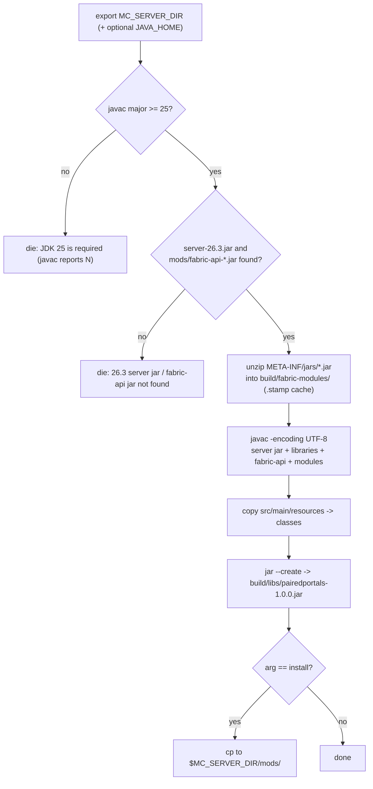

**English** · [中文](zh-CN/BUILDING.md)

# Building and installing PairedPortals

This document covers everything between a source checkout and a running server: the requirements, why
this project has no Gradle/Loom build and touches the network at no point, what
[`build.sh`](../build.sh) does step by step, the four failure messages it can stop on, the server
directory it reads, and how the finished jar is installed. The Chinese original of this material is
[README.zh-CN.md](../README.zh-CN.md) §3 and §7, and the same section numbers are used there; the
English README keeps the identical §N numbering and order.

## Requirements

| Item | Requirement |
|---|---|
| Minecraft | **26.3** |
| Mod loader | Fabric Loader |
| Required dependency | Fabric API |
| Side | **Server side.** The client installs nothing and needs no resource pack; a singleplayer world loads the mod through its own integrated server |
| Java | **25** (JDK, supplying `javac`/`jar`; 26.3's class files are Java 25, and JDK 21 cannot even read them — `build.sh` self-checks and fails with a clear message) |
| Optional compatibility | Worlds: Multiverse for Fabric (mod id `mc-worlds`) — a pure-reflection soft bridge; the mod works normally without it (README §11) |

The build needs a **JDK** (`javac` and `jar`), not a JRE. Without `JAVA_HOME` the script takes
`javac`/`jar`/`java` from `PATH`; the version check below still applies, so a JDK 21 on `PATH` fails
immediately and explicitly instead of burying you in `bad class file` errors.

## Why there is no Gradle, no Loom and no network

Minecraft **26.3 ships unobfuscated class names and has no intermediary mappings**, so there is
nothing to remap and nothing to generate. A plain `javac` + `jar` round trip produces a jar that
Fabric Loader accepts as-is — no `remapJar` step, no mapping download, no Loom.

Because it never fetches anything, the script takes its **compile classpath from your own local
server install**: `versions/26.3/server-26.3.jar`, `libraries/**.jar` and `mods/fabric-api-*.jar`.
The practical consequence is that the order is *run a Minecraft 26.3 Fabric server locally first,
then build* — there is no offline mapping cache to seed.

## The two commands

```bash
# MC_SERVER_DIR is the one required setting: point it at a Minecraft 26.3 Fabric server
# directory you already have locally.
export MC_SERVER_DIR="/path/to/your/mc26-fabric-server"

# JDK 25 is required (26.3's class files are Java 25). Without JAVA_HOME the script uses
# javac/jar from PATH — but an older one exits with an error rather than a wall of
# "bad class file" messages.
export JAVA_HOME="/path/to/jdk-25"

./build.sh                 # compile -> build/libs/pairedportals-1.0.0.jar
./build.sh install         # ... and copy the jar into $MC_SERVER_DIR/mods/
```

- **`MC_SERVER_DIR`** — required. Used to locate `versions/26.3/server-26.3.jar`,
  `libraries/**.jar` and `mods/fabric-api-*.jar`, and as the install target for
  `./build.sh install` (it copies to `$MC_SERVER_DIR/mods/pairedportals-1.0.0.jar`).
- **`JAVA_HOME`** — optional. When set, `javac`/`jar`/`java` are taken from `$JAVA_HOME/bin`;
  otherwise they are resolved from `PATH`. Either way the version self-check runs first.
- **Exit on error** — the script starts with `set -euo pipefail` and every missing prerequisite goes
  through `die() { echo "build.sh: $*" >&2; exit 1; }`. Nothing is half-built: the checks all run
  before the compile, and any failure stops the whole script with a non-zero exit status.
- **`./build.sh install` has no incremental check** — it simply copies the finished artifact. After
  editing Java sources, rebuild from scratch (`rm -rf build && ./build.sh && ./build.sh install`),
  or the sandbox will keep running the old jar (README §9).

## What `build.sh` does, step by step

1. **Version self-check.** It runs `javac -version` and extracts the major number:

   ```bash
   JAVAC_MAJOR="$("$JAVAC" -version 2>&1 | sed -n 's/^javac \([0-9][0-9]*\).*/\1/p' | head -n 1)"
   ```

   Anything unparsable or below 25 stops the build. This is deliberately first: Minecraft 26.3's
   class files are Java 25 (major version 69), and an older `javac` cannot even read them — it
   reports it as a wall of `bad class file ... wrong version` errors against Fabric API, which tells
   you nothing about the real problem.
2. **Locate the inputs.** `SERVER_JAR="$MC_SERVER_DIR/versions/26.3/server-26.3.jar"`, and the
   Fabric API jar via `find "$MC_SERVER_DIR/mods" -maxdepth 1 -name 'fabric-api-*.jar' | head -n 1`.
3. **Unpack Fabric API's nested modules.** Fabric API ships as a **bundle jar**: the real modules are
   nested jars under `META-INF/jars/`, so none of its API classes are on the classpath until they are
   unpacked. `build.sh` runs

   ```bash
   unzip -q -o -j "$FABRIC_API_JAR" 'META-INF/jars/*.jar' -d "$NESTED"
   ```

   into `build/fabric-modules/`, guarded by a `.stamp` cache (if the stamp is missing or older than
   the fabric-api jar, the directory is deleted and unpacked again; otherwise the existing
   extraction is reused). Without this step the compile fails on `CommandRegistrationCallback` /
   `ServerTickEvents`, which live in the nested modules and are invisible in the bundle.
4. **Assemble the compile classpath** — the 26.3 server jar, every jar under
   `$MC_SERVER_DIR/libraries` (`find ... -name '*.jar' | sort`), the fabric-api bundle jar itself,
   and each unpacked module.
5. **Handle Windows path/separator conventions.** Under Git Bash / MSYS / Cygwin (`uname -s` matching
   `MINGW*`, `MSYS*`, `CYGWIN*`) the classpath separator is `;` and every path is translated with
   `cygpath -w`; under a plain POSIX shell the separator is `:` and paths are passed through
   unchanged. That is the whole reason the script works in both.
6. **Compile** the sorted list of every `.java` file under `src/main/java`:

   ```bash
   "$JAVAC" -J-Duser.language=en -J-Duser.country=US -encoding UTF-8 -nowarn \
     -d "$(native "$OUT")" -cp "$CP" "${SOURCES[@]}"
   ```

   `-Duser.language=en -Duser.country=US` keeps javac's own diagnostics in English, and
   **`-encoding UTF-8`** is required because the sources carry non-ASCII text.
7. **Copy resources to the jar root** — `cp -r "$ROOT/src/main/resources/." "$OUT/"`, which puts
   `fabric.mod.json` and the mixin config where Fabric Loader expects them.
8. **Package** with `jar --create --file build/libs/pairedportals-1.0.0.jar -C build/classes .`, then
   `ls -l` the artifact. `build/classes` and `build/libs` are both deleted at the start of every run,
   so no stale class can survive.
9. **`install`** — only when the first argument is `install`: copy the jar to
   `$MC_SERVER_DIR/mods/$JAR_NAME` and print `>> installed to <path>`.

## Failure messages

All four stop the build with exit status 1 and print to stderr. They are quoted verbatim here and in
README §3:

```
build.sh: MC_SERVER_DIR is not set; point it at a Minecraft 26.3 Fabric server directory
build.sh: JDK 25 is required (javac reports 21); set JAVA_HOME to a JDK 25 install
build.sh: 26.3 server jar not found at <…> (check MC_SERVER_DIR)
build.sh: fabric-api jar not found under <…>/mods
```

(`javac reports 21` is the actual reported version, and the `<…>` placeholders are the resolved paths
the script prints.) Two further checks guard the tools themselves:

```
build.sh: javac not found (set JAVA_HOME to a JDK 25 install, or put javac on PATH)
build.sh: jar not found (set JAVA_HOME to a JDK 25 install, or put jar on PATH)
```



## Installing on a server

1. Install **Fabric Loader** and **Fabric API** on the server.
2. Put `pairedportals-1.0.0.jar` into the server's `mods/`.
3. Restart the server. The client does nothing at all.

Grab the released jar from Releases, or build it from source as described above. The complete list of
jars that has to be present is exactly: **Fabric Loader + Fabric API + this mod** (plus whatever else
you already run).

The mod has no client half, so there is nothing to install on the client and nothing to synchronise. The
metadata makes this explicit:

- `src/main/resources/fabric.mod.json` declares `"environment": "*"` and only a `main`
  entrypoint — there is no `client` entrypoint.
- `depends`: `fabricloader >=0.19.5`, `fabric-api *`, `minecraft ~26.3-`, `java >=25`.
- `suggests`: `mc-worlds` (Worlds: Multiverse for Fabric). It is optional — see
  [COMPATIBILITY.md](COMPATIBILITY.md) and README §11.

## The server directory

[`build.sh install`](../build.sh) and every script under [`test/`](../test) locate the server through
**`$MC_SERVER_DIR`**. Point it at your own Minecraft 26.3 Fabric server directory. **If it is unset,
the scripts exit with an error** rather than running against a guessed path:

```
$MC_SERVER_DIR/
  versions/26.3/server-26.3.jar     26.3 server jar (the evidence jar quoted in this document set has sha1 = cc3964451a3b32a0488110d5e3e6ad8d75fe6a66)
  mods/                             fabric-api, this mod (smallernetherportals / netherportalfix may be added as interference)
  libraries/                        Fabric Loader's libraries
  world_sbx_probe/                  test world (rebuilt by each script on every start)
```

`server.properties`'s `level-name` gets rewritten by different scripts, so **each script names its
own world** and `rm -rf`s it before starting (see the third pitfall in [TESTING.md](TESTING.md)).

Three environment facts worth knowing when working with a 26.3 server:

- **Use JDK 25's `javap` to read 26.3's API.** An older `javap` cannot read Java 25 class files at
  all. If the `java` on `PATH` is not 25, invoke `"$JAVA_HOME/bin/javap"` explicitly.
- **`pause-when-empty-seconds` defaults to 60.** Without setting it to `0`, a server with nobody on
  it stops ticking its levels (which would freeze every headless test).
- **26.3's `gamerule` names are snake_case** — `spawn_mobs`, `spawn_monsters` (the old camelCase ids
  no longer parse).

## Related documents

- [README.md](../README.md) · [README.zh-CN.md](../README.zh-CN.md) — the full technical document
  (§3 build and install, §7 server directory and sandbox)
- [ARCHITECTURE.md](ARCHITECTURE.md) · [zh-CN/ARCHITECTURE.md](zh-CN/ARCHITECTURE.md)
- [TESTING.md](TESTING.md) · [zh-CN/TESTING.md](zh-CN/TESTING.md) — how to run the test scripts and
  what they measure
- [COMMANDS.md](COMMANDS.md) · [zh-CN/COMMANDS.md](zh-CN/COMMANDS.md)
- [COMPATIBILITY.md](COMPATIBILITY.md) · [zh-CN/COMPATIBILITY.md](zh-CN/COMPATIBILITY.md)
- [GAMEPLAY.md](GAMEPLAY.md) · [zh-CN/GAMEPLAY.md](zh-CN/GAMEPLAY.md)
- [CHANGELOG.md](../CHANGELOG.md) · [CHANGELOG.zh-CN.md](../CHANGELOG.zh-CN.md)
- [CONTRIBUTING.md](../CONTRIBUTING.md) · [CONTRIBUTING.zh-CN.md](../CONTRIBUTING.zh-CN.md)
