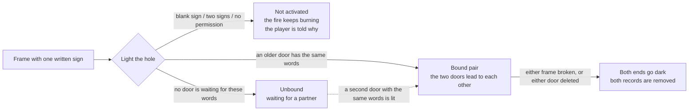

**English** · [中文](zh-CN/GAMEPLAY.md)

# Gameplay guide

This is the guide for the two people who actually touch PairedPortals: the **player** who builds a door, and the **server owner** who installs the mod. It assumes you have never seen the mod and will never read its code. Every string that can appear in the game is quoted here in English **and** Chinese, because each player is shown the wording their own client language selects. Where something is documented but has not been tested, this guide says so.

## What a paired portal is

A **paired portal** is an ordinary nether-portal frame with one extra thing: **a written sign standing inside the hole**.

Nothing else about it is new. The frame is vanilla obsidian, the lit blocks in the hole are vanilla `minecraft:nether_portal`, and the mod adds no blocks, items, entities, textures or sounds. A player who has never heard of PairedPortals cannot tell one of its doors from an ordinary portal frame by looking at it.

What the written sign changes is **where the door leads**. Vanilla's rule is overworld ↔ nether. A frame whose hole holds a written sign stops following that rule: two doors whose signs carry **the same words** become a two-way pair and lead to each other — across dimensions, and across *worlds* on a multi-world server.

Only the **server** needs the mod. Install it there and vanilla clients connect exactly as they always did, with no mod and no resource pack.

## Quick start

1. **Build a portal-shaped obsidian frame.** Any shape vanilla itself accepts — the classic 4×5, a 2×3, and so on — with an empty hole, exactly as you would build for a normal nether portal.
2. **Put exactly one written sign inside the hole.** "Inside the hole" means in one of the cells the portal blocks would occupy, not next to the frame.
3. **Light the hole** with flint and steel (or any fire) where the portal blocks would appear. The frame becomes an **unbound** custom door: it is lit and waiting for a partner. Nothing else happens yet.
4. **Build a second frame somewhere else** — another spot in the same dimension, the nether, the End, a modded dimension, or another world on a multi-world server — and **write the same words** on its sign.
5. **Light it.** Both doors bind immediately and lead to each other: the new ignition finds the earliest still-waiting door carrying those words and links the two. There is no command to run, no confirmation to click, and nothing to enable.
6. **Aim at the door** — at the obsidian frame or at a lit block in the hole — and the action bar tells you which state the door is in and, once it is bound, where its twin is.

> **The sign does not survive ignition.** Lighting the door replaces every block of the hole with portal blocks, so the words are read once, copied into the door's record, and the sign itself is gone. If you plan to build the other end later, write the words down first. The record keeps them even across a server restart.

## The sign rules

The sign is the whole configuration surface, so the rules are short and strict:

- **Exactly one sign, inside the hole.** One sign, in one of the hole's cells.
- **It must have text.** A blank sign (including a sign whose only text is on its *back* face) does not activate the door. The player who lit it is told `the sign in the frame is blank` and nothing is built.
- **Two signs in the hole do not activate it either.** The player is told `only one written sign fits in the frame`.
- **A sign next to the frame is ignored.** If the only sign is outside the hole, the frame is left entirely to vanilla: a valid empty frame lights as an ordinary nether portal.
- **A frame with no sign at all is left to vanilla**, again as an ordinary nether portal.

Because two of the three refusals above keep the fire burning (the fire is not extinguished on top of the frame), a refusal looks like "the flint and steel did nothing except place a fire".

Two details of the words themselves are worth knowing, because they decide whether two doors match:

- Only the **front face** is read, and the four lines are concatenated in order with nothing inserted between them. `AB` on line 1 and `C` on line 2 is the text `ABC`.
- Matching is **case sensitive**. `Home` and `home` are two different doors, and a trailing space is trimmed away.

And one consequence of the rules: vanilla's own ignition test only accepts air, fire and existing portal blocks in the hole, so a frame holding a sign can **never** light as an ordinary portal. It is either a custom door or a refusal with a message — never a normal nether portal.

## What the action bar tells you

Aim at a door (frame block or the lit block inside the hole) within about five blocks and the action bar answers, refreshing once a second while you keep looking. Nothing else in the world shows a door's state: both states look identical, so the action bar is the only place a door can tell you what it is.

| Situation | English (client language is not `zh*`) | Chinese (`zh_cn` / `zh_tw` / `zh_hk`) |
|---|---|---|
| Aiming at a waiting door | `Unbound custom portal: waiting for another door carrying "{text}"` | `未绑定的自定义传送门：等待另一扇写着「{text}」的门` |
| Aiming at a bound door | `Bound custom portal: leads to {dimension} {pos} ({world state})` | `已绑定的自定义传送门：通往 {dimension} {pos}（{world state}）` |
| Bound door whose twin record is gone | `Bound custom portal (its twin's record is gone)` | `已绑定的自定义传送门（对门记录已不在）` |
| World state: loaded | `loaded` | `已加载` |
| World state: registered but not loaded | `registered, not loaded` | `未加载（用的时候会自动加载）` |
| World state: unknown | `no such world` | `世界不存在` |
| Lit a frame around a blank sign | `the sign in the frame is blank` | `门洞内的告示牌没有内容` |
| Lit a frame with two written signs | `only one written sign fits in the frame` | `门洞内只能放一块有内容的告示牌` |
| No permission to light a door | `no permission to light a custom portal (currently: {policy})` | `没有权限激活自定义传送门（当前：{policy}）` |
| Activation policy `all` | `everyone` | `所有人` |
| Activation policy `op` | `operators only` | `仅 OP` |
| Activation policy `none` | `nobody` | `所有人都不行` |

- `{text}` is the words on the sign; `{pos}` is the twin's hole corner, written like `1, 100, 0`; `{dimension}` is the dimension id, written like `minecraft:the_nether` or `newworld:overworld`; `{policy}` is one of the three policy words in the last three rows.
- The bound line is the only place you learn where the other end is. On a multi-world server that dimension name is what separates "my base" from "the base in the other world", and the world state says whether that world is up right now.
- The last two rows are **ignition** feedback: they are sent to the nearest player within eight blocks of the fire. If nobody is near, they go to the server log instead — the door is still refused.
- Aiming at a frame that belongs to no custom door (including an ordinary nether portal) shows nothing at all.

## In-game languages

- **Every player-visible string follows the player's own client language.** A client language starting with `zh` (`zh_cn`, `zh_tw`, `zh_hk`) gets Chinese; every other language gets English. The server reads the language from the connecting client (`ServerPlayer.clientInformation().language()`).
- Both surfaces follow it: the **action-bar hints** and the **`/pairedportals` command output**. Two players on the same server can therefore see the same door described in different languages at the same time.
- **There is no resource pack and no language setting to install.** The mod has no client half, so it cannot ship a client language file, and it does not use the vanilla translation system: the server picks the literal sentence for each player and sends it. Nothing appears in the client's options, and nothing needs to.
- **Server log lines stay English.** So do console output and command blocks, which have no client language attached. The `list` / `info` tail markers (`[loaded]`, `[registered, not loaded]`, `[no such world]`) are always English for the same reason — the test scripts grep for them.

## Rules that surprise people



### One text is one pair at a time, and the queue is first come, first served

The same words can describe exactly **one** pair. When you light a third door carrying text that is already in use, it does not steal an existing twin: it waits for its own partner like any other unbound door. The partner is always the **earliest still-waiting door with those words** — ignition order, not distance. That order is recorded in the world's saved data, so the queue keeps its order across server restarts.

### Two doors can share a frame pillar

Two frames built three blocks apart share the obsidian post between them, and that post is part of both door rings. The doors do not interfere: looking at the shared post reports the door whose hole is nearer (with a fixed tie-break, so the answer never flickers between runs), and tearing one door down clears only **its own** hole — the shared pillar is untouched. This is covered by `test/smoke-adjacent.sh`.

### Tearing down one end removes the whole pair

Break the frame of one door, or delete one door with `/pairedportals delete`, and the two ends go down **together**: both holes go dark and both records are removed. That is deliberate — a door with one end left standing would be a lit portal nothing can travel through, and a player who stepped into it would fall through to vanilla and be given an ordinary nether trip. Taking the pair down together is what guarantees there is never a door that is lit but unusable. The server log records it: `[pairedportals] portal at ... went down with its twin at ...`.

### When is the frame "broken"? Not at its corners

A door counts as broken exactly when **the four strips of frame that touch the hole** are no longer whole (and the hole itself is no longer entirely lit portal blocks). The four **diagonal corner cells** of the ring are not part of the test — vanilla's own shape reader walks the bottom row, the two side columns and the top bar, and never reads the corners. Mining a corner therefore leaves a fully working lit door, and the mod does not treat it as a demolition.

### A broken door can be rebuilt

Demolition leaves the obsidian frames standing; only the lit blocks and the records are gone. Put a new sign in the hole, write the words, and light it again — that is a **brand-new pair** with new ids, indistinguishable from one you had never built.

One edge case worth knowing: if you repair a frame block before the periodic sweep notices the damage and then light the hole again **with the same words**, the old record still describes that frame, so the door is simply re-lit and keeps its existing pairing. Different words, or a sweep that already ran, mean a fresh door. `/pairedportals purge` asks the server to run that sweep immediately.

## Travelling through a door

- **You arrive at the twin.** There is no destination search and no 1:8 coordinate scaling: the only place a paired door leads is its twin's hole.
- **The landing spot reproduces vanilla's own mapping**, including between doors of different sizes. Your relative position inside the door you walked into is mapped onto the door you come out of: hug the left post of a wide door and you leave by the matching post of a narrow one, and a 3-wide door mapped onto a 2-wide twin spreads its travellers across both of the twin's blocks instead of stacking them on one. If something is already standing there, vanilla's own "find a spot that does not suffocate" step nudges you aside.
- **You leave through the far side of the door you were in.** The rotation handed to the game is *relative*: 0° when the two doors share an axis, +90° when they are perpendicular, always anchored to your current heading — so you keep walking the way you were going and step out through the far door instead of arriving nose-first against its frame.
- **The arrival hole does not send you straight back.** Vanilla's portal cooldown — 300 ticks, or 10 ticks when the entity is carrying a player — is applied by the trip itself, and standing in a portal block while on cooldown re-arms the cooldown instead of starting a new trip. You have to step out, let the cooldown run out, and step back in. Two doors standing close together therefore make the return leg slow, never a loop.
- **A door with no partner is deliberately silent.** Walking into an unbound door does nothing at all: no action bar, no sound, no particles, and no vanilla nether trip either. The reason appears only in the server log (`[pairedportals] blocked travel (…)`) and in `/pairedportals list`, which shows the door as waiting. This is the same behaviour as a vanilla door that refuses: the door keeps its opinion to itself.

### Which entities can travel

The mod replaces only the **destination lookup** — the single question "where does this portal lead". Everything else is vanilla: who is allowed to use a portal, the per-entity bookkeeping while standing in one, the cooldown, the sound and screen effect, and the move itself (including passengers). So whatever vanilla would send through a nether portal, a paired door sends too, and whatever vanilla refuses, a paired door refuses. The measured set from `test/smoke-entities.sh` (6/6):

| Test subject | Type | Result |
|---|---|---|
| `minecraft:item` (a dropped item) | non-mob | travels; landed at `(1.0, 100.0, 0.5)` |
| `minecraft:armor_stand` | non-mob | travels; same landing |
| `minecraft:minecart` | vehicle (overrides its own portal handling) | travels; same landing |
| `minecraft:zombie` | mob (control) | travels; same landing |
| `minecraft:horse` | vehicle | travels; landed at `(1.0, 100.0, 0.698)` — 0.2 off, because `PortalShape.findCollisionFreePosition` moved it clear of the wall |
| `minecraft:zombie` riding the horse | **passenger** | arrived in the nether with the horse, with no travel line of its own — it was carried by the vehicle, because a passenger cannot use a portal by itself (`Entity.canUsePortal(false)` is false for passengers) |

## Who may light a door

`/pairedportals permission [all|op|none]` decides who may light a **new** door.

| Value | Who may light a new door |
|---|---|
| `all` (default) | everyone |
| `op` | operators only (command level 2, i.e. `Permissions.COMMANDS_GAMEMASTER`) |
| `none` | nobody |

- **A refusal is literally just a fire.** The block you placed stays lit, nothing turns into a portal, and not even vanilla's own portal branch runs. The igniter gets `no permission to light a custom portal (currently: operators only)` (the policy word is whatever is set).
- **The question is asked about the nearest player within eight blocks of the fire.** The ignition hook has no "who lit it" argument, so this is the most accurate reading available: someone standing at the frame with flint and steel is exact, while a frame lit by a dispenser or by spreading fire counts as having no operator at all and is refused under `op` and `none`.
- **This only ever constrains lighting new doors.** Every existing door keeps working under every setting: `none` means "no new doors", not "switch the feature off". Refusing a fire must never take a working pair away from the players who built it.
- The setting is stored in the world's saved data with the door records, so it survives restarts and applies to the whole server — one setting, because a pair usually spans two dimensions and "who may light this" has no reason to differ between its two ends.

## Server-owner notes

**What to install.** A Minecraft 26.3 Fabric server with Fabric Loader and Fabric API, and `pairedportals-1.0.0.jar` in the server's `mods/` folder. Java 25 is required (the 26.3 classes are Java 25). Restart the server. Clients install nothing and need no resource pack; in single-player the game runs its own server internally, so installing the jar is enough for your own worlds.

**Where the state lives.** Every door record and the activation policy live in the world's saved data, in one server-wide file:

```
<world>/data/pairedportals/portals.dat
```

It is not per dimension (a pair usually spans two), it survives restarts, and it moves with the world folder — so back up the world folder as usual.

**Maintenance commands.** `/pairedportals` is available at permission level 4 (owners). These four are the day-to-day tools:

| Command | What it does |
|---|---|
| `/pairedportals list [bound\|unbound]` | A head count, then one line per door: full id, dimension, hole corner, size, state, sign words, and for a bound door where its twin is |
| `/pairedportals info <uuid\|pos>` | One door in full, including its twin and whether the twin's world is up right now (the position form accepts relative coordinates, so `/pairedportals info ~ ~ ~` answers "which door am I standing in?") |
| `/pairedportals purge` | Sweep now and retire every door whose frame no longer stands — both ends, as always |
| `/pairedportals delete <uuid\|pos>` | Remove a door and its twin |

The full command surface (including `tp`, `unbind`, `pair`, `permission` and `debug`) is documented in [docs/COMMANDS.md](COMMANDS.md).

**Multi-world servers.** Nothing in the mod special-cases a dimension: a door leads to whatever dimension key its record holds. Making a *custom* world come up on demand is the job of **Worlds: Multiverse for Fabric** (mod id `mc-worlds`); without it, a door into a world that is not currently loaded has nowhere to land, and the trip is refused while the door keeps its pairing. See [docs/COMPATIBILITY.md](COMPATIBILITY.md).

**Logs.** Server log lines are English-only and prefixed `[pairedportals]`; `-Dpairedportals.debug=true` turns on the full decision trail (ignition, pairing, travel, refusals). A door that cannot carry a traveller writes one line per change of reason, so a permanently stuck door is visible without flooding the log.

## What the mod does not do

Honesty matters more here than a longer feature list:

- It adds **no new blocks, items, entities, textures, models or sounds**. Everything you see is vanilla.
- It does **not** change vanilla nether portals. Ordinary portals behave exactly as before, and one of the mod's three hooks exists specifically so vanilla's portal search never lands on one of our doors.
- It does **not** generate a partner for you. Vanilla creates a matching portal when you travel; a paired door never does — it either reaches its twin or refuses the trip.
- It does **not** scale coordinates (no 1:8 overworld/nether mapping) and does **not** search for a nearby portal.
- It has **no custom rendering**: a door's state is not drawn, coloured or named in the world. The action bar is the only channel.
- It does **not** show a client-side name or tooltip; the blocks are still called Obsidian and Nether Portal Block by the client.
- It does **not** gate travel by permission. The activation policy only concerns lighting **new** doors.
- It does **not** tell a player why a dead door is dead. That is the zero-feedback design described above; the reason is in the server log.
- It does **not** ship a resource pack, a language file or a config screen.

## Verified by hand on a real server

| Area | Result |
|---|---|
| Cross-world travel (a door in one world leading to a door in another) | **Walked 2026-10-11** on a real multi-world server with the Worlds mod: a door in the default world and one in `newworld:overworld` carrying the same sign text showed `BOUND` at both ends with the right world state, and walking through carried the traveller into the other world. Cross-world *demolition* has not been walked. |

## Not yet verified

The following are documented here but were **not** confirmed end to end by the author. Treat them as describing intended behaviour, not as measured results:

| Area | Status |
|---|---|
| Sound | Unverified — a screenshot cannot show it, and the checked evidence was visual. |
| "Mining a frame corner is not a demolition" | The test stage that covers it was only syntax-checked (`bash -n`), never executed. |
| Same-dimension pairs | Human-tested (two overworld doors paired, travelled both ways, and stayed in the arrival hole for tens of seconds without bouncing). The regression script `test/smoke-samedim.sh` is written but has not been run. |
| Travelling from the End | Igniting a door there is tested; the *travel* half was not walked, because it needs a paired door at the far end. (Travelling from a **modded** dimension — a Worlds world — was walked on 2026-10-11; see the table above.) |
| Piston behaviour and mining time of the frame | Not measured. The frame blocks are literally vanilla obsidian, so vanilla behaviour is expected. |

## FAQ

**Why does nothing happen when I walk into my door?**
Either the door has no partner yet, or its twin's world is not available right now. Run `/pairedportals list`: a waiting door shows up in the `waiting for a partner` count and as `PENDING`. Remember that this is silent by design — no action bar, no sound, no particles — so the absence of a reaction is not evidence that the door is broken. The reason is written to the server log.

**Why did my door disappear?**
Because the other end was broken or removed. A pair dies together: when one end goes, both holes go dark and both records are removed, leaving two plain obsidian frames. If you did not break anything, check whether someone mined the twin's frame, or whether a door was deleted with `/pairedportals delete`.

**Do my players need a mod or a resource pack?**
No. All of the mod runs on the server: the metadata is `"environment": "*"`, there is no `client` entrypoint, and nothing sits in the client's assets. Vanilla clients connect and see everything the mod sends, including the action-bar text in their own language. In singleplayer the integrated server runs the mod for you, so your own worlds work as well.

**Can two doors share a pillar?**
Yes. Two frames three blocks apart share the obsidian post, the doors remain independent, and tearing one down does not touch the shared pillar or the other door.

**Can I have the same words in three places?**
Yes, but not all three as one pair. The first two doors lit with those words pair up, and the third waits for a fourth. If the queue paired the wrong two, free the doors you want with `/pairedportals unbind <uuid|pos>`, then join them by hand with `/pairedportals pair <idA> <idB>`. `pair` only accepts two **waiting** doors and deliberately does not check their words or dimensions (it warns you when the words differ, because then nothing in the world explains the pair).

**Does it work in the End, in modded dimensions, in other worlds?**
Yes. Nothing in the travel path special-cases a dimension: a door leads to its record's dimension key, so the same code covers one dimension, two vanilla dimensions, a modded dimension or two worlds of a multi-world server. Igniting a door in the End is tested. Cross-world travel additionally needs the Worlds mod, so that a world that is not loaded can be brought up on demand.

**What happens if the sign text is edited after binding?**
Nothing happens to the pairing. The words are read once, at ignition, and copied into the door's record; after that the mod never reads a sign again. In fact the sign does not survive ignition at all — the lit hole replaces it — so there is nothing left to edit. And if a lit hole loses one of its blocks for any reason, the hole is no longer complete: the door and its twin are retired by the next sweep.

**What about the same dimension — overworld to overworld?**
Supported, and measured on a human client. Two overworld doors with the same words paired normally and travelled both ways. The return leg waits out the vanilla portal cooldown (300 ticks; 10 ticks while an entity carries a player), so two doors standing next to each other are slow to round-trip but never form a loop.

**Will it interfere with my ordinary nether portals?**
No. A frame with no sign in the hole is left entirely to vanilla, and the mod makes vanilla's own portal search skip our frames, so a normal portal next to a paired door still sends you where it always did.

## Related documents

| English | Chinese |
|---|---|
| [README.md](../README.md) | [README.zh-CN.md](../README.zh-CN.md) |
| [docs/GAMEPLAY.md](GAMEPLAY.md) | [docs/zh-CN/GAMEPLAY.md](zh-CN/GAMEPLAY.md) |
| [docs/ARCHITECTURE.md](ARCHITECTURE.md) | [docs/zh-CN/ARCHITECTURE.md](zh-CN/ARCHITECTURE.md) |
| [docs/BUILDING.md](BUILDING.md) | [docs/zh-CN/BUILDING.md](zh-CN/BUILDING.md) |
| [docs/TESTING.md](TESTING.md) | [docs/zh-CN/TESTING.md](zh-CN/TESTING.md) |
| [docs/COMMANDS.md](COMMANDS.md) | [docs/zh-CN/COMMANDS.md](zh-CN/COMMANDS.md) |
| [docs/COMPATIBILITY.md](COMPATIBILITY.md) | [docs/zh-CN/COMPATIBILITY.md](zh-CN/COMPATIBILITY.md) |
| [CHANGELOG.md](../CHANGELOG.md) | [CHANGELOG.zh-CN.md](../CHANGELOG.zh-CN.md) |
| [CONTRIBUTING.md](../CONTRIBUTING.md) | [CONTRIBUTING.zh-CN.md](../CONTRIBUTING.zh-CN.md) |
