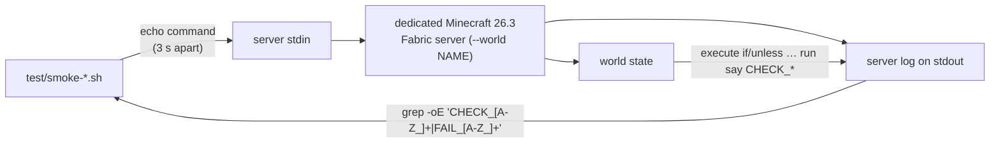

**English** · [中文](zh-CN/TESTING.md)

# Testing and evidence

This document describes the test rig that lives in [`test/`](../test): the 15 shell scripts, what each
one covers and what it actually recorded, how to run them, the three pitfalls they all have to work
around, the client-side half that drives a real vanilla client, and — most importantly — an honest
split between what is **measured**, what is **argued but not measured**, what is **noted but not
reproduced**, and what is **not tested at all**. The Chinese original of this material is
[README.zh-CN.md](../README.zh-CN.md) §6 and §8; the acceptance-item mapping (I1–I7, F1–F20) is in
§10.

## How the harness works

Every `smoke-*` and `probe-*` script has the same shape: it starts a dedicated Minecraft server, feeds
console commands into the server process's **stdin**, and then greps the server's **log** for the
result. There is no RCON and no socket — the console is stdin, the evidence is stdout.

Assertions about the world are not done by reading the log: the script issues
`execute … if|unless <condition> run say CHECK_*` (and the mirrored `… run say FAIL_*`), so the
**world itself** reports the result by printing a marker line the script then greps for. That is why
almost every check exists in two halves.



The server is launched with `-Dpairedportals.debug=true` (and `-Dmixin.debug.export=true` in
`smoke-phase3.sh` / `probe-sign.sh`), which is what makes the `[pairedportals]` log lines the scripts
grep for appear.

## How to run them

The scripts depend on exactly two environment variables:

| Variable | Required | Meaning |
|---|---|---|
| `MC_SERVER_DIR` | **yes** | a Minecraft 26.3 Fabric server directory |
| `JAVA_HOME` | no | a JDK 25 install; without it `java` is taken from `PATH` |

Without `MC_SERVER_DIR` a script exits immediately with:

```
test: set MC_SERVER_DIR to a Minecraft 26.3 Fabric server directory; see README §7
```

Each script then self-checks `java.specification.version >= 25` (via
`java -XshowSettings:properties -version`) and otherwise exits with:

```
test: JDK 25 is required (set JAVA_HOME); see README §7
```

26.3's class files cannot be read by an older JVM, so the check is there to stop you before a pile of
`UnsupportedClassVersionError` messages.

A few scripts also accept optional overrides for the harness itself — `LOG` (where the server log
goes), `WORLD` (the world name), `RESET` (`smoke-phase4.sh`, `smoke-travel.sh`, `smoke-edges.sh`,
`smoke-entities.sh`, `smoke-samedim.sh`, `smoke-unloaded.sh`, `probe-unload.sh`: `RESET=0` keeps the world, which
`smoke-phase4.sh` needs for its second run), and `CTL`/`PORT` for `client-host.sh`. None of them are
needed to run a script the normal way.

Two timing facts decide how the scripts are written:

- **The server takes about 60 seconds from process start to accepting console commands** (the scripts
  `sleep 60`, `smoke-travel.sh` / `smoke-entities.sh` / `smoke-samedim.sh` / `client-host.sh` and
  `probe-unload.sh` use 62 before the first command).
- **The console occasionally swallows a command silently.** Every assertion is therefore paired — an
  `if … run say FAIL_*` and an `unless … run say CHECK_*` — instead of a single `unless`, and
  commands are spaced ~3 seconds apart. A missing `CHECK_*` marker means "the condition was false,
  **or** the console line never reached the server", which is exactly why the paired form exists.

## The 15 scripts

| Script | Covers | Recorded result |
|---|---|---|
| `test/smoke-phase2.sh` | Registry + same-text FIFO pairing | pass |
| `test/smoke-phase3.sh` | Entity travel to the twin door (including cross-dimension) | pass |
| `test/smoke-phase4.sh` | Two runs: PENDING→BOUND, the DOOM pair's demolition (both holes cleared, HOME unaffected), survival across a restart, `info`/`delete` (delete clears the twin too) | pass |
| `test/smoke-isolation.sh` | A vanilla door next to ours is **not** stolen (both directions, and our own door still works) | pass, and the filter log fired 2 times (proving the search really did hit our door) |
| `test/smoke-edges.sh` | End-dimension ignition, F3 blank sign, F4 two signs, `help`/`purge` | pass |
| `test/smoke-travel.sh` | Two-way travel, landing point, no bounce after 20 s (R-9), self-proof of the `@e` dimension trap (phase 0) | pass |
| `test/smoke-rebuild.sh` | A player edits a door: mine one frame block → the pair goes down together (twin hole cleared, twin frame intact); rebuild the frame + relight with new words → the registry rebuilds from nothing (counts 1→2→0→1→2) | pass |
| `test/smoke-adjacent.sh` | Two doors sharing one obsidian post: mine A's own cell → A and its twin go down, **B and the shared post are untouched** | pass |
| `test/smoke-demolish.sh` | Demolition semantics: mine one end → both holes cleared, the twin frame still obsidian, `0 portal(s)`, `went down with its twin`; relight the same frames → a fresh pair | pass (the newly added "mining a diagonal corner is not a demolition" stage only ever had `bash -n`) |
| `test/smoke-samedim.sh` | **Same-dimension pairing** (overworld↔overworld): one text, two doors, ordinary pairing (`1 bound pair(s)`), both directions travel, both `travel:` lines name `minecraft:overworld`, still at the twin 22 s later, exactly one `travel:` per leg | **not executed** (`bash -n` only; the user asked that the new assertions not be run yet. The same-dimension behaviour is covered by a real-client observation: pairing + both directions + standing still for tens of seconds without bouncing) |
| `test/smoke-entities.sh` | Which entities can use a door: dropped item / armor stand / minecart / zombie / horse + **a zombie riding the horse** (passenger) | 6/6 pass — see the entity table below |
| `test/smoke-unloaded.sh` | While the twin's chunk is unloaded and again after it is reloaded, vanilla is never stolen; our own door still delivers | pass (the premise "the chunk really is unloaded" is unstable in this sandbox — see the evidence policy) |
| `test/probe-unload.sh` | Diagnostic: `forceload query`, `if loaded` and the mod's own sweep count placed side by side against one clean unload cycle | the three observers agreed |
| `test/probe-sign.sh` | Early probe of how a freshly placed sign reads in 26.3 (NBT field names/shapes) | pass |
| `test/client-host.sh` | Long-lived host (**not** an assertion script): rebuilds `world_client`, builds the CP door pair, prints `HOST_READY`, then keeps reading console commands from the FIFO `/tmp/cp-client-ctl` (the real-client screenshots in §8.2 were taken this way; the **increment** of `grep -c HOST_READY` is what means "this start is ready", because the log is appended to) | used |

The `repro-overlay-unload{,-b,-c}.sh` scripts (minimal reproductions written for the "ghost overlay"
back then) were deleted along with the overlay feature itself; the note at the end of README §9 records
what they proved.

## The client-side half

`test/client-host.sh` and `test/client-join.py` are used as a **pair**: the former starts a long-lived
server with an open console on the FIFO `/tmp/cp-client-ctl`, the latter starts a client and connects
straight to it.

`client-host.sh` differs from the smoke scripts in that it never stops the server on its own — it
builds the CP pair on a stone viewing platform and then loops `cat "$CTL"` forever, so later steps can
poke the running world:

```bash
test/client-host.sh                      # starts, builds the CP pair, prints HOST_READY, stays up
echo "say hi" > /tmp/cp-client-ctl       # drive the running console
```

Its defaults are `WORLD=world_client` (its own world, so the smoke worlds stay clean),
`LOG=/tmp/cp-client-host.log`, `CTL=/tmp/cp-client-ctl`, `PORT=25599`; it rewrites `server-port` in
`server.properties`, sets `pause-when-empty-seconds=0` and `doFireTick false`. Set `STOP=1` or write
`stop` into the FIFO to end it.

`client-join.py` additionally needs **your own** vanilla 26.3-Fabric client installation: it copies
that profile's classpath recipe, `libraries/`, `assets/` and `natives/` into a throwaway zero-mod
profile somewhere else (the loader may create an empty `mods/` folder, so the assertion is "no `.jar`
files in there", not "the folder does not exist"):

| Environment variable | Default | Meaning |
|---|---|---|
| `CP_CLIENT_MC_HOME` | none (**required**) | your Minecraft game directory, e.g. `~/.minecraft` |
| `CP_CLIENT_SRC` | `$CP_CLIENT_MC_HOME/versions/26.3-Fabric` | that 26.3-Fabric version folder |
| `CP_CLIENT_LIBS` | `$CP_CLIENT_MC_HOME/libraries` | the shared mapped libraries |
| `CP_CLIENT_ASSETS` | `$CP_CLIENT_MC_HOME/assets` | asset index and objects |
| `CP_CLIENT_NATIVES` | `$CP_CLIENT_SRC/natives-<os>-<arch>` | specify it manually when the platform name does not match |
| `CP_CLIENT_PROFILE` | `$CP_CLIENT_MC_HOME/versions/cptest-modfree` | where the throwaway zero-mod profile is built |
| `CP_CLIENT_JAVA` | `$JAVA_HOME/bin/java`, else `java` on `PATH` | needs Java 25 |

Command line: `--timeout` (default 300 s), `--keep-running`, `--quick <host:port>` (jumps straight in
via `--quickPlayMultiplayer`), `--username` (default `TestPlayer`). It scans the client console for
crash/connection-failure patterns versus "the game really came up" markers and reports a verdict
(`ok` / `joining` / `fail` / `timeout` / `exited`).

## The three pitfalls

All three were hit for real while writing these scripts.

1. **An `@e` selector with no position filter matches across dimensions.** In
   `execute in minecraft:the_nether ... if entity @e[tag=x]`, the `@e[tag=x]` also counts the
   overworld one — so "it is in the nether" and "it is in the overworld" are true at the same instant.
   **Every entity assertion must carry `distance=..N`** (`smoke-travel.sh` phase 0 is that trap's
   self-proof). Conversely: **if you see a CHECK and a FAIL at the same time, dump the entities before
   believing the conclusion** — when the world was not reset, a zombie carrying the same tag from an
   earlier round makes both sides true, and that is neither a bounce nor the selector's fault.
2. **Log formats.** `say` prints `[Server thread/INFO]: [Server] XXX`; command receipts print
   `[Server thread/INFO]: System chat: ...`. The server takes about **60 seconds** from process start
   to accepting console commands, and the console occasionally swallows a command silently — hence
   the 3-second spacing and the paired assertions (`if ... run say FAIL_*` plus
   `unless ... run say CHECK_*`) instead of a single `unless`.
3. **The world must be named by the script itself**: `WORLD="${WORLD:-world_sbx_probe}"` +
   `rm -rf "$WORLD"` + `nogui --world "$WORLD"`. The sandbox's `server.properties` is **shared** and
   its `level-name` gets changed by other runs (we were fooled for a whole round: the script deleted
   `world_sbx_probe` while the server loaded `cp_corner2`, so the registry accumulated four or five
   old doors and `smoke-phase4.sh`'s A/K and `smoke-travel.sh`'s T1/T2 all became false failures).
   The hard evidence that a world is clean is **`sweep checked 0 loaded portal(s)` at startup**
   (before any door is built) — note the criterion is **not** the missing
   `loaded N portal(s) from the world registry` line: `PortalRegistry.fromTag` is only called when
   records were actually persisted to disk, so a brand-new world goes through the empty constructor
   and **never prints that line at all**. So "no `loaded` line in the startup log" = a fresh world;
   conversely, a `loaded N portal(s)` line when you were not testing persistence means the world was
   not reset.

## What the assertions match on

The scripts assert on **English log and command output strings**. Do not change them — and note that
console/log-visible text stays English-only even though player-facing text follows the player's client
language, precisely because these scripts grep it:

- `N portal(s):` — the first line of `/pairedportals list` (`0 portal(s):`, `2 portal(s):`, …)
- `loaded N portal(s) from the world registry` (`smoke-phase4.sh` asserts `loaded 2 portal(s) from
  the world registry`)
- `vanilla's portal search found our door` (the POI filter firing)
- `sweep checked N loaded portal` (the validator's sweep count)
- `blocked travel` (a door that refused the trip)
- `travel: … -> … (minecraft:the_nether)` (a delivered crossing, with the destination dimension)
- `went down with its twin`, `no longer matches the world` (pair demolition)
- the `[pairedportals]` log prefix, and the `System chat: ` wrapper on command receipts
- the in-world markers themselves: `CHECK_*`, `FAIL_*`, `WARN_*`, and the phase `say` markers
  (`PHASE4_BOUND`, `DEMOLISH_AFTER`, `SAMDIM_LEG1_END`, …)

## Evidence policy

This project distinguishes four grades of claim. Nothing below is upgraded without evidence, and the
hedges are deliberate.

### Measured — script + log evidence

Ignition branching in all three states (no sign / blank sign / two signs all hand the frame back to
vanilla); same-text FIFO pairing; PENDING→BOUND; **breaking either end takes the whole pair down**
(both holes cleared, the twin frame intact, records back to zero, `went down with its twin`); a
demolished frame can be re-signed and relit into a completely fresh pair; demolishing A does not
disturb a B that shares a post; the registry survives a restart; `info`/`delete`/`purge`/`help`/`debug`
(`delete` clears the twin as well); two-way travel and landing points (**by vanilla's own formula:
same-size doors land in the same place, a 3-wide door spreads its three cells across a 2-wide door**);
**outbound facing by vanilla's rule (0° on the same axis, +90° relative across axes, measured with a
zombie under control)**; no bounce after 20 seconds; End-dimension ignition; a vanilla door in the
same dimension and adjacent is not stolen (measured in the 128-block high-risk direction); a clean
server with no mixin errors; **six kinds of entity crossing a door** (table below); and the
**real-client observations** (§8.2 below).

### Constructed argument, not measured

**T1/T2 — would SmallNetherPortals displace the sign inside the hole?** Its trigger needs a player
right-clicking with flint and steel, and the tests ignite with `setblock fire`, which never runs its
handler; on timing, our branching happens in the same tick inside `onPlace`, before its
one-tick-delayed task. So: argued, not measured.

### Noted but not reproduced

- **R-8 (the twin's chunk is unloaded):** when the twin's chunk is unloaded we add a
  `TicketType.PORTAL` ticket and load it synchronously (no ticket when it is already loaded), then
  build the `TeleportTransition`. `smoke-unloaded.sh`'s three observers contradicted each other about
  whether the chunk was really unloaded (`if loaded` said no while our own `sweep`, whose guard is
  `level.hasChunkAt` — a read that never force-loads — kept seeing the door), so that particular
  reading is a false positive. `probe-unload.sh` did produce one clean unload cycle with the three
  observers in agreement (`sweep` counts `22×0 → 5×1 → 8×2 → 23×1 → 9×2`).
- **R-9 (landing-point bounce):** the landing point is measured to be the bottom centre of the hole,
  the traveller is still in the destination dimension 20 seconds later, and neither of the two
  two-way rounds bounced.

### Not tested

- The **travel half** of F10/F11 (the End side would need a paired door there too to complete a trip).
- **F13** (changing the sign text after binding has no effect — true by construction, since `twinId`
  is never re-read from the sign once written, but there is no script for it).
- **F17/F18** (whether pistons can push it, whether mining takes the same time as obsidian — the real
  block *is* obsidian, not measured).
- **Sound.**

### Which entities can use a door (`test/smoke-entities.sh`, 6/6)

Mechanically we replace only `NetherPortalBlock.getPortalDestination` (the landing lookup):
eligibility (`Entity.canUsePortal`), the standing-in-a-portal bookkeeping (`PortalProcessor`), the
cooldowns, the sound/purple screen, and the actual move (`Entity.teleportCrossDimension`'s first
instruction is `getPassengers()`) all stay vanilla. So "whatever vanilla sends through a nether
portal, we send through ours; whatever vanilla refuses, we refuse" — and the measurement agrees:

| Subject | Type | Result |
|---|---|---|
| `minecraft:item` (dropped stone) | non-living | crossed; landed at `(1.0, 100.0, 0.5)` |
| `minecraft:armor_stand` | non-living | crossed; same landing |
| `minecraft:minecart` | vehicle (overrides `handlePortal` itself) | crossed; same landing |
| `minecraft:zombie` | living (control) | crossed; same landing |
| `minecraft:horse` | vehicle + passenger | crossed; landed at `(1.0, 100.0, 0.698)` — 0.2 blocks off a single-cell entity's landing, because `PortalShape.findCollisionFreePosition` shifts the horse's hitbox out of the wall |
| `minecraft:zombie` riding the horse | **passenger** | arrived in the nether with the horse, **with no `travel` log line of its own** ⇒ it was carried by the vehicle (a passenger cannot use a portal itself: `Entity.canUsePortal(false)` is false for passengers) |

> The script itself was caught by a trap worth recording: the first version summoned the horse *inside*
> the hole before riding it, but a non-player entity's portal delay is **0 ticks**
> (`NetherPortalBlock.getPortalTransitionTime` reads the gamerule only for players) ⇒ two seconds
> later the horse was already in the nether, the `ride` command failed silently, and the two entities
> crossed independently — **proving nothing about passengers**. It now mounts outside the portal (on a
> one-block obsidian floor) and only then `tp`s the horse into the hole.

### Real-client observations (a mod-free vanilla client, direct connection)

`test/client-join.py` started a 26.3 client with **no mods at all** (it asserts first that there are no
jars in the client's `mods/`) and connected straight to the same sandbox server (default
`127.0.0.1:25599`). Every screenshot is vanilla F2, landing in that client profile's own
`screenshots/` — not an external window capture.

> The table below is the author's observation record from the round when it was run. **The raw PNGs are
> not distributed with the repository** (they land in each person's own client profile and are
> one-off run evidence); the numbers in the table are just the sequence numbers of that round and do
> not affect the conclusions.

| Observation | What was observed | Conclusion |
|---|---|---|
| Login | `Setting user: TestPlayer` + `logged in with entity id 3` + the world rendering | **R5 dynamic half**: the server mod requires nothing on the client |
| Crosshair on a **PENDING** door (SOLO)'s post | actionbar `Unbound custom portal` | the frame's three-state text ✓ |
| Crosshair on a **BOUND** door (CP)'s post | actionbar `Bound custom portal` | same ✓ |
| Crosshair on the **portal block inside the hole** (with the block selection outline visible) | the same bound-door actionbar | "the hole block hints too" ✓ |
| Real client standing in front of the CP door, baseline | the hole lit, crosshair on the hole block ⇒ the bound-door actionbar | pre-demolition baseline ✓ |
| After breaking **the twin's** `(-1,100,0)` cell in the nether | the overworld end became an **empty pure-obsidian frame** (you could see through the hole) with **no actionbar text at all** | the semantics the user asked for ✓ (the server log printed `[pairedportals] portal at BlockPos{x=1, y=100, z=0} (minecraft:the_nether) no longer matches the world; retiring it` and `… went down with its twin at BlockPos{x=1, y=100, z=0} (minecraft:overworld)` at the same moment; the world probe answered `OW_HOLE_EMPTY`) |
| The two ignition-failure messages | `the sign in the frame is blank` / `only one written sign fits in the frame` | the player feedback for F3/F4 ✓ |
| Standing in the door for 4 s (80 ticks) → nether landing | purple screen, then landing `(1.0,100.0,0.5)`; F3 showing `XYZ: 1 100 1` and the biome | F20 (player delay = vanilla's `PLAYERS_NETHER_PORTAL_DEFAULT_DELAY`) ✓ |
| (Before the rename) crosshair on a frame | the older actionbar wording | the wording was changed to `… custom portal` on request — see the three rows above |
| (Before the rename) the overlay after being aligned with the obsidian | a separate controlled experiment: "an entity is lit by the block it stands in, so anything embedded in a light-blocking block is necessarily pitch black" | this is the direct reason the overlay was deleted entirely; kept as historical evidence |

Two further player-side observations: **R-9's round-trip bounce does not reproduce for players** (checks
at 10 / 27 / 50 seconds after crossing showed no second travel, with `PortalCooldown` going 0 → 10);
and **`pending`/`orphan` doors give a player zero feedback** (only the log line `blocked travel (…)`,
with no actionbar — this had been made a "friendly hint" and was judged a spec deviation by §12/§10.2
F6 "zero feedback" and reverted). The `orphan` state itself is gone too: breaking one end takes the
whole pair down (README §4), so no door can stay lit while being untravellable.

## Related documents

- [README.md](../README.md) · [README.zh-CN.md](../README.zh-CN.md) — §6 test scripts, §8 measured vs
  untested, §10 acceptance mapping
- [BUILDING.md](BUILDING.md) · [zh-CN/BUILDING.md](zh-CN/BUILDING.md) — how to build and install, and
  the server directory the scripts read
- [ARCHITECTURE.md](ARCHITECTURE.md) · [zh-CN/ARCHITECTURE.md](zh-CN/ARCHITECTURE.md)
- [COMMANDS.md](COMMANDS.md) · [zh-CN/COMMANDS.md](zh-CN/COMMANDS.md)
- [COMPATIBILITY.md](COMPATIBILITY.md) · [zh-CN/COMPATIBILITY.md](zh-CN/COMPATIBILITY.md)
- [GAMEPLAY.md](GAMEPLAY.md) · [zh-CN/GAMEPLAY.md](zh-CN/GAMEPLAY.md)
- [CHANGELOG.md](../CHANGELOG.md) · [CHANGELOG.zh-CN.md](../CHANGELOG.zh-CN.md)
- [CONTRIBUTING.md](../CONTRIBUTING.md) · [CONTRIBUTING.zh-CN.md](../CONTRIBUTING.zh-CN.md)
