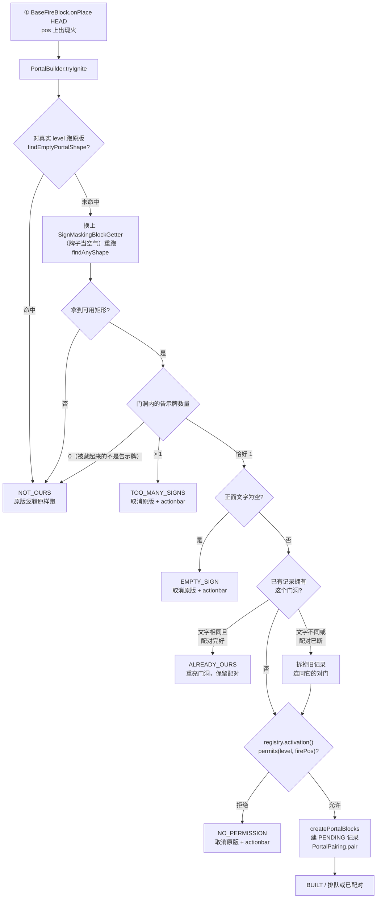

[English](../ARCHITECTURE.md) · **中文**

# 架构

PairedPortals 把原版的一条规则 ——「下界门永远通往下界」—— 换成另一条：**牌子写着同样文字的两扇门互为
目的地**。本文是这条替换的设计说明，写给**要去读代码的人**：这个 mod 是什么、它刻意不是什么、逐文件
清单、三个 mixin 注入点为什么恰好是这三个、点火流水线与它背后的数据模型、配对与拆门上成立的不变量、
「这一格门框归哪扇门」的几何裁决、一路到落点数学的穿越路径，以及与 Worlds 之间的反射桥。中文原文见
[README.zh-CN.md](../../README.zh-CN.md) 的 §1、§2、§4、§5、§5.1 与 §11，用的是同一套 §N 编号；英文
canonical 版见 [docs/ARCHITECTURE.md](../ARCHITECTURE.md)，两版结构逐节对应。

本文不是教程。怎么构建见 [BUILDING.md](BUILDING.md)，玩家看到什么见 [GAMEPLAY.md](GAMEPLAY.md)，
运维命令面见 [COMMANDS.md](COMMANDS.md)，每条结论背后的证据见 [TESTING.md](TESTING.md)。

## 1. 这个 mod 是什么，边界在哪里

一扇**自定义传送门** = 一个**传送门形状**的黑曜石框 + 门洞里**一块写着文字的告示牌**。点火后它不会
按原版意义生成下界门：门洞被填上**真正的原版 `minecraft:nether_portal`**，框还是**原版黑曜石**，这扇
门被记成*未绑定*。下一扇用**同样文字**点亮的门与它配对，此后走进任何一端都会被送到另一端 —— 无论两
端在哪个维度。

三条性质划定了整个设计的边界：

| 性质 | 仓库里的证据 |
|---|---|
| **服务端侧**。原版客户端直接连，什么都不用装，也不需要资源包；单人存档由游戏自带的集成服务端加载，跑的是同一套服务端逻辑。 | [`fabric.mod.json`](../../src/main/resources/fabric.mod.json) 是 `"environment": "*"`，只有一个 `main` 入口、**没有** `client` 入口；编译产物 jar 共 45 个条目、**不含任何客户端资源**——就是本 mod 自己的 class 文件加 `fabric.mod.json` 与 `pairedportals.mixins.json`，没有 `assets/`、`lang/`、`models/`、`textures/` 条目（`unzip -Z1 build/libs/pairedportals-1.0.0.jar | grep -v '\.class$'`；一条不分大小写的 `client|assets|lang|models|textures` 只会命中 `com/example/pairedportals/text/Lang.class`，那是我们自己的类文件，不是资源） |
| **零游戏注册项**。没有新方块、物品、实体、方块实体、POI 类型、菜单、封包、标签或数据组件。 | 全仓源码只有两个游戏回调：`ServerTickEvents.END_SERVER_TICK` 与 `CommandRegistrationCallback.EVENT`，都在 [`PairedPortals.java:56-63`](../../src/main/java/com/example/pairedportals/PairedPortals.java) —— 外加自己的命令树，而命令树不是注册项 |
| **无第三方依赖**。 | `fabric.mod.json` 的 `depends` 只有 `fabricloader`、`fabric-api`、`minecraft`、`java`；可选的 Worlds 桥（§11）走反射，只在 `suggests` 里提一句 |

前两条的后果就是这个 mod 之所以长这样的原因：服务端 mod 没法替客户端给方块起名字 —— 方块显示名由
客户端从自己的语言文件解析，自定义名称数据组件属于**物品**而不是世界里的**方块**，所以 F3 与任何
WAILA 式叠加层永远都会说 "Obsidian"。**actionbar 是「零资源服务端 mod」真正拥有的唯一客户端可见面**，
门的两句状态文案就放在那里（§7）。

同一条边界也决定了**措辞本身**怎么来的，这一点值得先写在前面，因为它看起来像是漏了什么。
不管元数据怎么写（1.0.0 起是 `"environment": "*"`，所以单人存档也会
加载本 mod），本 mod 都没有客户端半边 —— 只有一个 `main` 入口、`assets/` 下空无一物 ——
因此它永远不能带语言文件；而 `Component.translatable(...)`
会被当成一个没人能解析的 key 送到客户端，显示成原始的 `pairedportals.message.pending` 文本。**服务端必须
自己按玩家选措辞、发字面量** —— 这正是 §2 里 `text/` 包做的事：语言取自服务端唯一的每玩家信号，也就是
客户端加入时报的语言码（`ServerPlayer.clientInformation().language()`）。任何以 `zh` 开头的算中文，其余
（包括控制台发送者、命令方块，以及每一条日志）算英文。

第三条的后果是 jar 里**没有任何第三方代码**。Minecraft、Fabric Loader、Fabric API 都在构建时从本机
读取、从不随仓库分发（见 [BUILDING.md](BUILDING.md) §3）。

这个 mod 也从不新建维度，对「存在哪些维度」没有任何看法：一扇门的目的地，就是它对门记录里那个维度键
（§5、§11）。

## 2. 逐文件清单

全部 25 个 Java 文件，按包排列。职责一句已对着源码核对；README.zh-CN.md §1 覆盖到的文件沿用该表措辞
（`ActivationPolicy` 与 `IgnitionResult` 不在那张表里，按源码写；`text/` 三个文件比那张表新，单独见 §2.1）。

| 文件 | 职责 |
|---|---|
| [`PairedPortals.java`](../../src/main/java/com/example/pairedportals/PairedPortals.java) | 入口 `implements ModInitializer`：注册 tick 回调（每 10 tick 名字提示、每 40 tick 巡检）与命令树；持有 `MOD_ID`、`LOGGER`、`-Dpairedportals.debug` 开关与 `info`/`debug` 日志助手 |
| [`mixin/BaseFireBlockMixin.java`](../../src/main/java/com/example/pairedportals/mixin/BaseFireBlockMixin.java) | ① 点火分流：在 `BaseFireBlock.onPlace` HEAD 判断这次点火是否落在「有合格告示牌的门洞」里；是则取消原版、自己建门；两种拒绝结果给点火者一条 actionbar |
| [`mixin/NetherPortalBlockMixin.java`](../../src/main/java/com/example/pairedportals/mixin/NetherPortalBlockMixin.java) | ② 传送接管：在 `NetherPortalBlock.getPortalDestination` HEAD，实体踩进**我们的**门时返回自己的 `TeleportTransition` |
| [`mixin/PortalForcerMixin.java`](../../src/main/java/com/example/pairedportals/mixin/PortalForcerMixin.java) | ③ 原版隔离：在 `PortalForcer.findClosestPortalPosition` RETURN，原版搜索命中我们的门时报「没找到」 |
| [`mixin/PortalShapeAccessor.java`](../../src/main/java/com/example/pairedportals/mixin/PortalShapeAccessor.java) | `@Accessor` mixin 接口，读 `PortalShape` 的六个私有字段（`bottomLeft`、`rightDir`、`axis`、`width`、`height`、`numPortalBlocks`） |
| [`portal/CustomPortal.java`](../../src/main/java/com/example/pairedportals/portal/CustomPortal.java) | 一扇门的记录：id / 维度 / 门洞 AABB / 轴向 / 尺寸 / 牌子文字 / 点火序 / 创建时刻 / 状态 / 对门 id；与 12 个 NBT 键互相序列化 |
| [`portal/PortalState.java`](../../src/main/java/com/example/pairedportals/portal/PortalState.java) | `PENDING` / `BOUND`，以及把无法识别的名字一律降级为 `PENDING` 的 `byName` |
| [`portal/PortalLocation.java`](../../src/main/java/com/example/pairedportals/portal/PortalLocation.java) | `(维度, 方块坐标)` 作为每次查找的索引键 |
| [`portal/PortalRegistry.java`](../../src/main/java/com/example/pairedportals/portal/PortalRegistry.java) | `SavedData` 注册表：`byId` / `byHole` / `pendingByText` 三个派生索引、点火序分配、激活策略，以及 NBT 读写 |
| [`portal/PortalPairing.java`](../../src/main/java/com/example/pairedportals/portal/PortalPairing.java) | 配对：同文字取**最早**的 `PENDING`，两端一起转 `BOUND`；另有两个手工操作 `unpair` 与 `forcePair`（两者都把门留着） |
| [`portal/PortalBuilder.java`](../../src/main/java/com/example/pairedportals/portal/PortalBuilder.java) | 点火分流后的建门逻辑：认领 / 重建 / 排队配对，以及 `/pairedportals debug` 用的只读回放 `explain` |
| [`portal/PortalGeometry.java`](../../src/main/java/com/example/pairedportals/portal/PortalGeometry.java) | 经 `@Accessor` 从 `PortalShape` 取出门洞格与框内告示牌位置，并读出牌子正面文字 |
| [`portal/PortalValidator.java`](../../src/main/java/com/example/pairedportals/portal/PortalValidator.java) | 40 tick 巡检（`isFrameValid` / `sweep`）与拆门（`retire` / `demolish` / `extinguish`）：框不在了就把这扇门**和它的对门一起**拆掉 |
| [`portal/IgnitionResult.java`](../../src/main/java/com/example/pairedportals/portal/IgnitionResult.java) | 一次点火判定的六值结果枚举：`NOT_OURS` / `BUILT` / `EMPTY_SIGN` / `TOO_MANY_SIGNS` / `NO_PERMISSION` / `ALREADY_OURS` |
| [`portal/ActivationPolicy.java`](../../src/main/java/com/example/pairedportals/portal/ActivationPolicy.java) | `all` / `op` / `none` 激活闸门，以及它的「取最近玩家」权限判定（8 格半径） |
| [`proxy/SignMaskingBlockGetter.java`](../../src/main/java/com/example/pairedportals/proxy/SignMaskingBlockGetter.java) | 一个把门洞里的告示牌当空气读的 `BlockGetter`，让原版的形状识别「看不见」它；并记下自己遮蔽过哪些位置 |
| [`compat/WorldsCompat.java`](../../src/main/java/com/example/pairedportals/compat/WorldsCompat.java) | 反射软桥（没有编译依赖）：一个维度是**已加载 / 已注册但没加载 / 不存在**，以及一个 Worlds 世界此刻能不能收传送。没装 Worlds 时全部退化为默认值（§11） |
| [`visual/FrameCells.java`](../../src/main/java/com/example/pairedportals/visual/FrameCells.java) | 门框环 / 门洞格的纯几何，加上「这一格归哪扇门」的裁决（`portalAt` / `portalOwning` / `distanceToHoleSq`）。不含任何实体、显示或渲染代码 |
| [`visual/FrameNameHint.java`](../../src/main/java/com/example/pairedportals/visual/FrameNameHint.java) | 准星指向门框或门洞里的传送门方块时的 actionbar 提示 —— 本 mod 唯一的客户端可见面，也是点火拒绝用的 `warn` 通道 |
| [`teleport/CustomPortalTravel.java`](../../src/main/java/com/example/pairedportals/teleport/CustomPortalTravel.java) | 决定一次穿越怎么走：解析本门、解析对门、处理三种「对面不在」、算出落点与相对朝向、构造 `TeleportTransition` |
| [`teleport/TravelDecision.java`](../../src/main/java/com/example/pairedportals/teleport/TravelDecision.java) | `(handled, transition)`：区分「别动原版」（`NOT_OURS`）、「吞掉这次尝试」（`NOTHING`）与「传送到对门」（`goTo`） |
| [`command/CustomPortalCommand.java`](../../src/main/java/com/example/pairedportals/command/CustomPortalCommand.java) | `/pairedportals` 命令树：`help` \| `list` \| `info` \| `delete` \| `purge` \| `tp` \| `unbind` \| `pair` \| `permission` \| `debug` |
| [`text/Lang.java`](../../src/main/java/com/example/pairedportals/text/Lang.java) | 两种语言（`EN`、`ZH`）与答案的唯一来源：`Lang.of(player)` 读客户端自报的语言，`of(source)` 对任何非玩家的发送者（控制台、命令方块、`/execute`）退回 `EN`，于是那些被钉死在英文 |
| [`text/Text.java`](../../src/main/java/com/example/pairedportals/text/Text.java) | 一条消息同时携带两列（`en`、`zh`），配 `resolve(lang)` / `format(lang, args)`；作为格式参数的 `Text` 先按同一语言解析，于是消息可以由其它消息拼成 |
| [`text/Messages.java`](../../src/main/java/com/example/pairedportals/text/Messages.java) | 本 mod 全部玩家可见文案，以 `Text` 常量与工厂形式给出（`signBlank`、`noPermission`、`hintWaiting`、`hintBound` 等） |

另外两个资源文件补完这个 mod，且都不是游戏注册项：[`fabric.mod.json`](../../src/main/resources/fabric.mod.json)
是 §1 引用的元数据，[`pairedportals.mixins.json`](../../src/main/resources/pairedportals.mixins.json) 声明
§3 的四个 mixin 类。mixin 配置是 `"required": true` 且 `"injectors": { "defaultRequire": 1 }` ——
将来某个 Minecraft 版本挪走了三个注入点中的任何一个，这个 mod 会**大声加载失败**，而不是默默什么都不做。

### 2.1 `text/` 包：没有语言文件时的玩家可见措辞

`text/` 这三个文件就是本 mod 对「没有客户端半边的 mod 不能带翻译」的完整回答；它的形状值得单独写一段，因为它摆
在 §2 的表旁边看起来像是漏了什么。

- **两列装在同一个对象里。** [`Text`](../../src/main/java/com/example/pairedportals/text/Text.java)
  是一个 `(en, zh)` 记录。换成「一个 key + 两张 map」在这里买不到任何东西：这个 mod 没有构建步骤能抓住
  漏译（没有 Gradle、没有资源管线），唯一能抓住的，是读者在 `Messages` 里看到两行并排，以及编译器发现
  一个工厂必须产出两列。
- **解析只在边缘发生一次。** `Lang.of(收件人)` 只在知道收件人的地方调用 —— actionbar 在
  [`FrameNameHint`](../../src/main/java/com/example/pairedportals/visual/FrameNameHint.java)，命令输出在
  `CustomPortalCommand`。再往下没有任何东西知道语言存在。作为格式参数使用的 `Text` 会先按同一语言解析，
  于是 `list` 表头的激活策略名跟随**读者**而不是调用者。
- **分流刻意粗糙。** 任何以 `zh` 开头的（含 `zh_`、`zh-`）算中文，其余算英文。这个 mod 就是用两种语言
  写的；再发明第三种答案 —— 「部分翻译」或「未命中的 key」状态 —— 只会意味着要发一些没人写过的字符串。
- **控制台输出钉死英文。** 控制台发送者、命令方块与 `execute as` 没有客户端语言，所以拿英文；每一条日志
  也一样，显式按 `Lang.EN` 解析。这也正是 smoke 脚本还能诚实的原因：它们的断言读的是英文输出，不管当时
  在线的还有谁。

## 3. 三个注入点

三个 `@Inject`、一个 `@Accessor`，除此之外不改游戏任何一处。

| # | 位置 | 干什么 | 为什么不能换地方 |
|---|---|---|---|
| ① | `BaseFireBlock.onPlace` **HEAD** | 判断这次点火是否落在「有合格告示牌的门洞」里；是则取消原版、自己建门 | 与玩家的打火石、`setblock fire`、发射器同一条路径；同 tick 完成，早于其他 mod 的延迟事件 |
| ② | `NetherPortalBlock.getPortalDestination` **HEAD** | 实体踩进**我们的**门时，改由我们给出目的地 | 原版用它决定落点；在这里返回自己的 `TeleportTransition` 即可复用原版的整套穿越流程 —— 音效、返程记录、冷却 |
| ③ | `PortalForcer.findClosestPortalPosition` **RETURN** | 原版找落脚点时若命中我们的门，就报「没找到」 | 我们的门面是真的 `nether_portal`，必然注册成 `NETHER_PORTAL` POI；**每次原版穿越**都会扫到我们（主世界→下界半径 16、下界→主世界半径 128）。全 jar 只有 `NetherPortalBlock` 调这个方法 ⇒ 一个钩子即可关掉全部抢门，且顺带兼容 NetherPortalFix |

**③ 不是死代码。** ② 只在「实体进入**我们的**门」时提前返回；实体进入**原版**门时，原版的搜索照样会跑到，
③ 拦的就是这一路。证据在 [TESTING.md](TESTING.md)：`smoke-isolation.sh` 断言我们旁边那扇原版门两个方向都
照常工作，而它的过滤日志证明原版搜索**真的扫到了我们**并被压掉
（`vanilla's portal search found our door at 1, 100, 0 (minecraft:the_nether); reporting none`）。

① 为什么坐在 `BaseFireBlock` 而不是原版那条 portal 分支上：`FireBlock` 覆写了 `onPlace` 但先调 `super`，
所以钩基类同时覆盖普通火与灵魂火 —— 后者根本不覆写 `onPlace`。而 `FireBlock.onPlace` 里原版那条分支被
`inPortalDimension(level)` 限制在主世界与下界；坐在整个方法前面，才让末地与 mod 维度也能点火。

### 3.1 为什么滤波器放在消费者，而不是 POI store

③ 有一个诱人的替代做法：干脆别让我们的门方块进兴趣点存储。它过不了重载这一关：
`PoiSection.refresh` 会清空该区再从方块重新派生每条记录，而我们的方块**真的是**传送门方块。所以滤波器
放在记录被消费的地方。返回 `Optional.empty()` 而不是「下一个最近的」是刻意的：`empty` 正是原版「附近
没有门」时看到的东西，会把原版送进它自己的 `createPortal` 路径 —— 也就是本 mod 从未安装时会走的那条
分支；同时不干扰调用方依赖的区块加载副作用。

### 3.2 为什么 `@Accessor` 也算第五个 mixin

`PortalShape` 全字段 private、单个 private 构造器、无 accessor，所以 `findAnyShape` 返回的 shape 否则
是不透明的。读字段胜过手工重推门洞矩形，因为原版 walker 已经判定接受了**哪个**矩形 —— 我们要的是**那个**
矩形，而不是第二种意见。六个 accessor 就是全部接口
（[`PortalShapeAccessor.java`](../../src/main/java/com/example/pairedportals/mixin/PortalShapeAccessor.java)）。

## 4. 点火流水线

一次点火到达我们这里时的形态是「`level` 里的 `pos` 被放了一个火方块」。



`tryIgnite` 只是一层包装：它转调 `classify`，并在调试开关下记一行结果日志。全部逻辑都在 `classify` 里，
而它的步骤顺序是有理由的。

**第 1 步 —— 先问原版。** `PortalShape.findEmptyPortalShape(level, firePos, Direction.Axis.X)` 对
**真实** level 跑一遍。若原版会在这里点出一扇门，说明这个框门洞里没有牌子，这次点火不是我们的；方法返回
`NOT_OURS`，一个字节的世界都不碰。这是整个特性「只做加法」的地方（§11）。

**第 2 步 —— 问我们真正关心的那个问题。** 第二遍把 `SignMaskingBlockGetter` 塞给 walker 代替 level，于是
牌子读作空气（§8）。`findUsableShape` 先试轴 X 再试轴 Z，要求形状合法**且**已有门方块数为 0 —— 这两条
`findAnyShape` 不做而 `findEmptyPortalShape` 在其内部做了，所以这一遍镜像了原版自己对「这个框是空的、
可以被点亮」的判据。

这也就解释了为什么下面三种情况与原版点亮同一个框互斥：原版的 `isEmpty` 只接受空气、火与已有门方块，
所以**装着牌子的框永远不可能被原版点亮**，没有竞态需要仲裁。

**第 3 步 —— 找牌子，并在建门之前读它。** `signsIn` 扫描门洞格找 `BlockTags.ALL_SIGNS`。两块以上是
`TOO_MANY_SIGNS`。一块都没有，说明这个矩形扫得干净只是因为我们藏了东西、而那样东西不在门洞里 —— 不是
我们的框，交还原版。恰好一块时，文字**立刻**被读出，早于任何建造动作：`createPortalBlocks` 会替换每个
门洞格，连同装着文字的 `SignBlockEntity` 一起。读出来是空的即 `EMPTY_SIGN`。

**第 4 步 —— 认领、重建或拆掉。** `owningPortal` 遍历新形状的门洞格，用注册表的 `byHole` 索引问「这些格
里有没有已经属于我们的」。若已有记录拥有这个门洞：

- 把记录里存的文字与牌子的当前文字比对，**并**检查存下来的链接是否完好 —— 一条声称 `BOUND` 的记录，只有
  在对门仍存在、仍是 `BOUND`、且指回自己时才算真的绑定；
- 文字相同且配对完好 ⇒ `shape.createPortalBlocks(level)` 并返回 `ALREADY_OURS`。这就是「亮着的门框被砸了
  又补回来」那种情况：按记录把门洞重新点亮、保留既有配对，而不是给同一个门洞再铸一条记录；
- 文字不同，或配对已断 ⇒ `PortalValidator.demolish(...)`：丢旧记录、清它的门洞，**并在同一次调用里把
  对面那端也带下去**。存下来的记录已经不再描述这个框，而把它的对门继续点亮着，只会留下一扇什么都送不
  过去的门。新的点火序也把这扇重建的门放回 FIFO 队尾。

**第 5 步 —— 权限闸门。** 到这时才问 `registry.activation().permits(level, firePos)`：在重亮分支之后、
任何写入之前。重亮一扇已经是我们的门不算激活 —— 门洞是按记录原样重建的；而后面的一切都在造新门（新门，
或「旧记录已经对不上这个框」的替代品），那才是策略管的事。把检查放到上面那次 `demolish` 之前也同样重要，
只是方向相反：**拒绝绝不能带走一对门。** 策略本身见 §5.3。

**第 6 步 —— 建门并配对。** `createPortalBlocks` 填满门洞，`CustomPortal.create` 铸出一条 `PENDING`
记录并带上注册表给的 `sequence`（是计数器不是时钟 —— 同一毫秒点亮的门会打平，队列就不再是队列），记录
入索引，`PortalPairing.pair` 要么找到正在等的对门，要么把这扇门排进队列。

钩子随后把结果翻译成钩子行为：`NOT_OURS` 什么都不做；`BUILT`、`EMPTY_SIGN`、`TOO_MANY_SIGNS`、
`NO_PERMISSION` 都调 `ci.cancel()`；`ALREADY_OURS` 静默 cancel。两个拒绝结果也 cancel，这不是面子问题：
不 cancel 就会落到 `state.canSurvive(level, pos)`，那里可能把火熄灭，打火石看起来就像坏了。现在是火正常
烧着，点火的人拿到一句 actionbar。

## 5. 数据模型

### 5.1 一个门洞一条记录

一个门洞 = 一条记录，且一个门洞不可能有两份记录：建门逻辑在造任何东西之前先按格查询拥有者（上面的
`owningPortal`）。记录生为 `PENDING`，恰好一次变成 `BOUND`，此后只会被销毁 —— 而销毁会同一口气销毁
对面那端。

一扇门的身份 —— 门洞位置与牌子文字 —— 在点火时固定、之后不再变。配对链接是唯一可变的部分。这里刻意
**没有「目的地方块坐标」字段**：对门通过对门**自己的 id**（`twinId`）经注册表既有的 `byId` 索引解析。
单独一个 pair token 需要自己的索引，而那个索引维护一失手，就和「对面没了」无法区分。

### 5.2 `CustomPortal`

| 字段 | 含义 |
|---|---|
| `id` | `UUID`，点火时由 `UUID.randomUUID()` 铸出 |
| `dimension` | `ResourceKey<Level>` —— 这一端所在的维度 |
| `holeMin`、`holeMax` | 门洞 AABB 的两个角（闭区间） |
| `axis` | 门所在平面的 `Direction.Axis` |
| `width`、`height` | 门洞尺寸（格） |
| `signText` | 配对键，按 §8 的读法原样保存 |
| `sequence` | 点火时注册表计数器的值，FIFO 顺序 |
| `createdAt` | 墙钟时间戳，给运维看 |
| `state` | `PortalState` |
| `twinId` | 对门的 `id`，未绑定时为 `null` |

`holeMin` 是原版的 `PortalShape.bottomLeft`，这件事有一个后果，读传送代码之前必须知道：当 `rightDir` 是
WEST 或 SOUTH 时，`bottomLeft` 坐在一条水平轴的**高端**。所以 `holeCorner()` 会重算真正的最小角 ——
原版自己的落点数学正是从那里起算的。

加载是失败软化的：`id` 或 `dimension` 解析失败的记录会让 `CustomPortal.load` 返回 **null** 而不是抛异常，
于是一条损坏记录被丢弃，而不是带走整个世界的注册表（§6）。声称 `BOUND` 却没有 `twinId` 的记录降级为
`PENDING`。

### 5.3 `PortalState` —— 只有两个状态，不是三个

`PENDING` 与 `BOUND`。这就是全部状态机。

没有 `ORPHAN`。因为拆门是两端一起下（§6），亮着的门就是能走的门，走不通的门就不亮着。这不是对旧设计的
简化，而是对它的替换：更早的一版为「配对断了以后剩下的那半扇」留过一个 `ORPHAN` 态，它连同
`discard`/`orphan` 那一套机制一起被删掉了。`PortalState.byName` 仍然把无法识别的名字 —— 包括旧存档里可能
写过的 `ORPHAN` —— 降级为 `PENDING`，而这是惰性态：它不通、不会自己配对、同框重新点火会接管它。给一个
不认识的值声称 `BOUND`，等于承诺一次通往叫不出名字的对门的旅行。

`PortalLocation` 是索引键：一个 `(ResourceKey<Level>, BlockPos)` 对。每次查找都必须经过它，因为同一个
`BlockPos` 在两个维度是两个不同的地方。

### 5.4 `PortalRegistry`

注册表是存放在**服务器**上的 `SavedData`，走 `MinecraftServer.getDataStorage()`。这不是细节：
`MinecraftServer` 在 `<world>/data` 上建单个 `SavedDataStorage`，而 `ServerLevel.getDataStorage()` 落到
**每维度一份**的文件夹。门天生跨维度，每维度一份注册表会让主世界门与下界门互相不可见，配对永远无法完成。
磁盘身份是 `<world>/data/pairedportals/portals.dat`。

三个索引紧挨着权威 map。三者都是派生的，三者都在加载注册表时重建：

| 索引 | 类型 | 回答什么 |
|---|---|---|
| `byId` | `Map<UUID, CustomPortal>`（`LinkedHashMap`） | 一切按身份的查找，包括解析对门 |
| `byHole` | `Map<PortalLocation, UUID>` | 「这次点火是否落在我们已拥有的门里」，每格 O(1) |
| `pendingByText` | `Map<String, List<UUID>>` | 「还有谁在等这个文字」，O(1) 加一次对几乎每个文字都为空的列表扫描 |

`byHole` 只索引**门洞格**；门框格是几何而不是索引项 —— 这正是 §7 存在的原因。

注册表还持有 `nextSequence` 与激活策略。三个顶层 NBT 键承载它 —— `portals`、`next_sequence`、
`activation` —— 每条记录贡献 §5.2 的 12 个键：
`id/dimension/hole_min/hole_max/axis/width/height/text/sequence/created_at/state/twin`（`twin` 仅
在确有时才写）。

加载路径里有两个细节是承重的。`CustomPortal.load` 对不可读记录返回 `null` 时，丢弃计数加一，并记
`[pairedportals] dropped {} unreadable portal record(s) from the registry` —— 损伤被报告且被限界，
而不是致命。`nextSequence` 会被抬到至少是文件里见过的最大 `sequence`，这样一次重载不会发出已经用过的
号、把 FIFO 弄坏。

`oldestPending` 是在候选里扫出最小的 `sequence`，而不是相信列表顺序，所以重启之后不需要维持任何顺序
不变量。

### 5.5 两个状态、一条链接、一条排队规则

- 文字相同 ⇒ 配对：在同文字的那些门里取**最早**的那扇 `PENDING`。这是 FIFO，而且它是一条**规则**而不是
  神谕：三门同文字或牌子打错字时，配对会按队列顺序而不是建造者的本意发生。`/pairedportals pair` 存在的
  意义就是手工纠正，它刻意不校验文字，因为重点正是修正文字搞错的东西。
- 配对成功时两端一起转 `BOUND`，并各自记下对方的 id。配对是单向、对称、一次完成的；只有 `PENDING` 门
  会被考虑。
- `PortalPairing.unpair` 与 `forcePair` 是链接的注册表侧一半，可以在**两扇门都留着**的前提下拆开或接上
  链接 —— 与 `PortalValidator.demolish` 恰好相反。

## 6. 不变量：配对与拆门

**拆掉一端 ⇒ 整对一起消失。** `PortalValidator.demolish(server, registry, dead)` 解析对门、清掉死者
自己的门方块与记录，然后对**对门**做同样的事，日志
`[pairedportals] portal at {} ({}) went down with its twin at {} ({})`。

为什么两端一起下：只剩一端的门是一个谎言。对面还会是一扇亮着却什么都送不过去的门；更糟的是 —— 记录被丢
而方块还亮着之后，这扇门就不再属于我们，下一个踏进去的实体会落到原版手里，被从「一面黑曜石墙上一个洞」
里送去做普通下界旅行。两端都清掉，只剩两个普通框。`demolish` 可以安全地调用两次，也可以在遍历 `all()`
的过程中调用（删除就是 map delete）。

**框的判据与原版一致，且比「整个环」更窄。** `isFrameValid` 只要求两件事：

1. 门洞每一格仍然是 `minecraft:nether_portal` —— 等价于原版自己的 `PortalShape.isComplete`（合法尺寸
   且每一格都亮着）；
2. 与门洞面贴面的每一格（`FrameCells.sideCells`）仍然是 `BlockTags.NETHER_PORTAL_FRAME`。那是
   `2 * (width + height)` 格：底边、顶边与左右两列。

环的四个斜角**不在**要求之内。原版 `PortalShape` 从底边往外走、沿两条侧列向上、最后读顶边，**斜角那一格
它从来不读**；所以挖掉一个斜角，留下的是一扇完全可用的亮门 —— 在这里要求整个环，会退役游戏自己乐意保留
的门。含斜角的 `FrameCells.ringCells` 只保留给 §8 的准星归属裁决用。

**拆门清的是门洞，不是环。** `extinguish` 把门洞里当前仍是 `nether_portal` 的每一格置为空气，这就是
共用柱永远不会被邻居的拆门牵连的原因（§7）。它也是巡检「从不加载任何东西」那条规则唯一被刻意搁置的地方：
目标区块没加载时，会加一张 `PortalForcer.TICKET_RADIUS` 半径的 `TicketType.PORTAL` 票并同步加载该区块，
因为方块确实必须被清掉。票会自己过期，区块之后回到未加载。

**巡检只判它信得过的世界。** `sweep(server)` 每 40 tick 跑一次，跳过所有 `WorldsCompat.isLive` 为假的
level（正在抽干或已关闭的世界 —— 读方块不值得问），跳过其它维度或区块未加载的记录，其余走
`retire` → `demolish` 退场。日志行会把跳过数量附成 `(skipped N world(s) that are shutting down)`。

## 7. 几何与归属：`FrameCells`

`FrameCells` 是纯粹对 `CustomPortal` 记录做算术。除了两个归属助手，它不读任何世界状态；它也不含任何实体、
显示或渲染代码 —— 更早的一版会往门框上画 block display 来区分两种状态，那一整套子系统已被删除。

| 成员 | 算什么 |
|---|---|
| `ringCells(portal)` | 门洞周围环上的每一格，**含四个斜角** |
| `sideCells(portal)` | 与门洞面贴面的格子：底边、顶边、左右两列 |
| `portalOwning(level, cell)` | 哪条记录的环包含这一格（按洞心最近） |
| `distanceToHoleSq(portal, cell)` | 格子中心到洞心的平方距离 |
| `portalAt(level, pos)` | 唯一入口：这一格属于哪扇门？ |

两个格子集合都只从记录本身推导，所以框被挖光了也仍然能报出它的格子。环在门所在的平面里算：轴向决定哪个
水平坐标是「沿门洞」的那一维、哪个是平面的固定值。

**共用柱。** 相隔三格的两个框共用中间那根黑曜石柱，所以两个环会重叠。重叠格归**洞心更近**的那扇门
（`distanceToHoleSq`）。若两个环等距 —— 两个等宽洞争同一根柱 —— tie-break 取**洞角坐标较小**者，按 x、再
y、再 z 逐级比较。这条规则只依赖记录已持有的几何，而两条记录在它下面永远不可能平手，于是顺序是全序。

为什么必须有这条确定性规则：`PortalRegistry.all()` 返回的是一个 map 的值，没有这条规则，归属会在不同运行
间变化，共用柱上的提示会在「已绑定 / 未绑定」之间翻。`portalOwning` 还先按维度过滤 —— 从本 level 的坐标
到不了另一维度的门，而一对门两端的 x/y/z 经常完全相同，漏掉这条会让下界端认领主世界端的框格。

**`portalAt` 为什么回退到几何。** 它用一个入口回答两个不同的问题：门洞里亮着的方块由注册表直接索引
（`at(PortalLocation)`），而框上的方块是几何、要遍历记录里的环。玩家的准星落在哪一个都可能，两者必须报
同一扇门。所以：先查注册表；未命中，且**只有当**该方块是 `BlockTags.NETHER_PORTAL_FRAME` 时，回退
`portalOwning`。没有这条回退，瞄准黑曜石门框 —— 玩家最自然的动作 —— 会什么都不报。

这也是 `FrameNameHint`（actionbar，§2）经 `portalAt` 而不是直接查注册表的原因：注册表只索引门洞格。

## 8. `SignMaskingBlockGetter` —— 让原版看不见那块牌子

原版的形状 walker 只接受 `isEmpty(state)` 的门洞格，而告示牌不是空的。两个替代做法都更差：改世界会毁掉
`SignBlockEntity` 及其 NBT，重写 walker 则会随时间漂移。

于是改为递给 walker 一个过滤过的 `BlockGetter`，让原代码原样跑。
`SignMaskingBlockGetter.getBlockState` 把 delegate 的答案原样透传，**唯一例外**是任何匹配
`BlockTags.ALL_SIGNS` 的状态一律答作 `Blocks.AIR.defaultBlockState()`，并把这个位置记下来。
`getBlockEntity`、`getFluidState`、`getHeight`、`getMinY` 都是直通 delegate。

两个设计点：

- **为什么是 `BlockGetter` 而不是 `LevelAccessor`。** walker 一共只需要五个方法：`BlockGetter` 的三个加
  `LevelHeightAccessor` 的两个。代理 `LevelAccessor` 的约 40 个方法会更多代码、也更不清楚。
- **为什么记下被遮蔽的位置。** `masked()` 让调用方能区分「门洞扫得干净只是因为我们藏了东西」和「门洞真的
  是空的」。`PortalBuilder` 在第 3 步用的正是这条区别：矩形干净但里面**没有**牌子 ⇒ 不是我们的框，交还
  原版。

## 9. 穿越路径

站在传送门方块里的实体会调 `getPortalDestination`，也就是钩 ②。

**第 1 步 —— 这到底是不是我们的门？** `CustomPortalTravel.decide` 拿方块坐标去注册表里查。未命中返回
`TravelDecision.NOT_OURS`，钩子完全不碰原版的返回值。这条区分就是 `TravelDecision` 存在的全部理由：单纯
返回 `null` 表达不了它 —— 三种结果里有两种都以「没有 transition」收场，而 `NOT_OURS` 的意思是*别碰这个*，
在那里返回 `null` 会取消玩家真正走进去的那扇普通下界门。

**第 2 步 —— 解析对门。** 若这扇门不是 `BOUND`、或没有 `twinId`，这次尝试被 `NOTHING` 吞掉，玩家按
自己的语言拿到 `Messages.hintWaiting(signText)`（「这扇门还没有配对：在别处再点亮一扇写着「…」的门」）。
若对门的记录缺失、指向自己、或不是 `BOUND`，就把这扇门拆掉（两端，§6），玩家拿到
`Messages.hintTwinGone()`（「对面的门已经不在了」）。然后开始解析对面。

**第 3 步 —— 三种「对面不在」。** 这是 §11 的主题：

| 情况 | 判据 | 行为 |
|---|---|---|
| 世界没加载，但已注册 | `server.getLevel(...)` 返回非 null（Worlds 已按需建好） | 正常传送；`/pairedportals tp` 会补一句 `(this loaded that world)` |
| 世界已被删除 / id 根本不存在 | `getLevel` 返回 null **且** `WorldsData.getLevelData(id)` 也是 null（`WorldState.UNKNOWN`） | **不拆门**：门保持亮着、配对保留，这次旅行被吞掉（游戏内零反馈）；服务端日志按「原因变化才写一行」记 `no level for <id> (no such world)` |
| 世界正在关闭 / 已停 | `WorldsCompat.canReceiveTraveller` 为 false | **等**：这一 tick 不传送，下一 tick 再看 |

中间那种情况选择不拆门是刻意的：原版里维度不可能消失，所以「目的地维度不存在」过去等价于「记录坏了」。
多世界服务端里，一个世界不在的理由太多了 —— 还没加载、正在卸载、存档没搬完、这次没装那个 mod —— 把玩家
两边修好的门一起拆掉是错得最贵的一种反应。真正「世界在说门不在了」的两种情形 —— **对门记录缺失**、
**对面框已被挖** —— 仍然照旧拆，见上。

**第 4 步 —— 区块票，但只在需要时加。** 落点搜索要读方块，所以目的地区块必须先存在。
`PortalForcer.TICKET_RADIUS` 半径的 `TicketType.PORTAL` 票**只在** `!destination.hasChunkAt(twin.holeMin())`
时才加，随后同步 `getChunk`。已加载的区块由站在里面的人持有，之后原版传送自己的 `PLACE_PORTAL_TICKET`
接手。这个顺序 —— 先检查、只在未命中时加票 —— 是一次审计发现（无条件加票会在服务端线程上卡 tick，且落地
被拒时白留一张票）的修复。

**第 5 步 —— 对面的框还在吗？** `isFrameValid(destination, twin)`（§6）对对面跑一遍。不过就把整对拆掉，
并吞掉这次尝试。

**第 6 步 —— 落点。** `landingSpot` 复刻原版 `createDimensionTransition` 的数学：

```java
BlockUtil.FoundRectangle from = new BlockUtil.FoundRectangle(entry.holeCorner(), entry.width(), entry.height());
Vec3 relative = entity.getRelativePortalPosition(entry.axis(), from);
boolean exitAlongX = exit.axis() == Direction.Axis.X;
double lateral  = dimensions.width() / 2.0 + (exit.width() - dimensions.width()) * relative.x();
double vertical = (exit.height() - dimensions.height()) * relative.y();
double through  = 0.5 + relative.z();
BlockPos corner = exit.holeCorner();
Vec3 target = new Vec3(corner.getX() + (exitAlongX ? lateral : through),
                       corner.getY() + vertical,
                       corner.getZ() + (exitAlongX ? through : lateral));
return PortalShape.findCollisionFreePosition(target, destination, entity, dimensions);
```

你在**入口门**里的相对站位，按「扣除你自己包围盒之后剩下的余量」的横向与纵向比例映射到**出口门**；深度
则作为相对入口门平面中心的偏移照搬 —— 所以从入口门中心走进去的人，从出口门方块的中心出来。原版自己的
`findCollisionFreePosition` 随后把盒子挪到不会窒息的位置。

两个矩形都是从 `CustomPortal.holeCorner()` 建的，而**不是**记录的 `holeMin`：那个字段是原版的
`bottomLeft`，可能坐在某条水平轴的远端，会把横向读数翻过来。那次翻转是第一版一个 bug 的根因 —— 3 宽门的
三格全部落在同一处。改用 `holeCorner()` 之后，门在不同尺寸间就是可互换的：贴着宽门一根柱走进去，就从窄门
对应的那根柱出来；3 宽源映射到 2 宽对门，会把旅行者铺开在它两个格里，而不是叠在一个格上。

**第 7 步 —— 朝向。** `here.axis() == twin.axis() ? 0.0F : 90.0F`，并与
`Relative.union(Relative.DELTA, Relative.ROTATION)` 一起交出去。这是原版的规则，读自它的字节码：比较入口
门的轴与目标门的水平轴，不同就转 90°，并把结果当作**相对**旋转、锚在实体当前朝向上。不带 `Relative` 标记
的绝对偏航，会让玩家在两扇门不同轴时穿过门后**面朝门框** —— 那是真人报过的一个真 bug，2026-10-07 修掉。
`Vec3.ZERO` 作为移动增量。

transition 本身就是原版的那句：

```java
new TeleportTransition(destination, landing, Vec3.ZERO, yaw, 0.0F,
        Relative.union(Relative.DELTA, Relative.ROTATION),
        TeleportTransition.PLAY_PORTAL_SOUND.then(TeleportTransition.PLACE_PORTAL_TICKET));
```

因为我们只替换了*落点查询*，穿越的其余部分全部保持原版：资格判定（`Entity.canUsePortal`）、
`PortalProcessor` 的记账、冷却、音效与紫屏，以及真正的移动 —— 包括 `Entity.teleportCrossDimension` 第一条
指令就是传送乘客这件事。原版能送的我们都能送，原版拒绝的我们也拒绝。

**第 8 步 —— 冷却，以及为什么落在门洞里不会弹回来。** 原版在传送**之前**写 `setPortalCooldown()`，长度取自
`getDimensionChangingDelay()`：非玩家 300 tick，载着 `ServerPlayer` 的载具 10 tick。于是旅行者抵达时落在
对门门洞里，正好带着 portal cooldown，而 `Entity.setAsInsidePortal` 对**处于冷却中的实体**是「每 tick 重新
把冷却回满」而不是新建 `PortalProcessor`。结果就是站在抵达门洞里什么都不会发生。要回去必须走出去、让冷却
真正走完、再走进一扇门。两扇门挨得越近，回程要等的越久，但永远不会进死循环 —— 真人客户端实测确认。

**被拦的尝试零反馈。** `notice` 只把原因写服务端日志，且每扇门每种不同原因只写一行（`REFUSAL_REASONS`
先把新原因与存下的比对）。没有 actionbar、没有声音、没有粒子。这是刻意的、也是规格要求的：走进未配对的
门什么都不发生，正是设计意图。站在死门里的实体每 tick 都会问一次，逐 tick 打日志会淹掉一切，一句不打又会
把「这扇门永远不会通」藏起来。

## 10. 设计里没有维度特判

代码里没有任何 `if (dimension == NETHER)`，正是这一点让同维度配对与自定义维度配对走同一条代码路径，而不是
靠特例。

- 一扇门的目的地由它对门**自己的** `dimension` 键解析，所以两端可以在同一个维度、在两个原版维度、也可以
  在多世界服务端的两个世界里。
- 落点数学从不看维度。
- 注册表里完全可以躺着一对「两端所在维度目前还不存在」的门。

同维度穿越能跑通还有第二个原因值得记下：26.3 的 `Entity.teleportToPortalDestination` 先比两个维度键，
相等就直接交给 `Entity.teleportSameDimension`，所以我们那个带着对门自己 `ServerLevel` 的
`TeleportTransition` 就是全部所需。

## 11. `WorldsCompat` —— 反射桥

[`compat/WorldsCompat.java`](../../src/main/java/com/example/pairedportals/compat/WorldsCompat.java) 是
唯一碰 **Worlds: Multiverse for Fabric**（`mc-worlds`）的类，而且全部走 `Class.forName` 与带缓存的
`Method` 查找。这个 mod 在编译期从不引用任何 Worlds 类型，Worlds 不在时也从不加载任何 Worlds 类。

**反射目标。** 两个类、九个成员：

| 类 | 成员 |
|---|---|
| `dev.wroud.mc.worlds.McWorldMod` | `getMcWorld(MinecraftServer)` |
| `dev.wroud.mc.worlds.McWorld` | `getManager()` |
| `dev.wroud.mc.worlds.WorldsManager` | `getWorldsData()` |
| `dev.wroud.mc.worlds.WorldsData` | `getLevelData(Identifier)` |
| `dev.wroud.mc.worlds.server.level.CustomServerLevel` | `canTeleport()`、`isStopping()`、`isStopped()`、`isClosed()`、`isActive()` |

注意只有前两行加 level 谓词算公开面；`getManager`、`getWorldsData`、`getLevelData` 是用
`getClass().getName()` 查的，而不是类字面量 —— 这样查找就不会硬编码一个本 mod 从未见过的类。

**没装 Worlds 时的失败软化默认值。** 每个答案都退化成「只有原版维度」的世界观：

| 成员 | 没有 Worlds 时 |
|---|---|
| `available()` | `false` |
| `isWorldsLevel(level)` | 恒 `false` |
| `canReceiveTraveller(level)` | 恒 `true` |
| `isLive(level)` | 恒 `true` |
| `stateName(level)` | `null` |

所以在没装 Worlds 的服务端上，未加载的维度一律判 `no such world` —— 与引入 Worlds 支持之前的语义完全
一致。某个成员查不到就记一行 `[pairedportals] Worlds member <类>.<成员> is not available` 并退回同一个
默认值：Worlds 内部改名只会退化，不会崩。

**`WorldState` —— 一个枚举，三种答案，不带文案。** `LOADED` / `UNLOADED` / `UNKNOWN`。枚举**自身不带
任何标签** —— 全部措辞都在 `Messages` 里（§2.1），于是每种答案的两种语言只有一个地方写下来，而读的人用哪
种语言是在**边缘**选的，不在这里：

| 值 | 文案来自 | 中文 | 英文 |
|---|---|---|---|
| `LOADED` | `Messages.worldState(LOADED)` | `已加载` | `loaded` |
| `UNLOADED` | `Messages.worldState(UNLOADED)` | `未加载（用的时候会自动加载）` | `registered, not loaded` |
| `UNKNOWN` | `Messages.worldState(UNKNOWN)` | `世界不存在` | `no such world` |

传送路径里那句拒绝原因，是唯一一处刻意要固定的一列而不是读者语言的：它是一条**服务端日志**，所以显式解析
`.en()`，理由与 `FrameNameHint` 把拒绝写进日志时用英文一样（§2.1）。

`state(server, dimension)` 刻意无副作用 —— 它先遍历已加载的 level，再问 Worlds 有没有把这个维度写在册
上，全程不加载任何东西。问它的是 `info`、`list`、准星提示与传送日志；为了描述一扇门而把一个世界加载起来，
会让「描述一扇门」变成运维能做的最贵的事。传送路径里那句 `MinecraftServer.getLevel` 恰好相反：在 Worlds
服务端上，它会把「已注册但没加载」的世界按需加载起来 —— 这正是「走一趟门就能把对面的世界拉起来」得以成立
的原因。

**为什么用反射而不是编译依赖。** `build.sh` 是一次离线 `javac`，classpath 从本机服务端目录现场拼出来。
为了四个方法调用硬绑一个第三方 jar，会让任何没有那个 jar 的机器编译不过。代价是这座桥必须写得防御性十足，
上面的默认值表就是那份代价。

**谁负责加载对面世界：不是我们。** 在 Worlds 服务端上，Worlds 自己的 `MinecraftServerMixin` 注入在
`MinecraftServer.getLevel` 的返回点：当某个 id 不在原版表里、却在 `WorldsData.getLevelData(id)` 里时，
它会调 `McWorld.loadOrCreate(...)` 并返回一个活的 level。所以本 mod 那句
`level.getServer().getLevel(twin.dimension())` 就是一次按需加载。有用的副作用是：用 `/worlds` 关掉一个
世界并不会抹掉它的记录，所以「世界关着」对一扇门来说是**正常**状态 —— 下一次 `getLevel(该 id)` 会把它重建
出来。

**巡检的跳过规则。** `PortalValidator.sweep` 在某个 level 读方块之前先问 `WorldsCompat.isLive`：正在关闭的
世界其 chunk source 正在被抽干，一旦已关闭，透过它读方块就是一件不值得问的事。它的门留到这个世界下次起来
时再判 —— 那也是下次有人能走过去的时候。这是唯一一处把判定推迟的地方；§6 的拆门则是唯一一处强制加载区块的
地方。

**本轮未做机械验证。** 交付时跨世界传送没有在真服务器上跑过 —— 改动只经过编译与静态复核。手工验收清单见
README.zh-CN.md §11.6；[TESTING.md](TESTING.md) 记录每个脚本覆盖什么、不覆盖什么。

## 12. 代码保证的不变量

下面这些是「改动不许破坏」的性质。每条都在某处被强制，并写明了位置，方便读者去查。

1. **一个门洞一条记录。** `PortalBuilder.owningPortal` 在造东西之前按门洞格查注册表；
   `PortalRegistry.byHole` 的键就是门洞格。
2. **一对门同生共死。** `PortalValidator.demolish` 把两端都退掉；`PortalState` 没有第三个值，所以不存在
   「亮着但不能用」这种状态。
3. **任何地方都没有维度特判。** 配对规则、落点数学、有效性检查，读的都不外乎记录里存的那个维度。
4. **原版经由 ③ 被隔离。** 原版穿越时若找到我们的门，会被告诉「没有」；两个方向都由
   `smoke-isolation.sh` 断言。
5. **无牌 / 空牌 ⇒ 原版照旧处理。** `classify` 的第 1 步先问原版，原版会点亮这个框时直接 `NOT_OURS`，
   所以这个特性是纯加法。
6. **拒绝不销毁任何东西。** 激活闸门位于重亮分支之后、任何写入之前，所以 `NO_PERMISSION` 不可能带走一对门。
7. **一格门框只属于一扇门。** `FrameCells.portalOwning` 是全序且确定的：先比洞心距离，再比洞角坐标，两条
   记录永远不可能平手。
8. **拆门清门洞，绝不清环。** 相邻门之间的共用柱毫发无伤。
9. **「配对断了」不是一种状态，而是一个修复触发点。** 声称 `BOUND` 却没有完好对门的记录，会在加载时降级
   （`CustomPortal.load`），或在下次点火时被拆掉（`classify` 第 4 步），永远不会被静默信任。
10. **不向游戏注册任何东西，客户端也不需要任何东西。** `fabric.mod.json` 保持 `"environment": "*"`、
    一个 `main` 入口、没有 `client` 入口，而 `PairedPortals.onInitialize` 里那两个事件回调是仅有的游戏钩子。
    没有客户端半边，也就没有语言文件：每一条玩家可见文案都由**服务端按收件人**、按对方客户端自报的语言
    选出（§2.1）—— 网络上没有任何翻译 key，真有也解析不了。

## 相关文档

- [README.zh-CN.md](../../README.zh-CN.md) · [README.md](../../README.md) —— 完整技术文档
  （§1 目录结构、§2 三个注入点、§4 数据模型、§5 命令、§11 Worlds）
- [docs/ARCHITECTURE.md](../ARCHITECTURE.md) —— 本文的英文版
- 玩家指南：[docs/zh-CN/GAMEPLAY.md](GAMEPLAY.md) · [docs/GAMEPLAY.md](../GAMEPLAY.md) —— 玩家看到什么、
  怎么用
- 构建与安装：[docs/zh-CN/BUILDING.md](BUILDING.md) · [docs/BUILDING.md](../BUILDING.md)
- 测试与证据：[docs/zh-CN/TESTING.md](TESTING.md) · [docs/TESTING.md](../TESTING.md) —— 测试脚本与证据
- 命令参考：[docs/zh-CN/COMMANDS.md](COMMANDS.md) · [docs/COMMANDS.md](../COMMANDS.md) ——
  `/pairedportals` 命令树
- 兼容与多世界：[docs/zh-CN/COMPATIBILITY.md](COMPATIBILITY.md) · [docs/COMPATIBILITY.md](../COMPATIBILITY.md)
- 变更日志：[CHANGELOG.zh-CN.md](../../CHANGELOG.zh-CN.md) · [CHANGELOG.md](../../CHANGELOG.md)
- 贡献指南：[CONTRIBUTING.zh-CN.md](../../CONTRIBUTING.zh-CN.md) · [CONTRIBUTING.md](../../CONTRIBUTING.md)
