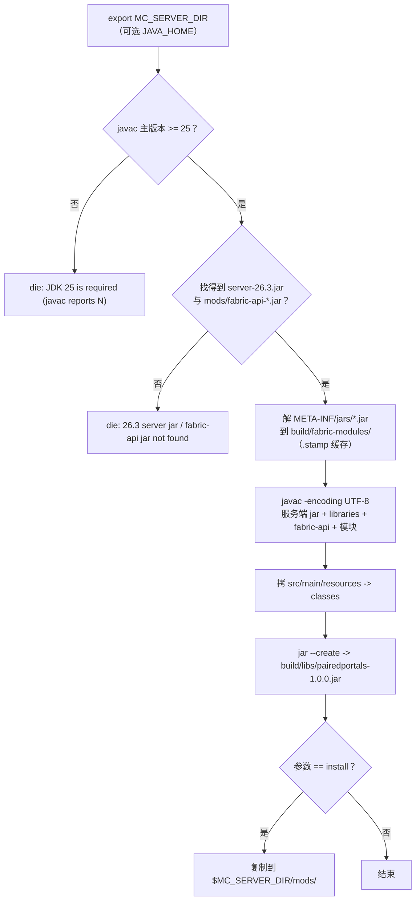

[English](../BUILDING.md) · **中文**

# 构建与安装

本文覆盖从一份源码到一台跑起来的服务端之间的全部内容：环境要求、为什么这个项目没有
Gradle/Loom 构建、为什么全程不联网、[`build.sh`](../../build.sh) 一步一步做了什么、它会停在哪四条报错上、
它读取的服务端目录，以及成品 jar 怎么装。这些内容的中文原文见 [README.zh-CN.md](../../README.zh-CN.md) 的
§3 与 §7，两处用的是同一套 §N 编号；英文 README 保持完全相同的 §N 编号与顺序。

## 环境要求

| 项目 | 要求 |
|------|------|
| Minecraft | **26.3** |
| 模组加载器 | Fabric Loader |
| 必需依赖 | Fabric API |
| 安装侧 | **仅服务端**。客户端不需要安装本 mod，也不需要资源包 |
| Java | **25**（JDK，提供 `javac`/`jar`；26.3 的 class 是 Java 25，JDK 21 读都读不了 —— `build.sh` 会先自检并明确报错） |
| 可选兼容 | Worlds: Multiverse for Fabric（mod id `mc-worlds`）—— 纯反射软桥，不装也照常工作（§11） |

构建需要的是 **JDK**（`javac` 与 `jar`），不是 JRE。不设 `JAVA_HOME` 就用 `PATH` 里的
`javac`/`jar`/`java`；版本自检照样跑，所以 `PATH` 上只有 JDK 21 时会立刻明确报错，而不是甩你一脸
`bad class file`。

## 为什么没有 Gradle/Loom，也不联网

Minecraft **26.3 的 class 未混淆、无 intermediary 映射**，所以没有 remap 步骤、也没有需要生成的东西 ——
`javac` + `jar` 一个来回，就能产出 Fabric Loader 直接接受的 jar：没有 `remapJar`，不下载映射，也不需要 Loom。

因为全程不取任何东西，脚本的**编译 classpath 是从你本机那台服务端现场拼的**：
`versions/26.3/server-26.3.jar` + `libraries/**.jar` + `mods/fabric-api-*.jar`。
实际后果是顺序问题：**先在本地跑起一台 26.3 的 Fabric 服务端，再构建** —— 本机没有离线映射缓存可喂给它。

## 两条命令

```bash
# MC_SERVER_DIR 是唯一的必填项：指向一台本地跑着的 Minecraft 26.3 Fabric 服务端目录
export MC_SERVER_DIR="/path/to/your/mc26-fabric-server"

# 需要 JDK 25（26.3 的 class 是 Java 25）。不设 JAVA_HOME 就用 PATH 里的 javac/jar，
# 但版本不够会直接报错退出，而不是甩你一脸 bad class file。
export JAVA_HOME="/path/to/jdk-25"

./build.sh                 # 编译 -> build/libs/pairedportals-1.0.0.jar
./build.sh install         # 再把 jar 复制进 $MC_SERVER_DIR/mods/
```

- **`MC_SERVER_DIR`** —— 必填。用来定位 `versions/26.3/server-26.3.jar`、`libraries/**.jar` 与
  `mods/fabric-api-*.jar`，同时是 `./build.sh install` 的安装目标（复制到
  `$MC_SERVER_DIR/mods/pairedportals-1.0.0.jar`）。
- **`JAVA_HOME`** —— 可选。设了就取 `$JAVA_HOME/bin` 下的 `javac`/`jar`/`java`，不设就从 `PATH` 找。
  两种情况都先跑版本自检。
- **出错即退出** —— 脚本开头是 `set -euo pipefail`，每个缺失的前提都走
  `die() { echo "build.sh: $*" >&2; exit 1; }`。不存在「构建了一半」：所有检查都在编译之前，
  任何一项不过就整个脚本停住并返回非零。
- **`./build.sh install` 不做增量判断**，只复制产物。改完 Java 源码必须从头重建
  （`rm -rf build && ./build.sh && ./build.sh install`），否则沙盒里跑的还是旧 jar（README §9）。

## `build.sh` 做的事

1. **版本自检**：跑 `javac -version` 并取出主版本号：

   ```bash
   JAVAC_MAJOR="$("$JAVAC" -version 2>&1 | sed -n 's/^javac \([0-9][0-9]*\).*/\1/p' | head -n 1)"
   ```

   读不出来、或者低于 25，就停。这一步故意放在最前面：26.3 的 class 是 Java 25（major version 69），
   低版本 `javac` 连读都读不了，报出来的是一整屏对着 Fabric API 的
   `bad class file ... wrong version`，什么也说明不了。
2. **定位输入**：`SERVER_JAR="$MC_SERVER_DIR/versions/26.3/server-26.3.jar"`，
   fabric-api 则用 `find "$MC_SERVER_DIR/mods" -maxdepth 1 -name 'fabric-api-*.jar' | head -n 1` 找。
3. **解包 Fabric API 的嵌套模块**：fabric-api 是 **bundle jar**，真正的模块是 `META-INF/jars/` 下的嵌套 jar，
   不解包，它的 API 类一个都不在 classpath 上。脚本执行

   ```bash
   unzip -q -o -j "$FABRIC_API_JAR" 'META-INF/jars/*.jar' -d "$NESTED"
   ```

   解到 `build/fabric-modules/`，用 `.stamp` 做缓存（stamp 不存在、或比 fabric-api jar 旧，就清空重解；
   否则复用上次的解包结果）。少了这一步，编译会找不到 `CommandRegistrationCallback` / `ServerTickEvents` ——
   它们就在嵌套模块里，在 bundle 里看不见。
4. **拼编译 classpath**：26.3 服务端 jar + `$MC_SERVER_DIR/libraries` 下每个 jar
   （`find ... -name '*.jar' | sort`）+ fabric-api bundle jar 本身 + 每个解出来的模块。
5. **处理 Windows 的路径与分隔符**：在 Git Bash / MSYS / Cygwin 下（`uname -s` 命中 `MINGW*`、`MSYS*`、
   `CYGWIN*`）classpath 分隔符是 `;`、每个路径过 `cygpath -w`；普通 POSIX shell 里分隔符是 `:`、路径原样传。
   脚本能两边都跑就是因为这一处。
6. **编译** `src/main/java` 下按名排序的全部 `.java`：

   ```bash
   "$JAVAC" -J-Duser.language=en -J-Duser.country=US -encoding UTF-8 -nowarn \
     -d "$(native "$OUT")" -cp "$CP" "${SOURCES[@]}"
   ```

   `-Duser.language=en -Duser.country=US` 让 javac 自己的诊断信息保持英文；**`-encoding UTF-8`** 是必需的，
   因为源码里有非 ASCII 文本。
7. **把资源拷到 jar 根**：`cp -r "$ROOT/src/main/resources/." "$OUT/"`，`fabric.mod.json` 与 mixin 配置
   因此落在 Fabric Loader 期望的位置。
8. **打包**：`jar --create --file build/libs/pairedportals-1.0.0.jar -C build/classes .`，最后 `ls -l` 产物。
   `build/classes` 与 `build/libs` 每次运行开头都会删掉，所以不会留下过期的 class。
9. **`install`** —— 只有第一个参数是 `install` 时才走：把 jar 复制到
   `$MC_SERVER_DIR/mods/$JAR_NAME`，并打印 `>> installed to <路径>`。

## 报错信息

下面四条都会以退出码 1 停住并把信息写到 stderr。此处与 README §3 都是原文引用：

```
build.sh: MC_SERVER_DIR is not set; point it at a Minecraft 26.3 Fabric server directory
build.sh: JDK 25 is required (javac reports 21); set JAVA_HOME to a JDK 25 install
build.sh: 26.3 server jar not found at <…> (check MC_SERVER_DIR)
build.sh: fabric-api jar not found under <…>/mods
```

（`javac reports 21` 是实际报出来的版本号，`<…>` 是脚本打印的真实路径。）另有两条守着工具本身：

```
build.sh: javac not found (set JAVA_HOME to a JDK 25 install, or put javac on PATH)
build.sh: jar not found (set JAVA_HOME to a JDK 25 install, or put jar on PATH)
```



## 安装（服务端）

1. 服务端装好 **Fabric Loader** 与 **Fabric API**；
2. 把 `pairedportals-1.0.0.jar` 放进服务端的 `mods/`；
3. 重启服务端。客户端什么都不用做。

成品 jar 从 Releases 取，也可以按上面的步骤从源码自己构建。需要凑齐的 jar 清单就是：
**Fabric Loader + Fabric API + 本 mod**（外加你本来就装的其它东西）。

本 mod 是纯服务端的，所以没有需要安装、也没有需要同步的客户端半边。元数据把这件事写死了：

- `src/main/resources/fabric.mod.json` 是 `"environment": "server"`，只有 `main` 入口 —— 没有 `client` 入口。
- `depends`：`fabricloader >=0.19.5`、`fabric-api *`、`minecraft ~26.3-`、`java >=25`。
- `suggests`：`mc-worlds`（Worlds: Multiverse for Fabric），可选 —— 见
  [COMPATIBILITY.md](COMPATIBILITY.md) 与 README §11。

## 服务端目录与服务端沙盒

[`build.sh install`](../../build.sh) 与 [`test/`](../../test) 下所有脚本都通过 **`$MC_SERVER_DIR`** 定位服务端 ——
把它 export 成你自己那台 26.3 Fabric 服务端目录即可。**不设的话脚本直接报错退出**，不会拿一个猜出来的路径乱跑：

```
$MC_SERVER_DIR/
  versions/26.3/server-26.3.jar     26.3 服务端 jar（本文档引用的那份证据 jar sha1 = cc3964451a3b32a0488110d5e3e6ad8d75fe6a66）
  mods/                             fabric-api、本 mod（可另装 smallernetherportals / netherportalfix 当干扰项）
  libraries/                        Fabric Loader 的库
  world_sbx_probe/                  测试用世界（脚本每次启动自己重建）
```

`server.properties` 的 `level-name` 会被不同脚本互相改写，所以**每个脚本自己点名世界**并在启动前 `rm -rf` 重建
（见 [TESTING.md](TESTING.md) 的第三个坑）。

跟一台 26.3 服务端打交道时，三条环境事实值得记住：

- **查 26.3 的 API 要用 JDK 25 的 `javap`**：低版本 `javap` 读不了 Java 25 的 class 文件。
  如果 `PATH` 上的 `java` 不是 25，就得显式点 `"$JAVA_HOME/bin/javap"`。
- **`pause-when-empty-seconds` 默认 60**，不设 0，没人的服务端世界会停 tick（无头测试就全冻住了）。
- **`gamerule` 名字在 26.3 是 snake_case**（`spawn_mobs`、`spawn_monsters`）—— 旧的 camelCase id 已经不解析了。

## 相关文档

- [README.zh-CN.md](../../README.zh-CN.md) · [README.md](../../README.md) —— 完整技术文档
  （§3 构建与安装、§7 服务端目录与沙盒）
- 架构：[docs/zh-CN/ARCHITECTURE.md](ARCHITECTURE.md) · [docs/ARCHITECTURE.md](../ARCHITECTURE.md)
- 测试与证据：[docs/zh-CN/TESTING.md](TESTING.md) · [docs/TESTING.md](../TESTING.md) ——
  测试脚本怎么跑、测了什么
- 命令参考：[docs/zh-CN/COMMANDS.md](COMMANDS.md) · [docs/COMMANDS.md](../COMMANDS.md)
- 兼容与多世界：[docs/zh-CN/COMPATIBILITY.md](COMPATIBILITY.md) · [docs/COMPATIBILITY.md](../COMPATIBILITY.md)
- 玩家指南：[docs/zh-CN/GAMEPLAY.md](GAMEPLAY.md) · [docs/GAMEPLAY.md](../GAMEPLAY.md)
- 变更日志：[CHANGELOG.zh-CN.md](../../CHANGELOG.zh-CN.md) · [CHANGELOG.md](../../CHANGELOG.md)
- 贡献指南：[CONTRIBUTING.zh-CN.md](../../CONTRIBUTING.zh-CN.md) · [CONTRIBUTING.md](../../CONTRIBUTING.md)
