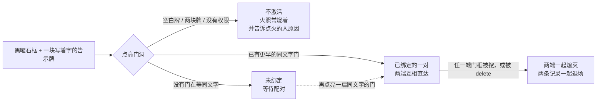

[English](../GAMEPLAY.md) · **中文**

# 玩家指南

这份文档写给真正会碰到 PairedPortals 的两种人：**建门的玩家**，和**装 mod 的服务端管理员**。读它不需要看过这个 mod，也不需要读一行代码。游戏里可能出现的每一句话都在这里给出了中英两版 —— 因为每个玩家看到的都是**自己客户端语言**对应的那一版。凡是「写了但没实测」的地方，本文都会明说。

## 什么是一对「配对传送门」

**配对传送门**就是一扇普通的传送门形状黑曜石框，外加一样东西：**门洞里立着一块写着字的告示牌**。

除此之外没有任何新东西。框就是原版黑曜石，门洞里亮着的方块就是原版 `minecraft:nether_portal`，本 mod 不新增任何方块、物品、实体、贴图或音效。一个从没听说过 PairedPortals 的玩家，光看是分不出我们的门和普通门框的。

告示牌改的是**这扇门通向哪里**。原版的规则是主世界 ↔ 下界；门洞里放着写着字的告示牌的框不再走这条规则：**写着同样文字**的两扇门配成一对、互相直达 —— 跨维度，在多世界服务端上也跨世界。

只有**服务端**需要装本 mod。装上之后原版客户端照常直连，不需要装任何东西，也不需要资源包。

## 快速上手

1. **砌一扇传送门形状的黑曜石框。** 形状用原版认的任意一种都行（经典的 4×5、2×3 等等），门洞先空着，跟搭普通下界门一样。
2. **在门洞里放且只放一块写着字的告示牌。** 「门洞里」指传送门方块本该占的那几格之一，不是门框旁边。
3. **点亮门洞** —— 拿打火石（或任意火源）点门方块该出现的位置。这扇门就进入**未绑定**状态：亮着，在等它的另一半。此时不会发生别的事。
4. **在别处再砌一扇框** —— 同一维度的另一处、下界、末地、某个 mod 维度，或者多世界服务端的另一个世界都行 —— 告示牌上写**同样的文字**。
5. **点亮它。** 两端立刻绑定、互相直达：新点着的这扇会去找「同文字里最早还在等的那扇」并把两扇接起来。不需要敲命令、不需要确认、也没有开关要打开。
6. **用准星指向这扇门**（门框、或门洞里亮着的传送门方块），actionbar 会告诉你它的状态；绑定之后还会告诉你对面在哪。

> **告示牌活不过点火那一刻。** 点亮门洞会把门洞里的每一格都换成传送门方块，所以文字只在点火时被读一次、存进门记录里，牌子本身随即消失。打算以后再建另一端的话，先把文字记下来 —— 就算服务端重启，记录里的文字也不会丢。

## 告示牌的规则

告示牌就是全部的「配置界面」，所以规则很短也很死：

- **门洞里恰好一块告示牌。**
- **牌上必须有内容。** 空白牌子（包括只在**背面**写了字的牌子）不会激活这扇门：点火的人会看到 `门洞内的告示牌没有内容`，什么都不会被建出来。
- **门洞里放两块牌子同样不会激活**，点火的人会看到 `门洞内只能放一块有内容的告示牌`。
- **放在门框旁边的牌子会被忽略。** 如果牌子不在门洞里，这个框完全交还原版：一个合法的空框会照常点成一扇普通下界门。
- **完全没有牌子的框照样交还原版**，也就是普通下界门。

上面两种拒绝都会**保留那团火**（不会顺手把火扑灭），所以拒绝的表现就是「打火石只点着了一团火，别的什么也没发生」。

关于「文字」本身，有两条细节决定两扇门算不算同一对：

- 只读**正面**，四行按顺序直接拼起来、中间不加任何分隔。第 1 行写 `AB`、第 2 行写 `C`，这扇门的文字就是 `ABC`。
- **区分大小写。** `Home` 和 `home` 是两扇不同的门；行尾空格会被去掉。

还有一条规则导致的推论：原版的点火判定只认门洞里的空气、火和已有传送门方块，所以**门洞里放着牌子的框绝不可能**被点成普通下界门 —— 它要么是我们的门，要么就是一条带提示的拒绝。

## actionbar 会告诉你什么

用准星指向一扇门（门框的某一格、或门洞里亮着的方块），大约五格以内 actionbar 就会作答，你一直盯着看的话每隔一秒刷新一次。世界上没有别的地方能显示门的状态 —— 两种状态长得一模一样，所以 actionbar 是门唯一能开口的地方。

| 情形 | 英文（客户端语言不是 `zh*`） | 中文（`zh_cn` / `zh_tw` / `zh_hk`） |
|---|---|---|
| 准星指向**等待中**的门 | `Unbound custom portal: waiting for another door carrying "{text}"` | `未绑定的自定义传送门：等待另一扇写着「{text}」的门` |
| 准星指向**已绑定**的门 | `Bound custom portal: leads to {dimension} {pos} ({world state})` | `已绑定的自定义传送门：通往 {dimension} {pos}（{world state}）` |
| 已绑定、但对门记录已不在 | `Bound custom portal (its twin's record is gone)` | `已绑定的自定义传送门（对门记录已不在）` |
| 世界状态：已加载 | `loaded` | `已加载` |
| 世界状态：已注册但没加载 | `registered, not loaded` | `未加载（用的时候会自动加载）` |
| 世界状态：不存在 | `no such world` | `世界不存在` |
| 门洞里只有一块空白告示牌时点火 | `the sign in the frame is blank` | `门洞内的告示牌没有内容` |
| 门洞里有两块写着字的牌子时点火 | `only one written sign fits in the frame` | `门洞内只能放一块有内容的告示牌` |
| 没有点火权限 | `no permission to light a custom portal (currently: {policy})` | `没有权限激活自定义传送门（当前：{policy}）` |
| 激活权限 `all` | `everyone` | `所有人` |
| 激活权限 `op` | `operators only` | `仅 OP` |
| 激活权限 `none` | `nobody` | `所有人都不行` |

- `{text}` 是牌子上的文字；`{pos}` 是对门的门洞角坐标，形如 `1, 100, 0`；`{dimension}` 是维度 id，形如 `minecraft:the_nether` 或 `newworld:overworld`；`{policy}` 是最后三行里的其中一个词。
- 只有已绑定那行会告诉你对面在哪。在多世界服务端上，这个维度名正是「我的基地」和「另一个世界里的基地」的区别，而世界状态说明对面此刻在不在。
- 最后两行是**点火**反馈：发给火附近八格内离得最近的那个玩家；周围没人就只写进服务端日志 —— 门一样会被拒绝。
- 指向一扇不属于任何自定义门的框（包括普通下界门）不会有任何提示。

## 游戏内语言

- **每一句玩家可见的文案都跟随玩家自己的客户端语言。** 客户端语言以 `zh` 开头（`zh_cn` / `zh_tw` / `zh_hk`）看中文，其余一律看英文。语言由服务端从连接的客户端读取（`ServerPlayer.clientInformation().language()`）。
- **两个界面都跟随**：**actionbar 提示**和 **`/pairedportals` 命令输出**。所以同一台服务器上两个玩家同时看同一扇门，可能各自看到自己语言的那一句。
- **没有资源包，也没有语言选项要装。** 本 mod 没有客户端半边，不可能附带客户端语言文件，也没有走原版的翻译机制：服务端为每个玩家挑好那一句字面文案再发下去。客户端选项里不会多出任何东西，也不需要。
- **服务端日志始终是英文。** 控制台与命令方块同理（它们没有客户端语言可言）。`list` / `info` 行尾的 `[loaded]` / `[registered, not loaded]` / `[no such world]` 也永远是英文 —— 测试脚本正是 grep 这些串。

## 会让人意外的规则



### 一种文字同一时刻只对应一对，而且是「先来先得」

同样的文字只能描述**一对**门。你点亮的第三扇同文字门不会去抢已经绑好的对门，它和别的未绑定门一样等自己的另一半。另一半永远是**同文字里最早还在等的那扇** —— 按点火顺序，不按距离。这个顺序存在世界存档里，服务端重启也保持。

### 两扇门可以共用一根门框柱

相隔三格砌的两个框会共用中间那根黑曜石柱，而它对两个门环都是边角格。两扇门互不牵连：指向共用柱时，报的是**洞心更近**的那扇门（等距时有固定的裁决规则，所以答案不会在两次运行之间跳来跳去）；拆掉其中一扇时，清掉的只是**它自己门洞里的方块**，共用柱毫发无伤。这一条由 `test/smoke-adjacent.sh` 覆盖。

### 拆掉一端 ⇒ 整对一起消失

挖掉一扇门的框、或用 `/pairedportals delete` 删掉一扇门，两端会**一起**退场：两个门洞都熄灭，两条记录都被移除。这是故意的 —— 只留一端亮着等于一扇谁也走不通的门，而走进它的玩家会掉回原版逻辑、被送去一次普通的下界旅行。整对一起退场，才能真正保证世界上不存在「还亮着却走不通」的门。日志会记下来：`[pairedportals] portal at ... went down with its twin at ...`。

### 什么时候算「框坏了」？挖斜角不算

判据与原版一致：**只要求贴着门洞的四条边**仍然完好（另外门洞本身还得整格都亮着传送门方块）。门环的**四个斜角格**不在判定里 —— 原版找形状时从门洞往外走底边、再沿左右两列向上、最后读顶边，**斜角那一格它从来不读**。所以挖掉一个斜角，门照样亮着能用，我们也不会把它当成「被拆了」。

### 拆掉的门可以重建

拆门只退掉亮着的方块和记录，黑曜石框原地不动。重新放一块牌子、写上文字、再点一次火，就是**全新的一对**（新 id），和你从没建过它没有区别。

有一个边角情况值得知道：如果你在周期性巡检发现之前就把框补好，并且用**同样的文字**重新点火，旧记录仍然描述着这个框 —— 门会被原样重新点亮并保留原来的配对。换了文字、或者巡检已经跑过，那就是一扇全新的门。想让服务端立刻巡检一次，用 `/pairedportals purge`。

## 穿越一扇配对门

- **你会抵达对门。** 没有目的地搜索、也没有 1:8 坐标缩放：配对门唯一通向的地方就是它的对门洞。
- **落点复刻原版自己的映射**，两端门大小不同时也一样。你在**入口门**里的相对站位会被按**出口门**剩下的余量重新铺开：贴着宽门左边的柱子进去，就从窄门对应的柱子出来；3 宽的门映射到 2 宽的对门时，旅行者会**铺开**在对门的两个门格里，而不是全挤在一格。出口被别的实体占住时，原版自己的「找一个不卡身位的地方」那一步会把你推开。
- **你从自己那扇门的另一侧走出去。** 交给游戏的旋转量是**相对**的：两扇门同轴时 0°、跨轴时 +90°，且始终锚在你当前的朝向上 —— 于是你保持原本的行进方向，从对面的门外走，而不是一头撞在门框上。
- **落在门洞里不会被立刻送回来。** 原版的传送冷却由这次传送自己写上（300 tick；载着玩家时 10 tick），而处于冷却中的实体站在门方块里只会把冷却重新回满，不会新建一次传送。要回去必须**走出去**、让冷却真正走完，再走进另一扇门。所以两扇门挨得越近，回程越慢，但永远不会进死循环。
- **没配对的门是刻意零反馈的。** 走进一扇未绑定的门什么都不会发生：没有 actionbar、没有音效、没有粒子，也不会掉回原版被送去下界。原因只写在服务端日志里（`[pairedportals] blocked travel (…)`）和 `/pairedportals list` 的等待计数里。这与「原版门拒绝时也不解释」是同一种行为。

### 哪些东西能过门

本 mod 只换掉了**目的地查询**这一个问题 —— 「这扇门通向哪里」。其余全部还是原版：谁有资格用门、站在门里的记账、冷却、音效与紫屏、以及真正的移动（包括乘客）。所以**原版能送的我们都能送，原版拒绝的我们也拒绝**。下表是 `test/smoke-entities.sh` 的实测结果（6/6）：

| 受试者 | 类型 | 结果 |
|---|---|---|
| `minecraft:item`（掉落物） | 非生物 | 过门，落点 `(1.0, 100.0, 0.5)` |
| `minecraft:armor_stand` | 非生物 | 过门，同上 |
| `minecraft:minecart` | 载具（自己覆写了 `handlePortal`） | 过门，同上 |
| `minecraft:zombie` | 生物（对照组） | 过门，同上 |
| `minecraft:horse` | 载具 | 过门，落点 `(1.0, 100.0, 0.698)`（偏了 0.2 格：`PortalShape.findCollisionFreePosition` 按马的碰撞箱把它挪到不卡墙的位置） |
| 骑在马上的 `minecraft:zombie` | **乘客** | 跟着马到了下界，**没有自己的 travel 日志行** ⇒ 是被载具带走的（乘客自己不能使用门：`Entity.canUsePortal(false)` 对 passenger 为 false） |

## 谁能点火

`/pairedportals permission [all|op|none]` 决定谁能点亮**新**门。

| 值 | 谁能点火 |
|---|---|
| `all`（默认） | 任何人 |
| `op` | 只有 OP（命令等级 2，即 26.3 的 `Permissions.COMMANDS_GAMEMASTER`） |
| `none` | 谁都不行 |

- **拒绝时的表现就是字面意思「真的只是点了个火」。** 那格火正常烧着，什么都不会变成传送门，连原版那条分支也不会跑；点火的人收到 `没有权限激活自定义传送门（当前：仅 OP）`（策略词按当前设置）。
- **权限问的是点火那一刻离火最近的那个玩家（8 格内）。** 点火钩子拿不到「谁点的火」，这是能做到的最准的读法：站在框前拿打火石点的情况完全准确；发射器或火焰蔓延点着的门则算作「没有操作者」，在 `op` / `none` 下都会被拒。
- **只约束「点一把新火」，不约束已经存在的门。** 任何设置下已有门都照常工作：`none` 的意思是「不许再点新门」，不是「关掉这个功能」—— 把别人已经建好、正在用的门拿走，和拒绝一次点火是两件量级完全不同的事。
- 这个设置跟门记录一起存在世界存档里，重启后保留，一处设置对整个服务器生效 —— 只有一处，因为一对门往往横跨两个维度，「谁能点」没有理由两端不一样。

## 服务端管理员须知

**装什么。** 一台 Minecraft 26.3 的 Fabric 服务端，装好 Fabric Loader 与 Fabric API，把 `pairedportals-1.0.0.jar` 放进服务端的 `mods/`，然后重启。需要 Java 25（26.3 的 class 就是 Java 25）。客户端什么都不用装、也不需要资源包；单人游戏里游戏自己就带着服务端，所以把 jar 装进自己的 `mods/` 就够自己的世界用了。

**状态存在哪。** 所有门记录和激活权限都存在世界的存档数据里，整个服务端一份：

```
<world>/data/pairedportals/portals.dat
```

它**不是**每维度一份（一对门往往横跨两个维度），重启后保留，并且跟着世界文件夹走 —— 照常备份世界文件夹即可。

**维护命令。** `/pairedportals` 需要权限等级 4（服主）。日常用这四个：

| 命令 | 作用 |
|---|---|
| `/pairedportals list [bound\|unbound]` | 先给数量总览，再一扇门一行：完整 id、维度、门洞角坐标、尺寸、状态、牌子文字，已绑定的行尾附对门在哪 |
| `/pairedportals info <uuid\|pos>` | 单扇门的全部字段，含对门位置与「对面世界此刻在不在」（坐标形式接受相对坐标，所以 `/pairedportals info ~ ~ ~` 回答的是「我现在站在哪扇门里」） |
| `/pairedportals purge` | 立刻巡检一次，把框已不在的门**连同它的对门**一起退掉 |
| `/pairedportals delete <uuid\|pos>` | 删掉一扇门，连同它的对门 |

完整的命令集（还有 `tp`、`unbind`、`pair`、`permission`、`debug`）见 [docs/zh-CN/COMMANDS.md](COMMANDS.md)。

**多世界服务端。** 整条路径没有维度特判：门通向的是它记录里的那个维度键。让**自定义**世界按需加载起来，是 **Worlds: Multiverse for Fabric**（mod id `mc-worlds`）的活；没装它时，通向一个当前没加载的世界的门无处可落，这次旅行会被拒，但门和对子保留。见 [docs/zh-CN/COMPATIBILITY.md](COMPATIBILITY.md)。

**日志。** 服务端日志只写英文，前缀 `[pairedportals]`；`-Dpairedportals.debug=true` 会打出完整的判定过程（点火、配对、传送、拒绝）。一扇送不走人的门只在**原因变化**时写一行日志，所以「这扇门永远不通」看得见，又不会把日志淹掉。

## 本 mod 不做什么

这里诚实比多列几条特性重要：

- **不新增**任何方块、物品、实体、贴图、模型或音效。你看到的一切都是原版的。
- **不改动**原版下界门。普通门的行为一模一样；三个注入点里有一个存在的唯一目的，就是让原版的搜索永远不落在我们的门上。
- **不会替你生成另一半。** 原版在你穿越时会顺手造一扇对门；配对门永远不造 —— 它要么直达对门，要么拒绝这次旅行。
- **不做坐标缩放**（没有 1:8 的主世界/下界换算），**也不搜索**附近的门。
- **没有任何自定义渲染**：门的状态不会被画出来、染上颜色或在世界里标注，actionbar 是唯一的渠道。
- **不发客户端名字或 tooltip**：客户端仍然管这些方块叫「黑曜石」和「下界传送门方块」。
- **不按权限限制穿越**。激活权限只管「点亮新门」。
- **不告诉玩家**一扇死门为什么走不通 —— 就是上面说的零反馈设计，原因在服务端日志里。
- **不带资源包**、语言文件或配置界面。

## 未实测部分

下面这些在本文里有描述，但**没有**被作者端到端证实过。请把它们读作「预期行为」，而不是实测结论：

| 范围 | 状态 |
|---|---|
| 跨世界传送（一个世界的门通向另一个世界的门） | 代码走的是和其他所有旅行完全相同的那条路径，但没有在真·多世界服务器上跑过。没做完的手工验收清单在 [README.zh-CN.md](../../README.zh-CN.md) §11.6。 |
| 音效 | 未验证 —— 截图看不出音效，当时的证据都是视觉的。 |
| 「挖斜角不算拆门」 | 覆盖它的那个测试阶段只做过 `bash -n`，没有执行。 |
| 同维度配对 | 真人实测通过（两扇主世界门自动配对、双向穿越、落在门洞里原地站几十秒不弹跳）。回归脚本 `test/smoke-samedim.sh` 已写好但**未执行**。 |
| 从末地或 mod 维度出发的穿越 | 在末地点火这一半已测；**穿越**那一半没走过，因为需要对面也有一扇配对门。 |
| 门框被活塞推动的行为与挖掘耗时 | 未实测。门框就是原版黑曜石，所以预期与原版一致。 |

## 常见问题

**走进我的门怎么什么都没发生？**
要么这扇门还没配对，要么对门所在的世界此刻拿不到。跑一下 `/pairedportals list`：还在等的门会算进 `waiting for a partner` 计数，状态是 `PENDING`。记住这是**刻意的零反馈** —— 没有 actionbar、没有音效、没有粒子 —— 所以「毫无反应」并不等于门坏了。原因写在服务端日志里。

**我的门怎么不见了？**
因为另一端被拆了或删了。**整对一起消失**：一端没了，两个门洞都熄灭、两条记录都移除，只留下两个普通的黑曜石框。如果不是你拆的，看看是不是有人挖了对门的框，或者有人用 `/pairedportals delete` 删了一扇门。

**我的玩家需要装 mod 或资源包吗？**
不需要。本 mod 的逻辑全在服务端：元数据是 `"environment": "*"`，没有 `client` 入口，客户端资源里也没有任何东西。原版客户端直连就能看到本 mod 发的一切，包括自己语言版本的 actionbar 文案。单人存档里由游戏自带的集成服务端加载本 mod，所以自己的世界同样能用。

**两扇门可以共用一根柱子吗？**
可以。相隔三格的两个框共用那根黑曜石柱，两扇门互不影响，拆掉其中一扇不会碰到共用柱，也不会牵连另一扇。

**同样的文字能不能出现在三个地方？**
可以，但三扇不能是一对。最先点亮的、同文字的两扇会配成一对，第三扇等它的第四扇。如果队列把不该配的两扇配在了一起，先用 `/pairedportals unbind <uuid|pos>` 把你想拆开的门退回等待，再用 `/pairedportals pair <idA> <idB>` 手工接起来。`pair` 只接受两扇**正在等待**的门，并且**故意不校验**文字与维度（文字不同会额外提醒一句，因为那样世界上就没有任何线索解释这两扇门为什么是一对）。

**末地、mod 维度、其他世界能用吗？**
能。整条传送路径没有维度特判：门通向的是它记录里的维度键，所以同一维度、两个原版维度、mod 维度、多世界服务端的两个世界都是同一条代码路径。在末地点火这一半已测。跨世界还需要装 Worlds，这样没加载的世界才能在需要时被拉起来。

**绑定之后改牌子文字会怎样？**
配对不对它有任何反应。文字只在点火时被读一次、写进门记录，之后本 mod 再也不读告示牌。实际上告示牌根本活不过点火 —— 亮起来的门洞把它替换掉了 —— 所以也没有东西可改。另外，亮着的门洞一旦因为任何原因少了一格，门洞就不再完整：这扇门和它的对门会在下一次巡检时一起退场。

**同一维度（主世界 ↔ 主世界）呢？**
支持，而且真人实测过：两扇主世界门同文字正常配对、双向都通。回程要等原版传送冷却（300 tick；载着玩家时 10 tick），所以两扇挨得很近的门来回走会慢，但永远不会成环。

**会影响我原来的普通下界门吗？**
不会。门洞里没有牌子的框完全交还原版处理，而本 mod 会让原版自己的搜索跳过我们的门，所以配对门旁边的普通门照样把你送到它一直送的地方。

## 相关文档

| English | 中文 |
|---|---|
| [README.md](../../README.md) | [README.zh-CN.md](../../README.zh-CN.md) |
| [docs/GAMEPLAY.md](../GAMEPLAY.md) | [docs/zh-CN/GAMEPLAY.md](GAMEPLAY.md) |
| [docs/ARCHITECTURE.md](../ARCHITECTURE.md) | [docs/zh-CN/ARCHITECTURE.md](ARCHITECTURE.md) |
| [docs/BUILDING.md](../BUILDING.md) | [docs/zh-CN/BUILDING.md](BUILDING.md) |
| [docs/TESTING.md](../TESTING.md) | [docs/zh-CN/TESTING.md](TESTING.md) |
| [docs/COMMANDS.md](../COMMANDS.md) | [docs/zh-CN/COMMANDS.md](COMMANDS.md) |
| [docs/COMPATIBILITY.md](../COMPATIBILITY.md) | [docs/zh-CN/COMPATIBILITY.md](COMPATIBILITY.md) |
| [CHANGELOG.md](../../CHANGELOG.md) | [CHANGELOG.zh-CN.md](../../CHANGELOG.zh-CN.md) |
| [CONTRIBUTING.md](../../CONTRIBUTING.md) | [CONTRIBUTING.zh-CN.md](../../CONTRIBUTING.zh-CN.md) |
