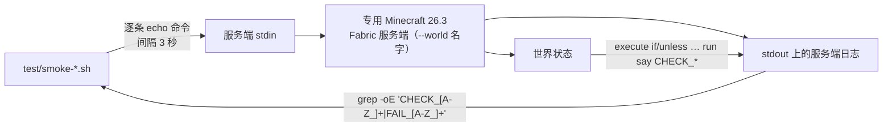

[English](../TESTING.md) · **中文**

# 测试与证据

本文讲的是 [`test/`](../../test) 里那套测试装置：15 个 shell 脚本、每个覆盖了什么、实测记录如何、
怎么跑、这类脚本必须绕开的三个坑、驱动真客户端的那一半，以及最重要的 —— 把「**已实测**」「**构造性论证
但未实测**」「**留意但未复现**」「**未测**」四档说清楚。这些内容的中文原文见
[README.zh-CN.md](../../README.zh-CN.md) 的 §6 与 §8；验收条目（I1–I7、F1–F20）的对照在 §10。

## 测试是怎么跑的

所有 `smoke-*` / `probe-*` 脚本都是同一个形状：起一台专用服务端，把控制台命令喂给它的 **stdin**，
再从它的日志里 grep 结果 —— 没有 RCON、没有 socket，控制台就是 stdin，证据就是 stdout。

对世界状态的断言不是靠读日志：脚本下发 `execute … if|unless <条件> run say CHECK_*`（以及镜像的
`… run say FAIL_*`），**由世界自己**打印一行标记，脚本再去 grep 它。断言几乎都成对出现，原因就在这里。



服务端启动时带 `-Dpairedportals.debug=true`（`smoke-phase3.sh` 与 `probe-sign.sh` 还带
`-Dmixin.debug.export=true`），脚本 grep 的那些 `[pairedportals]` 日志行就是这么来的。

## 怎么跑这些脚本

所有 `smoke-*` / `probe-*` 只依赖两个环境变量：

| 变量 | 必填 | 说明 |
|---|---|---|
| `MC_SERVER_DIR` | **是** | 一台 Minecraft 26.3 Fabric 服务端目录 |
| `JAVA_HOME` | 否 | 一份 JDK 25；不设就从 `PATH` 找 `java` |

不设 `MC_SERVER_DIR` 会直接报错退出：

```
test: set MC_SERVER_DIR to a Minecraft 26.3 Fabric server directory; see README §7
```

脚本开头会自检 `java.specification.version` 是不是 ≥ 25（走
`java -XshowSettings:properties -version`），不是就明确报错退出：

```
test: JDK 25 is required (set JAVA_HOME); see README §7
```

26.3 的 class 文件低版本 JVM 读不了，与其等一堆 `UnsupportedClassVersionError` 不如先拦。

少数脚本另外接受几个测试装置自己的覆盖变量：`LOG`（日志落点）、`WORLD`（世界名）、
`RESET`（`smoke-phase4.sh`、`smoke-travel.sh`、`smoke-edges.sh`、`smoke-entities.sh`、
`smoke-samedim.sh`、`smoke-unloaded.sh`、`probe-unload.sh`：`RESET=0` 保留世界，`smoke-phase4.sh` 的第二轮就靠它）、
以及 `client-host.sh` 的 `CTL` / `PORT`。按正常方式跑一个脚本，这些都不需要设。

两个时间事实决定了脚本怎么写：

- **服务端从进程启动到能吃控制台命令约 60 秒**（脚本 `sleep 60`；`smoke-travel.sh`、
  `smoke-entities.sh`、`smoke-samedim.sh`、`client-host.sh`、`probe-unload.sh` 第一条命令前用 62 秒）。
- **控制台偶尔会静默吞掉命令**。所以断言一律成对（`if … run say FAIL_*` + `unless … run say CHECK_*`），
  而不是单个 `unless`，命令之间隔约 3 秒。缺一个 `CHECK_*` 标记的含义是「条件为假**或**这行命令根本没到服务端」——
  成对断言存在的理由就是这个。

## 15 个脚本

| 脚本 | 覆盖 | 结果 |
|---|---|---|
| [`test/smoke-phase2.sh`](../../test/smoke-phase2.sh) | 注册表 + 同文字 FIFO 配对 | 通过 |
| [`test/smoke-phase3.sh`](../../test/smoke-phase3.sh) | 实体穿越到对门（含跨维度） | 通过 |
| [`test/smoke-phase4.sh`](../../test/smoke-phase4.sh) | 两次启动：PENDING→BOUND、拆掉 DOOM 一根框柱后**整对**退场（含对门门洞清空、HOME 对不受牵连）、跨重启存活、`info`/`delete`（delete 也清对门） | 通过 |
| [`test/smoke-isolation.sh`](../../test/smoke-isolation.sh) | 原版门在旁边时**不被抢**（两个方向 + 我们自己仍能走） | 通过，且过滤日志命中 2 次（说明真的扫到了我们的门） |
| [`test/smoke-edges.sh`](../../test/smoke-edges.sh) | 末地点火、F3 空白牌子、F4 两块牌子、`help`/`purge` | 通过 |
| [`test/smoke-travel.sh`](../../test/smoke-travel.sh) | 双向穿越、落点、20 秒后不回弹（R-9）、`@e` 维度陷阱自证（phase 0） | 通过 |
| [`test/smoke-rebuild.sh`](../../test/smoke-rebuild.sh) | 玩家改门：砸掉一格框 → 整对一起消失（对门门洞也清空、对门框完好）；补回框 + 换文字重燃 → 从零重新配对（计数 1→2→0→1→2） | 通过 |
| [`test/smoke-adjacent.sh`](../../test/smoke-adjacent.sh) | 两扇门共用一根柱：砌在一起时各自成门；砸掉 A 自己那一格 ⇒ A 与它的对门一起退场，**B 与共用柱毫发无伤** | 通过 |
| [`test/smoke-demolish.sh`](../../test/smoke-demolish.sh) | 拆门语义专测：拆一端 ⇒ 两端门洞都清空、对门框仍是黑曜石、`0 portal(s)`、日志 `went down with its twin`；同一对框重新放牌点火 ⇒ 全新一对 | 通过（新加的「挖斜角不算拆门」阶段只做过 `bash -n`，未执行） |
| [`test/smoke-samedim.sh`](../../test/smoke-samedim.sh) | **同维度配对专测**（主世界↔主世界）：一文字两扇门按普通规则配对（`1 bound pair(s)`）、A→B 与 B→A 双向都通、两侧的 `travel:` 行都写 `minecraft:overworld`、抵达后 22 秒仍在门口（R-9 同维度版不回弹）、每条腿的 `travel:` 计数必须为 1 | **未执行**（只做过 `bash -n`；用户要求新断言先别跑。同维度的行为已由真人实测覆盖：配对 + 双向 + 原地站几十秒不弹跳） |
| [`test/smoke-entities.sh`](../../test/smoke-entities.sh) | 哪些东西能过门：掉落物 / 盔甲架 / 矿车 / 僵尸 / 马 + **马背上的僵尸**（乘客） | 6/6 通过 —— 见下面的实体表 |
| [`test/smoke-unloaded.sh`](../../test/smoke-unloaded.sh) | 对门区块卸载期间 + 重载之后，原版门始终不被抢；我们自己的门仍能投递 | 通过（其中「区块真未加载」这一前提在本沙盒不稳定，见下面的证据分级） |
| [`test/probe-unload.sh`](../../test/probe-unload.sh) | 诊断脚本：把 `forceload query` / `if loaded` / `sweep` 计数三个观察者摆在同一坐标上对照一次干净的卸载周期 | 三者一致 |
| [`test/probe-sign.sh`](../../test/probe-sign.sh) | 告示牌读取的早期探针（26.3 里新放一块牌子读出来是什么样） | 通过 |
| [`test/client-host.sh`](../../test/client-host.sh) | 常驻宿主（**不是**断言脚本）：清空并重建 `world_client`、砌好 CP 门对、打印 `HOST_READY`，然后一直从 FIFO `/tmp/cp-client-ctl` 读控制台命令（§8.2 的真客户端截图就是这么拍的；`grep -c HOST_READY` 的**增量**才代表本次启动就绪，日志是追加的） | 用 |

当年为「幽灵叠加层」写的最小复现 `repro-overlay-unload{,-b,-c}.sh` 已随叠加层功能一起删除；
§9 末注记着它们证明过什么。

## 客户端那一半

[`test/client-host.sh`](../../test/client-host.sh) 与 [`test/client-join.py`](../../test/client-join.py) 是**成对**用的：
前者起常驻服务端并开放 FIFO 控制台 `/tmp/cp-client-ctl`，后者起客户端直连上去。

`client-host.sh` 与 smoke 脚本的区别在于它自己不停服务端 —— 砌好 CP 门对（外加一块站人的石头平台）后，
它就一直 `cat "$CTL"` 循环，好让后续步骤随时戳这台跑着的服务端：

```bash
test/client-host.sh                      # 启动、砌好 CP 门对、打印 HOST_READY、保持运行
echo "say hi" > /tmp/cp-client-ctl       # 驱动这台跑着的控制台
```

它的默认值是 `WORLD=world_client`（用自己的世界，免得弄脏 smoke 的世界）、
`LOG=/tmp/cp-client-host.log`、`CTL=/tmp/cp-client-ctl`、`PORT=25599`；它会改写 `server.properties` 里的
`server-port`，并设 `pause-when-empty-seconds=0` 与 `doFireTick false`。设 `STOP=1`、或往 FIFO 里写
`stop`，它就结束。

`client-join.py` 额外需要一份**你自己的**原版 26.3-Fabric 客户端安装：它从那套安装里复制 classpath 配方、
`libraries/`、`assets/`、`natives/`，在别处拼一个零 mod 的临时 profile（加载器首次运行会自己建一个空的
`mods/` 目录，所以断言是「里面没有 `.jar`」而不是「目录不存在」）：

| 环境变量 | 默认 | 说明 |
|---|---|---|
| `CP_CLIENT_MC_HOME` | 无（**必填**） | 你的 Minecraft 游戏目录，例如 `~/.minecraft` |
| `CP_CLIENT_SRC` | `$CP_CLIENT_MC_HOME/versions/26.3-Fabric` | 那套 26.3-Fabric 的版本目录 |
| `CP_CLIENT_LIBS` | `$CP_CLIENT_MC_HOME/libraries` | 统一映射库 |
| `CP_CLIENT_ASSETS` | `$CP_CLIENT_MC_HOME/assets` | 资源索引与对象 |
| `CP_CLIENT_NATIVES` | `$CP_CLIENT_SRC/natives-<os>-<arch>` | 平台名不符时手动指定 |
| `CP_CLIENT_PROFILE` | `$CP_CLIENT_MC_HOME/versions/cptest-modfree` | 临时零 mod profile 的落点 |
| `CP_CLIENT_JAVA` | `$JAVA_HOME/bin/java`，否则 `PATH` 里的 `java` | 需要 Java 25 |

命令行参数：`--timeout`（默认 300 秒）、`--keep-running`、`--quick <host:port>`（走
`--quickPlayMultiplayer` 直接进服）、`--username`（默认 `TestPlayer`）。它会扫客户端控制台里的崩溃／连接失败
模式与「游戏真的起来了」的标记，最后给一个判定（`ok` / `joining` / `fail` / `timeout` / `exited`）。

## 写这类脚本的三个坑（都踩过）

1. **没有位置过滤器的 `@e` 会跨维度匹配**。`execute in minecraft:the_nether ... if entity @e[tag=x]` 里的
   `@e[tag=x]` 会连主世界那只一起数到 —— 于是「在下界」和「在主世界」同时为真。**每个实体断言都要带
   `distance=..N`**（`smoke-travel.sh` 的 phase 0 就是这个陷阱的自证）。反过来说：**看到 CHECK 与 FAIL
   同时出现，先 dump 实体再看结论** —— 世界没被重置时，几轮之前留下的、带同一个 tag 的僵尸会让两边同时为真，
   那不是弹跳，也不是选择器的锅。
2. **日志格式**：`say` 的输出是 `[Server thread/INFO]: [Server] XXX`，命令回执是
   `[Server thread/INFO]: System chat: ...`；服务端从进程启动到能吃控制台命令约 **60 秒**；控制台偶尔会静默
   吞掉命令，所以断言间隔用 3 秒、并且用成对断言（`if ... run say FAIL_*` + `unless ... run say CHECK_*`）
   而不是单个 `unless`。
3. **世界必须由脚本自己点名**：`WORLD="${WORLD:-world_sbx_probe}"` + `rm -rf "$WORLD"` + 启动时
   `nogui --world "$WORLD"`。沙盒的 `server.properties` 是**共享**的，`level-name` 会被别的运行改掉
   （我们就被骗过一整轮：脚本删的是 `world_sbx_probe`，服务端加载的却是 `cp_corner2`，于是注册表里积了
   四五扇旧门，`smoke-phase4.sh` 的 A/K 与 `smoke-travel.sh` 的 T1/T2 全成了假失败）。**每次启动的
   `sweep checked 0 loaded portal(s)`**（在建立任何门之前）就是「世界真的是干净的」的硬证据 —— 注意判据
   **不是** `loaded N portal(s) from the world registry` 那行：`PortalRegistry.fromTag` 只在磁盘上真的存过
   记录时才会被调用，全新的世界只会走空构造器、**根本不打这行**。所以「启动日志里没有 `loaded` 行」= 全新世界；
   反过来，日志里出现了 `loaded N portal(s)` 而你又没打算测持久化，就说明世界没被重置。

## 断言依赖哪些字符串

脚本断言在**英文日志与命令输出字符串**上。不要改它们 —— 而且注意：即使玩家可见文案跟随玩家客户端语言，
控制台／日志可见的文本仍然**只有英文**，原因之一就是这些脚本要 grep 它：

- `N portal(s):` —— `/pairedportals list` 的首行（`0 portal(s):`、`2 portal(s):` ……）
- `loaded N portal(s) from the world registry`（`smoke-phase4.sh` 断言的是
  `loaded 2 portal(s) from the world registry`）
- `vanilla's portal search found our door`（POI 过滤器真的命中）
- `sweep checked N loaded portal`（巡检计数）
- `blocked travel`（被拒的穿越）
- `travel: … -> … (minecraft:the_nether)`（成功投递，带目标维度）
- `went down with its twin`、`no longer matches the world`（整对退场）
- `[pairedportals]` 日志前缀，以及命令回执外面的 `System chat: ` 包装
- 世界侧标记本身：`CHECK_*`、`FAIL_*`、`WARN_*`，以及阶段 `say` 标记
  （`PHASE4_BOUND`、`DEMOLISH_AFTER`、`SAMDIM_LEG1_END` ……）

## 证据分级

本项目把结论分四档。下面没有任何一条会在没有证据的情况下被升级，措辞上的保留都是故意的。

### 已实测 —— 脚本 + 日志证据

点火分流三态（无牌/空牌/两块牌都交还原版）、同文字 FIFO 配对、PENDING→BOUND、**拆掉任意一端 ⇒ 整对一起
消失**（两端门洞都清空、对门框完好、记录归零、`went down with its twin`）、**拆完的框可以重新放牌点火变成
全新一对**、拆 A 不牵连共用一根柱的 B、跨重启注册表存活、`info`/`delete`/`purge`/`help`/`debug`
（`delete` 同样清对门）、双向穿越与落点（**按原版公式：同尺寸落在同一处，3 宽→2 宽三格各自铺开**）、
**出站朝向按原版规则（同轴 0°、跨轴相对 +90°，僵尸受控实测）**、20 秒不回弹、末地点火、原版门在同维度
相邻时不被抢（128 格高风险方向实测）、纯净服务端无 mixin 报错、**六种实体过门**（下表）、以及
**真人客户端的观感**（下表）。

### 构造性论证但未实测

**T1/T2 —— SmallNetherPortals 会不会顶掉门洞里的告示牌？** 它的触发需要玩家用打火石右键，而测试用
`setblock fire` 不会触发它的处理器；时序上我们的分流在 `onPlace` 同 tick 完成，早于它延迟 1 tick 的任务。
所以：论证过，没实测。

### 留意但未复现

- **R-8（对门区块未加载）**：对门区块未加载时我们会加 `TicketType.PORTAL` 票据并同步加载（已加载时不再加票），
  然后构造 `TeleportTransition`。`smoke-unloaded.sh` 里三个观察者对「区块到底有没有卸载」互相矛盾
  （`if loaded` 说没加载，而我们自己的 `sweep` —— 判据是 `level.hasChunkAt`，只读不加载 —— 一直看得见这扇门），
  所以那一次读数是假阳性。`probe-unload.sh` 倒是造出过一次干净的卸载周期，三个观察者一致
  （`sweep` 计数 `22×0 → 5×1 → 8×2 → 23×1 → 9×2`）。
- **R-9（落点弹跳）**：落点实测是门洞**底部中心**，20 秒后仍在原维度，两轮双向都没回弹。

### 未测

- F10/F11 的**穿越**那一半（末地侧也要有配对门才能走完）。
- **F13**（绑定后改牌子文字无影响 —— 实现上天然成立：`twinId` 一旦写下就不再读牌子，但没单独写脚本）。
- **F17/F18**（活塞推不推得动、挖掘耗时是否与黑曜石一致 —— 真实方块就是黑曜石，没实测）。
- **音效**。

### 哪些东西能过门（[`test/smoke-entities.sh`](../../test/smoke-entities.sh)，6/6）

机制上我们只换 `NetherPortalBlock.getPortalDestination`（落点查询）：**资格判定**（`Entity.canUsePortal`）、
**站在门里的记账**（`PortalProcessor`）、**冷却**、**音效/紫屏**、以及**真正的移动**
（`Entity.teleportCrossDimension` 第一条指令就是 `getPassengers()`）全都还是原版。所以
「原版能送的我们都能送，原版拒绝的我们也拒绝」，实测与这条推断一致：

| 受试者 | 类型 | 结果 |
|---|---|---|
| `minecraft:item`（掉落石头） | 非生物 | 过门，落点 `(1.0, 100.0, 0.5)` |
| `minecraft:armor_stand` | 非生物 | 过门，同上 |
| `minecraft:minecart` | 载具（自己覆写了 `handlePortal`） | 过门，同上 |
| `minecraft:zombie` | 生物（对照组） | 过门，同上 |
| `minecraft:horse` | 载具 + 乘客 | 过门，落点 `(1.0, 100.0, 0.698)`（比单格实体偏了 0.2 格：`PortalShape.findCollisionFreePosition` 按马的碰撞箱把它挪到不卡墙的位置） |
| 骑在马上的 `minecraft:zombie` | **乘客** | 跟着马到了下界，**没有自己的 travel 日志行** ⇒ 是被载具带走的（乘客自己不能使用门：`Entity.canUsePortal(false)` 对 passenger 为 false） |

> 脚本本身也踩过一次坑，值得记下：第一版把马召唤在门洞里才去 `ride`，而非玩家实体的传送延迟是 **0 tick**
> （`NetherPortalBlock.getPortalTransitionTime` 只对玩家读 gamerule）⇒ 2 秒后 `ride` 时马早已在下界，
> 骑乘命令静默失败、两个实体各自独立穿越，**对「乘客」什么都没证明**。现在改成「先在门外的地面上马
> （门外铺一格黑曜石地板），再只 `tp` 马进门洞」。

### 真客户端实测（mod-free 原版客户端直连）

用 [`test/client-join.py`](../../test/client-join.py) 起了一个**没有任何 mod 的** 26.3 客户端（脚本会先断言
客户端 `mods/` 下没有 jar），直连同一台沙盒服务端（默认 `127.0.0.1:25599`）。截图一律用原版 F2
（落在该客户端 profile 自己的 `screenshots/`），不是外部窗口抓屏。

> 下表是作者本机跑那一轮时的观测记录。**原始 PNG 不随仓库分发**（它们落在各人本机的客户端 profile 里，
> 属于一次性的运行证据），下表的编号只是当时的序号，不影响结论。

| 观测点 | 观测到的东西 | 结论 |
|---|---|---|
| 登录 | `Setting user: TestPlayer` + `logged in with entity id 3` + 世界画面 | **R5 动态半边**：服务端 mod 不要求客户端装任何东西 |
| 准星压在 **PENDING 门**（SOLO）的柱子上 | actionbar `未绑定的自定义传送门` | 门框三态文案 ✓ |
| 准星压在 **BOUND 门**（CP）的柱子上 | actionbar `已绑定的自定义传送门` | 同上 ✓ |
| 准星压在**门洞里的传送门方块**上（画面里有方块选中框） | actionbar `已绑定的自定义传送门` | 「门洞方块也提示」✓ |
| 真人客户端站在 CP 门前的基准 | 门洞亮着，准星压在门洞方块上 ⇒ actionbar `已绑定的自定义传送门` | 拆门前基准 ✓ |
| 在下界拆掉**对门**的 `(-1,100,0)` 一格后 | 主世界这端变成**空的纯黑曜石框架**（能从门洞看穿到后面的地形）、**没有任何 actionbar 文案** | 用户要的语义 ✓（服务端日志同刻给出 `[pairedportals] portal at BlockPos{x=1, y=100, z=0} (minecraft:the_nether) no longer matches the world; retiring it` 与 `… went down with its twin at BlockPos{x=1, y=100, z=0} (minecraft:overworld)`，世界探针回 `OW_HOLE_EMPTY`） |
| 点火失败的两条文案 | `门洞内的告示牌没有内容` / `门洞内只能放一块有内容的告示牌` | F3/F4 的玩家反馈 ✓ |
| 踩门 4 秒（80 tick）→ 下界落点 | 紫屏 `加载地形中…` → 落点 `(1.0,100.0,0.5)`，F3 显示 `XYZ: 1 100 1`、生物群系 `灵魂沙峡谷` | F20（玩家延迟 = 原版 `PLAYERS_NETHER_PORTAL_DEFAULT_DELAY`）✓ |
| （改版前）准星盯门框 | actionbar `已绑定的传送门框` | 文案已按需求改为 `…自定义传送门`，见上面三行 |
| （改版前）叠加层与黑曜石对齐后的样子 | 另有「显示实体取自己所在方块的光照 ⇒ 嵌在不透光方块里必然全黑」的受控实验 | 这条是叠加层被整体删除的直接原因，保留为历史证据 |

玩家侧另有两条实测：**R-9 往返弹跳对玩家不复现**（穿越后 10 / 27 / 50 秒三次检查都没有第二次 travel，
`PortalCooldown` 由 0 变 10）；**`pending`/`orphan` 门对玩家是零反馈**（只有日志 `blocked travel (…)`，
不再推 actionbar —— 这一条曾被我做成「友好提示」，后被文档 §12/§10.2 F6「零反馈」判为规格偏离并改回）。
其中 `orphan` 这一态本身也已经删除：一扇门被拆时**整对一起消失**（§4），所以不存在「还亮着却走不通的对门」。

## 相关文档

- [README.zh-CN.md](../../README.zh-CN.md) · [README.md](../../README.md) —— §6 测试脚本、§8 已实测 /
  未实测、§10 验收对照
- 构建与安装：[docs/zh-CN/BUILDING.md](BUILDING.md) · [docs/BUILDING.md](../BUILDING.md) ——
  怎么构建安装，以及脚本读取的服务端目录
- 架构：[docs/zh-CN/ARCHITECTURE.md](ARCHITECTURE.md) · [docs/ARCHITECTURE.md](../ARCHITECTURE.md)
- 命令参考：[docs/zh-CN/COMMANDS.md](COMMANDS.md) · [docs/COMMANDS.md](../COMMANDS.md)
- 兼容与多世界：[docs/zh-CN/COMPATIBILITY.md](COMPATIBILITY.md) · [docs/COMPATIBILITY.md](../COMPATIBILITY.md)
- 玩家指南：[docs/zh-CN/GAMEPLAY.md](GAMEPLAY.md) · [docs/GAMEPLAY.md](../GAMEPLAY.md)
- 变更日志：[CHANGELOG.zh-CN.md](../../CHANGELOG.zh-CN.md) · [CHANGELOG.md](../../CHANGELOG.md)
- 贡献指南：[CONTRIBUTING.zh-CN.md](../../CONTRIBUTING.zh-CN.md) · [CONTRIBUTING.md](../../CONTRIBUTING.md)
